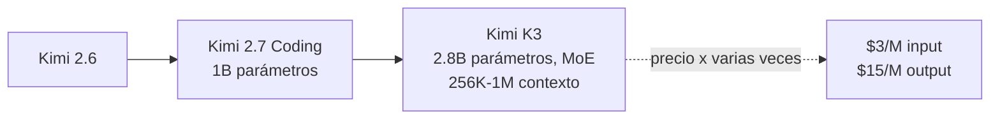

# 2. Arquitectura, mejoras y precio

## Evolución del modelo

- Línea de modelos: Kimi 2.6 → **Kimi 2.7 Coding** (anterior, enfocado en código) → **Kimi K3** (actual). [`2:17`](https://www.youtube.com/watch?v=DpP2tq74gf4&t=137)
- K3 tiene ventana de contexto de **256K** (llega hasta el millón de tokens en algunos contextos). [`2:17`](https://www.youtube.com/watch?v=DpP2tq74gf4&t=137) [`3:05`](https://www.youtube.com/watch?v=DpP2tq74gf4&t=185)

## Arquitectura

- **2,8 billones de parámetros**, arquitectura **Mixture of Experts (MoE)**: solo activa una parte de la red según la necesidad. [`2:44`](https://www.youtube.com/watch?v=DpP2tq74gf4&t=164)
- Respecto a Kimi 2.7 (1 billón de parámetros), el tamaño se **ha triplicado** — de ahí la mejora notable de inteligencia. [`3:05`](https://www.youtube.com/watch?v=DpP2tq74gf4&t=185)
- Contexto ampliado hasta 1M de tokens → permite leer más archivos de un proyecto y tomar mejores decisiones. [`3:05`](https://www.youtube.com/watch?v=DpP2tq74gf4&t=185)

## Precio (el punto polémico)

| | Antes (2.7) | Ahora (K3) |
|---|---|---|
| Input (por millón de tokens) | < $1 | **$3** |
| Output (por millón de tokens) | $0,380 aprox. (~380) | **$15** |

[`3:33`](https://www.youtube.com/watch?v=DpP2tq74gf4&t=213)

- Es el modelo chino de pesos abiertos más grande hasta la fecha, y el precio lo refleja: notablemente más caro que los modelos chinos anteriores a los que se estaba acostumbrado. [`3:33`](https://www.youtube.com/watch?v=DpP2tq74gf4&t=213)

## Límites de uso por suscripción (ejemplo Open Code, plan GO)

- Kimi K3: solo **110 peticiones** por ventana de 5 horas. [`4:10`](https://www.youtube.com/watch?v=DpP2tq74gf4&t=250)
- Mini Max M3: 3200 peticiones. [`4:39`](https://www.youtube.com/watch?v=DpP2tq74gf4&t=279)
- GLM 5.2: 880 peticiones. [`4:39`](https://www.youtube.com/watch?v=DpP2tq74gf4&t=279)
- Kimi K3 tiene incluso menos peticiones que Grok 4.5. [`4:39`](https://www.youtube.com/watch?v=DpP2tq74gf4&t=279)

