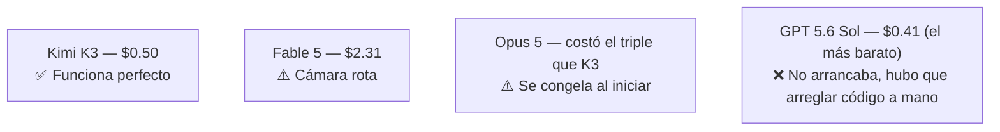

# 6. Comparativa a ciegas con otros modelos

## Metodología

- Prompt único para generar un juego 3D estilo **Temple Run/Temple Escape** (correr hacia adelante esquivando obstáculos). [`22:27`](https://www.youtube.com/watch?v=DpP2tq74gf4&t=1347)
- Mismo prompt enviado a varios modelos frontera + Kimi K3, **a ciegas** (el espectador no sabe cuál es cuál hasta el final). [`22:27`](https://www.youtube.com/watch?v=DpP2tq74gf4&t=1347)
- Llamada directa por **API por defecto**, sin arnés/herramientas, sin system prompt. [`25:53`](https://www.youtube.com/watch?v=DpP2tq74gf4&t=1553)
- Nivel de esfuerzo (`effort`) usado tal cual venía por defecto en cada API — no es igual en todos (afecta a coste). [`27:29`](https://www.youtube.com/watch?v=DpP2tq74gf4&t=1649) [`27:50`](https://www.youtube.com/watch?v=DpP2tq74gf4&t=1670)

## Resultados por modelo (etiquetas ciegas)

| Modelo (ciego) | Coste | Resultado |
|---|---|---|
| Modelo A | ~$0,50 | Funciona perfectamente, con música, sin errores relevantes. [`23:10`](https://www.youtube.com/watch?v=DpP2tq74gf4&t=1390) [`23:38`](https://www.youtube.com/watch?v=DpP2tq74gf4&t=1418) |
| Modelo B | $2,31 | Jugable pero con problemas de cámara. [`22:51`](https://www.youtube.com/watch?v=DpP2tq74gf4&t=1371) [`24:06`](https://www.youtube.com/watch?v=DpP2tq74gf4&t=1446) |
| Modelo C | — | Buena pinta visual, pero se queda congelado al iniciar. [`24:06`](https://www.youtube.com/watch?v=DpP2tq74gf4&t=1446) |
| Modelo D | $0,41 (el más barato) | No funcionaba al pulsar jugar; el autor **depuró el código a mano**, encontró un error de sintaxis (un punto de más) y lo arregló para poder probarlo. [`22:51`](https://www.youtube.com/watch?v=DpP2tq74gf4&t=1371) [`24:36`](https://www.youtube.com/watch?v=DpP2tq74gf4&t=1476) |

- Favorito del autor antes de revelar: el **modelo A** (medio dólar), por ser el único que funcionaba bien de inicio. [`25:31`](https://www.youtube.com/watch?v=DpP2tq74gf4&t=1531)

## Revelación de los modelos

- **Modelo A = Kimi K3** — $0,50, funcionó perfectamente a la primera. El autor admite que a ciegas pensó que era GPT 5.6 Sol. [`26:17`](https://www.youtube.com/watch?v=DpP2tq74gf4&t=1577)
- **Modelo B = Fable 5** — el más caro (+$2), resultado sorprendentemente flojo, con fallo de cámara. [`26:46`](https://www.youtube.com/watch?v=DpP2tq74gf4&t=1606)
- **Modelo C = Opus 5** — buena pinta, pero con el error de congelación al inicio; de no ser por eso, parecía el mejor. Costó el triple que Kimi K3. [`27:08`](https://www.youtube.com/watch?v=DpP2tq74gf4&t=1628)
- **Modelo D = GPT 5.6 Sol** — el más barato de todos (incluso menos que Kimi K3), pero gráficamente el más flojo y el único que necesitó arreglo manual de código. [`27:29`](https://www.youtube.com/watch?v=DpP2tq74gf4&t=1649)

## Conclusión de esta prueba

- En esta comparativa concreta (un solo prompt, un solo intento, juego 3D), **Kimi K3 fue el que mejor resultado dio por el precio pagado**, sorprendiendo incluso al propio autor. [`26:17`](https://www.youtube.com/watch?v=DpP2tq74gf4&t=1577)
- El autor insiste en que esto no invalida a los demás modelos: todos son iterables y podrían corregirse con más prompts. [`25:53`](https://www.youtube.com/watch?v=DpP2tq74gf4&t=1553)
