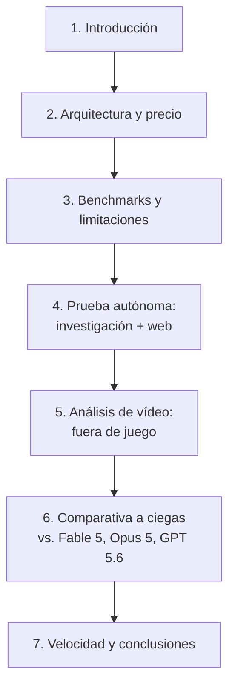

# Kimi K3 es Salvaje (lo siento, Claude)

- **Canal:** midudev
- **Duración:** 30:15
- **URL:** https://www.youtube.com/watch?v=DpP2tq74gf4

## Resumen

Vídeo de tipo *review/hands-on* en el que midudev pone a prueba **Kimi K3**, el nuevo modelo de pesos abiertos de la china **Moonshot AI** (2,8 billones de parámetros, arquitectura MoE, hasta 1M de contexto). Repasa su arquitectura y subida de precio respecto a Kimi 2.7, analiza benchmarks oficiales, y lo somete a varias pruebas prácticas: generación 3D con un solo prompt, una investigación autónoma de más de una hora (con enjambres de subagentes y modo QA automático), análisis de un vídeo deportivo (fuera de juego de Messi), y una comparativa a ciegas contra Fable 5, Opus 5 y GPT 5.6 Sol generando un juego 3D. Cierra con datos de velocidad de token/segundo y su opinión final: Kimi K3 sorprende muy positivamente en 3D y agentes autónomos, pero es notablemente lento en salida y su JavaScript generado es mejorable si no se piden buenas prácticas explícitamente.

## Índice de temas

1. [Introducción a Kimi K3](01-introduccion.md) — qué es, tamaño, primeras demos en 3D.
2. [Arquitectura, mejoras y precio](02-arquitectura-precio.md) — MoE, contexto, subida de precio, límites de peticiones.
3. [Rendimiento, benchmarks y limitaciones](03-rendimiento-benchmarks.md) — posicionamiento frente a modelos frontera, gap admitido por Moonshot, repercusión y suscripciones.
4. [Prueba autónoma: investigación + desarrollo web](04-prueba-autonoma.md) — enjambre de agentes, modo QA autónomo, calidad de código HTML/CSS/JS.
5. [Análisis de vídeo: el fuera de juego de Messi](05-analisis-video.md) — visión sobre vídeo, extracción de frames, análisis táctico generado.
6. [Comparativa a ciegas con otros modelos](06-comparativa-ciegas.md) — Kimi K3 vs. Fable 5 vs. Opus 5 vs. GPT 5.6 Sol generando un juego 3D.
7. [Velocidad, conclusiones y opinión final](07-conclusiones.md) — tokens/segundo, balance final del autor.

## Estructura del vídeo

## Transcripción completa

Ver [transcript.md](transcript.md) para el transcript íntegro con timestamps.
