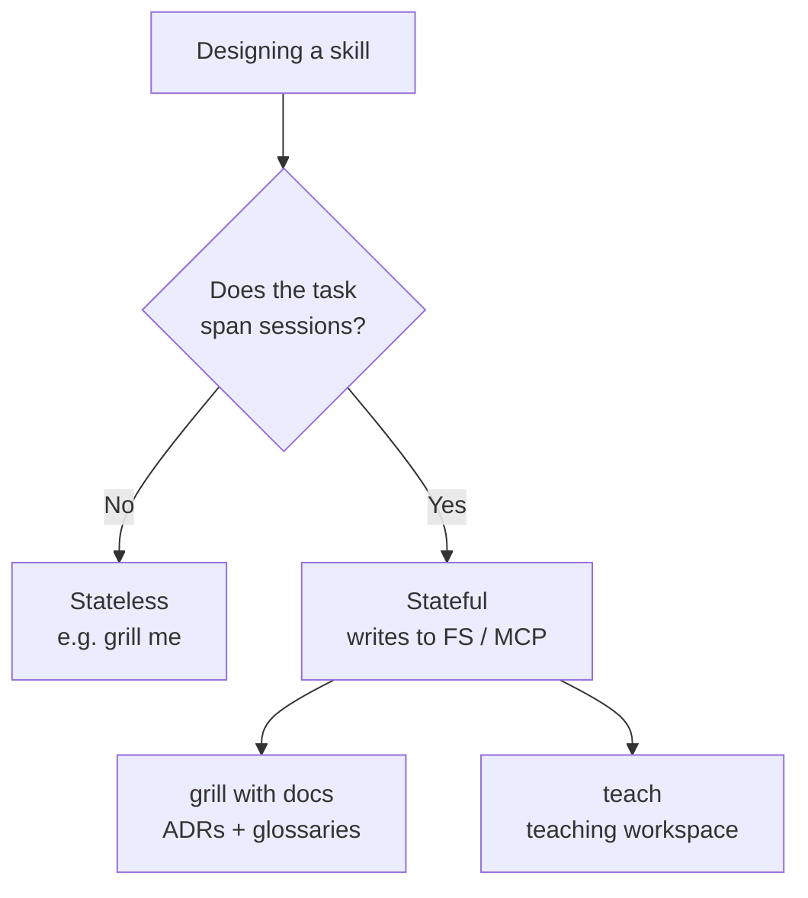

# 2. Stateful vs stateless skills

The central design distinction of the video: before writing a skill, decide whether it needs memory ([`0:40`](https://www.youtube.com/watch?v=s5T5oQJcJ6U&t=40)).

## The two categories

| | Stateless | Stateful |
|---|---|---|
| Retains state from previous runs | No ([`0:40`](https://www.youtube.com/watch?v=s5T5oQJcJ6U&t=40)) | Yes ([`0:40`](https://www.youtube.com/watch?v=s5T5oQJcJ6U&t=40)) |
| Where state lives | Nowhere — nothing saved | Local file system, or MCP servers ([`0:40`](https://www.youtube.com/watch?v=s5T5oQJcJ6U&t=40)) |
| Can pick up where it left off | No ([`0:40`](https://www.youtube.com/watch?v=s5T5oQJcJ6U&t=40)) | Yes — it keeps notes it later tracks ([`1:04`](https://www.youtube.com/watch?v=s5T5oQJcJ6U&t=64)) |
| Improves over time | No | Yes ([`1:52`](https://www.youtube.com/watch?v=s5T5oQJcJ6U&t=112)) |

## Worked examples from his skills repo

- **`grill me`** — totally stateless. It grills you about a topic until you're ready to implement, and remembers nothing afterwards ([`1:28`](https://www.youtube.com/watch?v=s5T5oQJcJ6U&t=88)).
- **`grill with docs`** — stateful. It saves **ADRs** (architectural decision records) and **glossaries** into the repo, so it gets better over time ([`1:52`](https://www.youtube.com/watch?v=s5T5oQJcJ6U&t=112)).

## Why `teach` had to be stateful

- His first instinct was a **stateless** teach: say "teach me this thing", it finds resources and emits one lesson ([`1:04`](https://www.youtube.com/watch?v=s5T5oQJcJ6U&t=64)).
- He rejected that: all the good teaching he does is inherently stateful — the teacher remembers where the student got to, what they've learned, what comes next, and which resources worked in past sessions ([`1:04`](https://www.youtube.com/watch?v=s5T5oQJcJ6U&t=64), [`1:28`](https://www.youtube.com/watch?v=s5T5oQJcJ6U&t=88)).

## The takeaway for skill authors

- Neither category is better — they're useful in different situations ([`1:52`](https://www.youtube.com/watch?v=s5T5oQJcJ6U&t=112)).
- Stateless vs stateful is an explicit, up-front design decision when authoring a skill ([`1:52`](https://www.youtube.com/watch?v=s5T5oQJcJ6U&t=112)).

