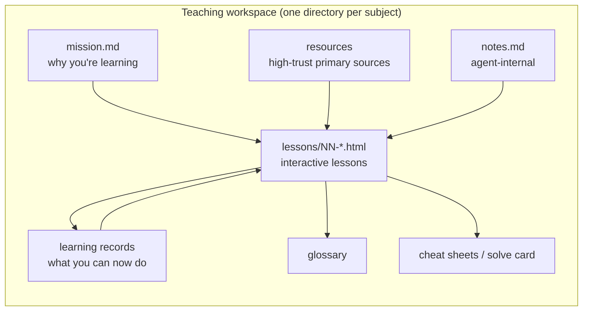

# 5. Reference material: glossary, cheat sheets, notes

Beyond lessons, the skill maintains standing **reference material** — something he found he needed while using it ([`5:22`](https://www.youtube.com/watch?v=s5T5oQJcJ6U&t=322)).

## Glossary

- Collects any weird jargon encountered during the journey ([`5:22`](https://www.youtube.com/watch?v=s5T5oQJcJ6U&t=322)).
- Cube-specific entries shown: anatomy, notation, the solving grip, the daisy ([`5:22`](https://www.youtube.com/watch?v=s5T5oQJcJ6U&t=322)).
- Two concrete benefits ([`5:22`](https://www.youtube.com/watch?v=s5T5oQJcJ6U&t=322)):
  1. **Future lessons get more concise** — they can just reference a glossary term instead of re-explaining it.
  2. **The learner has a place to look back** when confused.
- Called out as especially useful when learning a **coding language** this way ([`5:22`](https://www.youtube.com/watch?v=s5T5oQJcJ6U&t=322)).

## Cheat sheets

- The skill also generates cheat sheets ([`5:47`](https://www.youtube.com/watch?v=s5T5oQJcJ6U&t=347)).
- Example: a **solve card** giving the entire Rubik's Cube solve in one place, as a single reference to consult ([`5:47`](https://www.youtube.com/watch?v=s5T5oQJcJ6U&t=347)).

## `notes.md`

- **Internal note-taking for the agent itself**, not for the learner ([`5:47`](https://www.youtube.com/watch?v=s5T5oQJcJ6U&t=347)).
- Holds the learner's preferences and any "watch-outs" ([`5:47`](https://www.youtube.com/watch?v=s5T5oQJcJ6U&t=347)).

## The workspace as a whole

