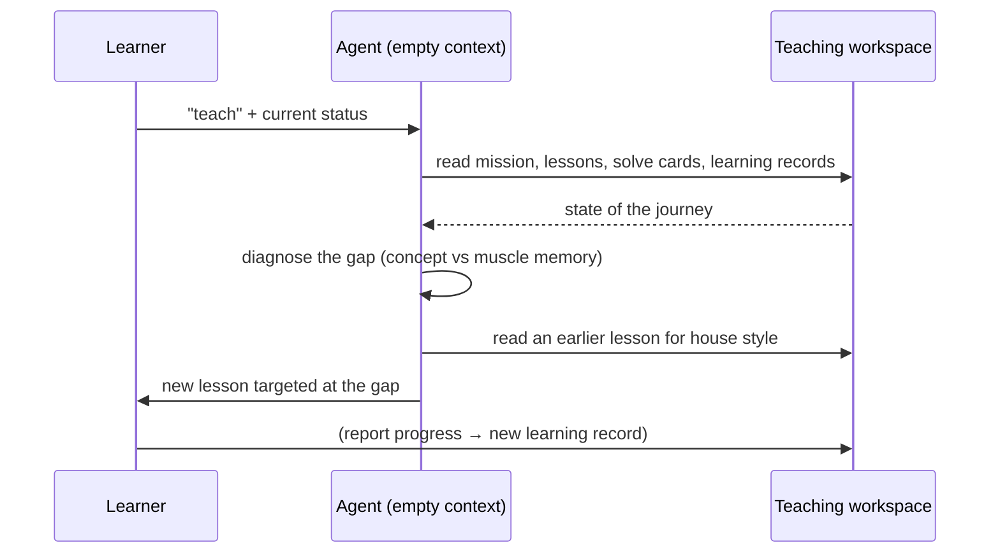

# 6. Continuing a learning session

A live demo of the stateful loop: a **fresh, empty context** picking up an in-progress journey ([`6:11`](https://www.youtube.com/watch?v=s5T5oQJcJ6U&t=371)).

## The interaction

1. He types just `teach` and tells it his current status in plain language: he can now complete the cube **except for the corner cycle**, which hasn't reached memory ([`6:11`](https://www.youtube.com/watch?v=s5T5oQJcJ6U&t=371)).
2. Because the context is empty, the agent **starts by checking the state of the teaching workspace** ([`6:11`](https://www.youtube.com/watch?v=s5T5oQJcJ6U&t=371)).
3. It reads the solve cards to see how far he's got ([`6:35`](https://www.youtube.com/watch?v=s5T5oQJcJ6U&t=395)).
4. It **diagnoses** the problem rather than restating it: the concept behind the corner cycle algorithm is solid — what's missing is **muscle memory** ([`6:35`](https://www.youtube.com/watch?v=s5T5oQJcJ6U&t=395)).
5. It reads an **earlier memorization lesson to match the house style** before writing the new one ([`6:35`](https://www.youtube.com/watch?v=s5T5oQJcJ6U&t=395)).

## What this demonstrates

- The agent has effectively been turned into a teacher, and you work with it **as you would any one-to-one teacher**: you tell it what problems you're having, and it designs lessons to solve them ([`6:35`](https://www.youtube.com/watch?v=s5T5oQJcJ6U&t=395), [`7:00`](https://www.youtube.com/watch?v=s5T5oQJcJ6U&t=420)).
- The diagnosis is expressed in real teaching vocabulary — it invokes the **zone of proximal development** and prescribes "one algorithm, pure muscle memory work" ([`7:00`](https://www.youtube.com/watch?v=s5T5oQJcJ6U&t=420)).
- Because everything lives on the file system, he can **clear the context** and every subsequent `teach` run still has what it needs ([`8:04`](https://www.youtube.com/watch?v=s5T5oQJcJ6U&t=484)).

