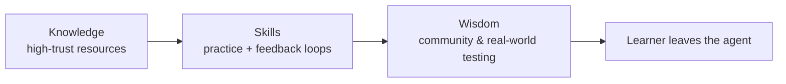

# 8. Inside the skill: structure and philosophy

A walkthrough of the skill file itself — *"really quite simple, although it is one of the longer skills"* he has written ([`8:37`](https://www.youtube.com/watch?v=s5T5oQJcJ6U&t=517)).

## How it opens

- It states the frame up front: the user has asked to be taught something; **this is a stateful request**; they intend to learn the topic **over multiple sessions** ([`8:37`](https://www.youtube.com/watch?v=s5T5oQJcJ6U&t=517)).
- Then it describes the **shape of the teaching workspace** ([`8:37`](https://www.youtube.com/watch?v=s5T5oQJcJ6U&t=517)).

## The philosophy section — defining the AI's vocabulary

He deliberately **defines the terms the AI should think in** ([`8:37`](https://www.youtube.com/watch?v=s5T5oQJcJ6U&t=517)). Three tiers:

| Tier | Source | How the skill delivers it |
|---|---|---|
| **Knowledge** | high-quality, high-trust resources ([`8:37`](https://www.youtube.com/watch?v=s5T5oQJcJ6U&t=517)) | highly relevant, interactive lessons |
| **Skills** | actually doing the thing ([`8:37`](https://www.youtube.com/watch?v=s5T5oQJcJ6U&t=517)) | practice prompts, feedback loops |
| **Wisdom** | interacting with other learners and practitioners ([`8:37`](https://www.youtube.com/watch?v=s5T5oQJcJ6U&t=517)) | delegation to a community |

## Sections of the skill

In order, as shown ([`9:10`](https://www.youtube.com/watch?v=s5T5oQJcJ6U&t=550)):

- shape of the lessons
- the mission / `mission.md`
- the zone of proximal development
- acquiring knowledge and skills, and how to do that
- acquiring wisdom — how to delegate the learner to a community once they have knowledge and skills
- reference documents
- `notes.md`

Plus a few **supporting documents** defining formats: learning record format, mission format, resources format, and so on ([`9:37`](https://www.youtube.com/watch?v=s5T5oQJcJ6U&t=577)).

## The wisdom rule — the most opinionated instruction

- Written into the skill: when the user asks a question that appears to require **wisdom**, the default posture is to **attempt to answer, but ultimately delegate to a community** ([`9:10`](https://www.youtube.com/watch?v=s5T5oQJcJ6U&t=550)).
- The stated intent behind it: **not** to keep the learner hooked on the agent for everything, but to give them the skills and confidence to go and work with a community — "send you out into the world" ([`9:37`](https://www.youtube.com/watch?v=s5T5oQJcJ6U&t=577)).

