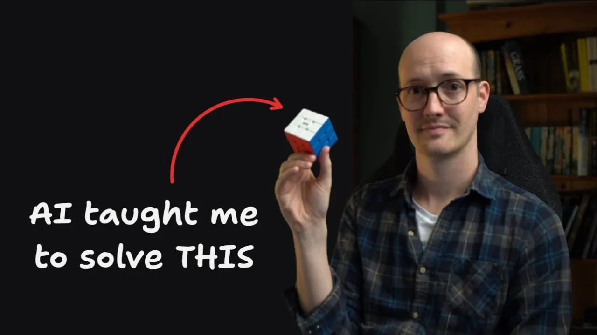
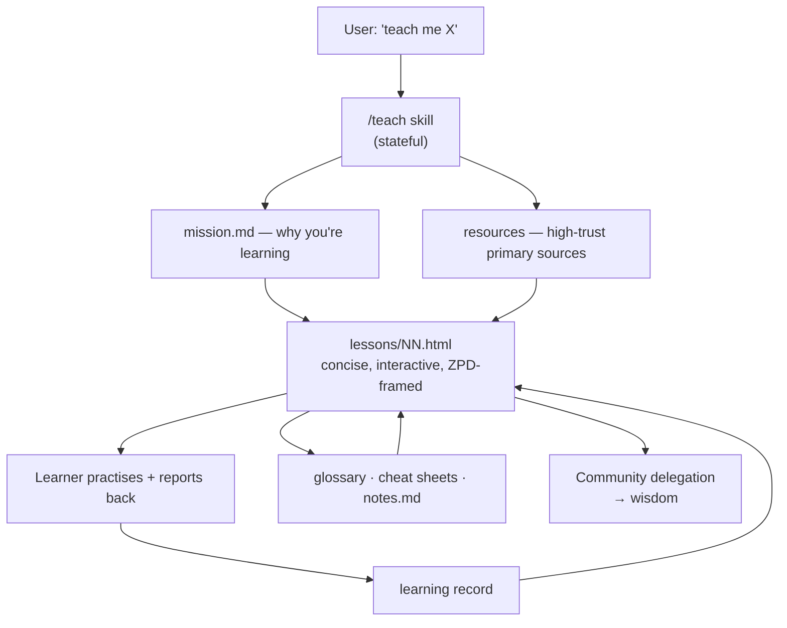

# Learn anything with the /teach skill

*Matt Pocock · 13:04 · [Watch on YouTube](https://www.youtube.com/watch?v=s5T5oQJcJ6U)*

## Summary

Matt Pocock walks through `teach`, a Claude Code skill he wrote in one sitting that turns a coding agent into a one-to-one tutor for **any** subject. The video is half product demo, half skill-design lesson: he uses his own Rubik's Cube learning journey to show every file the skill writes to disk — mission, resources, numbered HTML lessons, learning records, glossary, cheat sheets, agent notes — then opens the skill file itself to explain the teaching philosophy encoded in it (knowledge → skills → wisdom, and the zone of proximal development). The central technical argument is that `teach` had to be a **stateful** skill: teaching is only good when the teacher remembers where the student got to. He closes on codebase onboarding as the engineering use case, and on why developers are the first people positioned to carry AI instincts into non-coding domains.

## Topics

1. [Why a `/teach` skill](01-why-a-teach-skill.md) — the origin, and the Rubik's Cube proof case.
2. [Stateful vs stateless skills](02-stateful-vs-stateless-skills.md) — the core design distinction, with `grill me` vs `grill with docs` as examples.
3. [Installing and running `teach`](03-installing-and-running-teach.md) — `skills.sh`, an empty directory, and the model used.
4. [Mission, resources and HTML lessons](04-mission-resources-and-lessons.md) — what the skill generates on the first pass, and why HTML beats Markdown.
5. [Reference material: glossary, cheat sheets, notes](05-reference-material-glossary-and-notes.md) — the standing artefacts that make later lessons shorter.
6. [Continuing a learning session](06-continuing-a-learning-session.md) — a fresh context picking up mid-journey and diagnosing the gap.
7. [The zone of proximal development](07-zone-of-proximal-development.md) — the teaching principle that shapes every lesson, plus the interactive lesson demo.
8. [Inside the skill: structure and philosophy](08-inside-the-skill.md) — the skill file's sections and the knowledge/skills/wisdom model.
9. [Use cases, and developers as AI first movers](09-use-cases-and-first-movers.md) — codebase onboarding, personal learning, and the closing argument.

## How the pieces fit

## Key takeaways

- **Statefulness is an explicit design axis for skills, not an implementation detail.** A stateless skill saves nothing between runs; a stateful one writes to the local file system or MCP servers and improves over time. Neither is better — they suit different jobs ([`0:40`](https://www.youtube.com/watch?v=s5T5oQJcJ6U&t=40), [`1:52`](https://www.youtube.com/watch?v=s5T5oQJcJ6U&t=112)).
- **`teach` was redesigned from stateless to stateful mid-conception**, because all good teaching depends on the teacher remembering what the student has learned and what comes next ([`1:04`](https://www.youtube.com/watch?v=s5T5oQJcJ6U&t=64)).
- **The same repo demonstrates both patterns:** `grill me` is stateless; `grill with docs` is stateful — it saves ADRs and glossaries into the repo, which is why it gets better over time ([`1:28`](https://www.youtube.com/watch?v=s5T5oQJcJ6U&t=88), [`1:52`](https://www.youtube.com/watch?v=s5T5oQJcJ6U&t=112)).
- **Lessons are HTML, not Markdown, and that choice is the core of the experience.** It bought diagrams, call-outs, quizzes, an interactive tap-through of an algorithm and a toggleable guided mode — "the full power of the browser" ([`3:31`](https://www.youtube.com/watch?v=s5T5oQJcJ6U&t=211), [`8:04`](https://www.youtube.com/watch?v=s5T5oQJcJ6U&t=484)).
- **Quizzes are rated a weak feedback loop** — good only when no richer feedback loop is available ([`4:00`](https://www.youtube.com/watch?v=s5T5oQJcJ6U&t=240)).
- **The skill starts by writing a mission, because scope must be fixed before teaching.** The generated Rubik's Cube mission was "solve a scrambled 3×3 unaided at least once — not speed, not theory" ([`2:47`](https://www.youtube.com/watch?v=s5T5oQJcJ6U&t=167)).
- **A glossary makes later lessons shorter,** because lessons can reference terms instead of re-explaining them — most valuable when learning a coding language ([`5:22`](https://www.youtube.com/watch?v=s5T5oQJcJ6U&t=322)).
- **The stateful loop was demonstrated working from an empty context:** the agent read the workspace, diagnosed that the corner cycle was conceptually solid but lacked muscle memory, matched the house style of an earlier lesson, and produced a targeted new one ([`6:11`](https://www.youtube.com/watch?v=s5T5oQJcJ6U&t=371), [`6:35`](https://www.youtube.com/watch?v=s5T5oQJcJ6U&t=395)).
- **The zone of proximal development is the operating constraint:** teach where the learner is perfectly challenged but not intimidated — every lesson concise, compact, and exactly framed, so the student is neither bored nor freaked out ([`7:16`](https://www.youtube.com/watch?v=s5T5oQJcJ6U&t=436)).
- **The skill encodes a three-tier model — knowledge, skills, wisdom** — and treats wisdom as unobtainable from the agent: on wisdom-shaped questions its default posture is to attempt an answer but ultimately delegate to a community ([`8:37`](https://www.youtube.com/watch?v=s5T5oQJcJ6U&t=517), [`9:10`](https://www.youtube.com/watch?v=s5T5oQJcJ6U&t=550)).
- **The design goal is explicitly anti-lock-in:** not to keep the learner hooked on the agent, but to give them enough confidence to go work with a community ([`9:37`](https://www.youtube.com/watch?v=s5T5oQJcJ6U&t=577)).
- **Codebase onboarding is the named engineering payoff:** static docs are costly to maintain *and* structurally outside any given reader's zone of proximal development, whereas a per-hire `teach` workspace pointed at the codebase adapts to what that person is missing ([`10:04`](https://www.youtube.com/watch?v=s5T5oQJcJ6U&t=604), [`10:30`](https://www.youtube.com/watch?v=s5T5oQJcJ6U&t=630)).
- **The closing thesis:** AI is currently better at writing code than at nearly anything else, so developers are the first group to experience AI on a task it excels at — and the transferable move is to package those instincts as skills for non-coding domains ([`11:07`](https://www.youtube.com/watch?v=s5T5oQJcJ6U&t=667), [`11:44`](https://www.youtube.com/watch?v=s5T5oQJcJ6U&t=704)).
- **Demo setup:** Opus 4.8 at medium effort ([`7:00`](https://www.youtube.com/watch?v=s5T5oQJcJ6U&t=420)).

---

The full [transcript](transcript.md) is kept alongside these notes.
