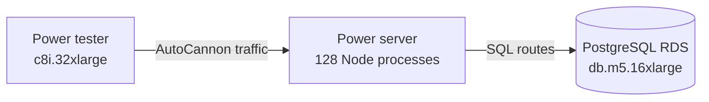

# Moving the benchmark to AWS

- The local clustered patch test reaches around 50,000 requests per second without screen recording, which is still far from 1 million per second. [`34:24`](https://www.youtube.com/watch?v=W4EwfEU8CGA&t=2064)
- The cloud setup is explicitly risky for viewers to copy, because the initial setup costs about $30/hour or $20,000/month. [`35:09`](https://www.youtube.com/watch?v=W4EwfEU8CGA&t=2109) [`35:27`](https://www.youtube.com/watch?v=W4EwfEU8CGA&t=2127)
- The power server and power tester use `c8i.32xlarge` instances with 128 CPU cores, 256 GB RAM, and 50 Gbit/s network performance, at around $6/hour or $5,000/month each. [`37:56`](https://www.youtube.com/watch?v=W4EwfEU8CGA&t=2276) [`38:29`](https://www.youtube.com/watch?v=W4EwfEU8CGA&t=2309)
- A separate RDS PostgreSQL instance uses `db.m5.16xlarge` with 64 CPU cores and 256 GB RAM, also about $6/hour or $5,000/month. [`41:56`](https://www.youtube.com/watch?v=W4EwfEU8CGA&t=2516) [`42:15`](https://www.youtube.com/watch?v=W4EwfEU8CGA&t=2535)
- The architecture uses one server machine, one tester machine, and one PostgreSQL database, all on a private network to avoid public-internet bandwidth as the main variable. [`44:16`](https://www.youtube.com/watch?v=W4EwfEU8CGA&t=2656) [`45:04`](https://www.youtube.com/watch?v=W4EwfEU8CGA&t=2704)
- The server runs 128 Node instances with PM2, one for each core. [`46:13`](https://www.youtube.com/watch?v=W4EwfEU8CGA&t=2773)

## Results

- The `/simple` route reaches about 6 million requests per second, fully using the power server while the tester still has about 50% idle CPU. [`47:54`](https://www.youtube.com/watch?v=W4EwfEU8CGA&t=2874) [`48:16`](https://www.youtube.com/watch?v=W4EwfEU8CGA&t=2896) [`48:40`](https://www.youtube.com/watch?v=W4EwfEU8CGA&t=2920)
- The 30 KB patch route only reaches around 100,000 requests per second because it moves about 120 GB in 20 seconds, or about 6 GB/s. [`50:00`](https://www.youtube.com/watch?v=W4EwfEU8CGA&t=3000) [`50:22`](https://www.youtube.com/watch?v=W4EwfEU8CGA&t=3022) [`51:09`](https://www.youtube.com/watch?v=W4EwfEU8CGA&t=3069)
- The bottleneck is the 50 Gbit/s network, not the tester and not the server CPU. [`51:24`](https://www.youtube.com/watch?v=W4EwfEU8CGA&t=3084) [`51:47`](https://www.youtube.com/watch?v=W4EwfEU8CGA&t=3107)
- Reducing the generated response array from 100 items to 3 makes the patch response about 1 KB and allows the same route shape to reach about 3 million requests per second. [`58:30`](https://www.youtube.com/watch?v=W4EwfEU8CGA&t=3510) [`59:28`](https://www.youtube.com/watch?v=W4EwfEU8CGA&t=3568) [`1:00:08`](https://www.youtube.com/watch?v=W4EwfEU8CGA&t=3608)
- The uploader flags that the full 30 KB version will be solved later only after moving to C++ with Drogon and RapidJSON. [`1:00:42`](https://www.youtube.com/watch?v=W4EwfEU8CGA&t=3642) [`1:01:26`](https://www.youtube.com/watch?v=W4EwfEU8CGA&t=3686)
