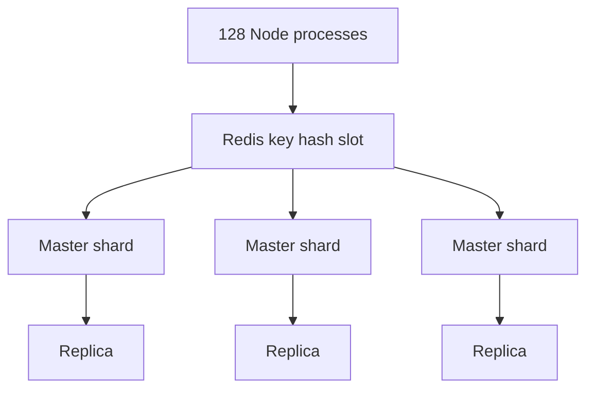

# Redis Cluster and million-write throughput

- Redis Cluster is introduced because one Redis instance cannot reach the million-request-per-second target. [`1:36:21`](https://www.youtube.com/watch?v=W4EwfEU8CGA&t=5781)
- A local script can set up 30 Redis processes, demonstrating that Redis scales by running multiple instances. [`1:36:57`](https://www.youtube.com/watch?v=W4EwfEU8CGA&t=5817) [`1:37:17`](https://www.youtube.com/watch?v=W4EwfEU8CGA&t=5837)
- A single Redis instance is single-threaded and caps around 100,000 to 200,000 reads/writes per second. [`1:37:42`](https://www.youtube.com/watch?v=W4EwfEU8CGA&t=5862)
- Redis Cluster hashes keys to map data to specific nodes, so code must respect hash slots and key tags when writing related data. [`1:38:26`](https://www.youtube.com/watch?v=W4EwfEU8CGA&t=5906) [`1:39:29`](https://www.youtube.com/watch?v=W4EwfEU8CGA&t=5969)
- The `code-ultra-fast` route removes sequential ID tracking and uses `crypto.randomUUID`, avoiding the extra Redis write needed to track uniqueness. [`1:38:43`](https://www.youtube.com/watch?v=W4EwfEU8CGA&t=5923) [`1:39:07`](https://www.youtube.com/watch?v=W4EwfEU8CGA&t=5947)
- The UUID collision risk is accepted because at 1 million IDs per second it would take about 86,000 years to reach a 50% probability of a duplicate. [`1:40:27`](https://www.youtube.com/watch?v=W4EwfEU8CGA&t=6027) [`1:41:11`](https://www.youtube.com/watch?v=W4EwfEU8CGA&t=6071)
- On the AWS machine, the cluster reports 30 total Redis nodes: 15 masters and 15 replicas. [`1:43:48`](https://www.youtube.com/watch?v=W4EwfEU8CGA&t=6228)

## Result

- Running the clustered Node application against Redis Cluster drives the power server near full CPU use. [`1:46:32`](https://www.youtube.com/watch?v=W4EwfEU8CGA&t=6392) [`1:46:53`](https://www.youtube.com/watch?v=W4EwfEU8CGA&t=6413)
- The `code-ultra-fast` write route reaches 1 million requests per second while still preserving a path to sync data into PostgreSQL later. [`1:46:53`](https://www.youtube.com/watch?v=W4EwfEU8CGA&t=6413) [`1:47:23`](https://www.youtube.com/watch?v=W4EwfEU8CGA&t=6443)
- Repeating the test creates tens of millions of Redis records quickly, and memory usage reaches about 100 GB after at least 60 million records. [`1:49:31`](https://www.youtube.com/watch?v=W4EwfEU8CGA&t=6571)
- Memory becomes the next operational pressure: at a million writes per second, data must be flushed, batched into PostgreSQL, written to disk, or otherwise drained quickly. [`1:49:43`](https://www.youtube.com/watch?v=W4EwfEU8CGA&t=6583) [`1:50:07`](https://www.youtube.com/watch?v=W4EwfEU8CGA&t=6607)
- Compared with PostgreSQL, Redis adds huge speed but also shifts the hard problem to memory capacity, sync design, and data durability. [`1:50:43`](https://www.youtube.com/watch?v=W4EwfEU8CGA&t=6643)
