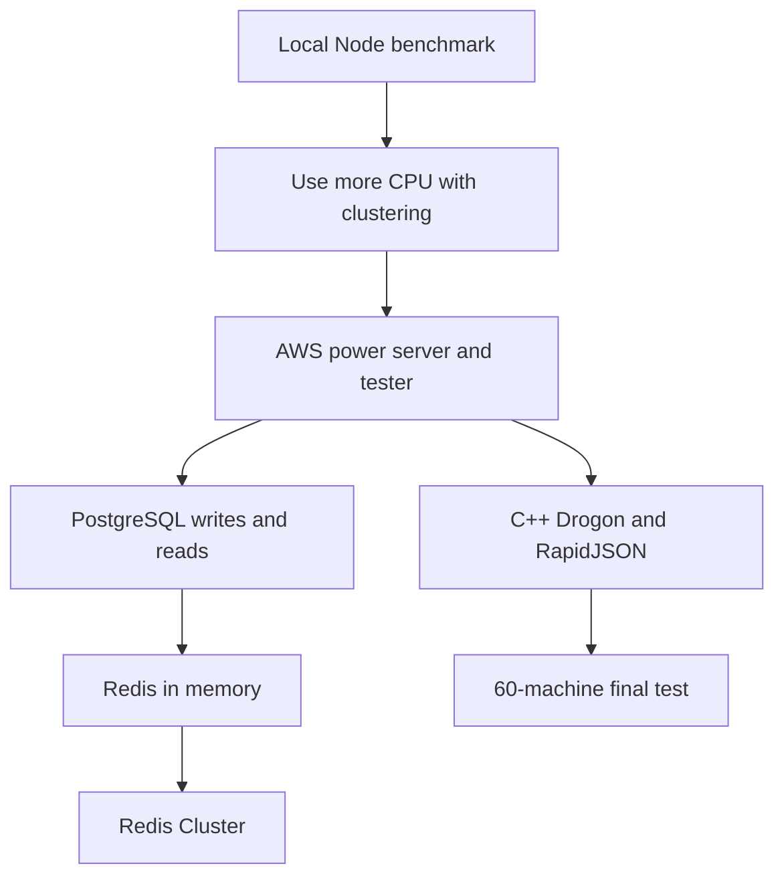

# Let's Handle 1 Million Requests per Second, It's Scarier Than You Think!

This video is an educational performance-engineering tutorial. It starts with a local Node.js API benchmark, then keeps changing the system until it can handle million-plus request rates: clustering Node processes, moving to large AWS instances, testing PostgreSQL limits, using Redis and Redis Cluster, rewriting the hot path in C++ with Drogon and RapidJSON, and finally running a 60-machine load test.

1. [Introduction](01-introduction.md)
2. [CPU utilization and threads](02-cpu-utilization-and-threads.md)
3. [Getting started with a simple API benchmark](03-getting-started.md)
4. [AutoCannon model and metrics](04-autocannon.md)
5. [Node clustering and framework overhead](05-node-clustering-and-frameworks.md)
6. [Moving the benchmark to AWS](06-moving-to-aws.md)
7. [PostgreSQL write and read limits](07-storage-based-database.md)
8. [Redis as an in-memory buffer and read store](08-memory-based-database.md)
9. [Redis Cluster and million-write throughput](09-redis-cluster-mode.md)
10. [C++ with Drogon and RapidJSON](10-cpp-drogon-rapidjson.md)
11. [The final colossal tests](11-final-colossal-tests.md)
12. [Outro and project direction](12-outro.md)

## Key takeaways

- A trivial `/simple` JSON route on a 128-core AWS server reached about 6 million requests per second, but that result depended on a very simple response and roughly $5,000/month-class hardware. [`48:40`](https://www.youtube.com/watch?v=W4EwfEU8CGA&t=2920)
- The more realistic patch route hit a network bottleneck on a 50 Gbit/s instance, moving about 6 GB/s and only reaching around 100,000 requests per second with the larger 30 KB response. [`51:09`](https://www.youtube.com/watch?v=W4EwfEU8CGA&t=3069) [`51:24`](https://www.youtube.com/watch?v=W4EwfEU8CGA&t=3084)
- PostgreSQL writes on a large RDS instance reached about 35,000 requests per second without errors at 300 connections, then about 66,000 requests per second after increasing provisioned IOPS, still far from 1 million. [`1:05:14`](https://www.youtube.com/watch?v=W4EwfEU8CGA&t=3914) [`1:09:11`](https://www.youtube.com/watch?v=W4EwfEU8CGA&t=4151)
- A bad SQL shape mattered more than machine size: `order by random()` over 10 million records took about 43 seconds for one response because it scanned the table. [`1:14:26`](https://www.youtube.com/watch?v=W4EwfEU8CGA&t=4466) [`1:14:41`](https://www.youtube.com/watch?v=W4EwfEU8CGA&t=4481)
- Redis improved the write path to about 100,000 requests per second, but a single Redis instance still capped around 100k reads/writes per second, so clustering was needed. [`1:30:44`](https://www.youtube.com/watch?v=W4EwfEU8CGA&t=5444) [`1:31:35`](https://www.youtube.com/watch?v=W4EwfEU8CGA&t=5495)
- Redis Cluster with 15 masters and 15 replicas let the Node system write at about 1 million requests per second while using memory as a fast buffer before later synchronization to PostgreSQL. [`1:43:48`](https://www.youtube.com/watch?v=W4EwfEU8CGA&t=6228) [`1:46:53`](https://www.youtube.com/watch?v=W4EwfEU8CGA&t=6413) [`1:47:23`](https://www.youtube.com/watch?v=W4EwfEU8CGA&t=6443)
- Node/Cpeak got close on the 30 KB patch route but could not reach 1 million on the larger beast machines; the bottleneck became CPU and parent-process distribution overhead. [`1:55:56`](https://www.youtube.com/watch?v=W4EwfEU8CGA&t=6956) [`1:56:13`](https://www.youtube.com/watch?v=W4EwfEU8CGA&t=6973)
- Rewriting the patch route in C++ with Drogon and RapidJSON reached an average of about 1 million requests per second over 60 seconds, peaking around 1.2 million and moving about 38 GB/s. [`2:03:27`](https://www.youtube.com/watch?v=W4EwfEU8CGA&t=7407) [`2:03:54`](https://www.youtube.com/watch?v=W4EwfEU8CGA&t=7434)
- The final 30-minute distributed test used 60 tester machines and one beast server, processed about 2 billion requests, moved more than 60 TB, and had only 40 timeouts. [`2:11:06`](https://www.youtube.com/watch?v=W4EwfEU8CGA&t=7866) [`2:34:13`](https://www.youtube.com/watch?v=W4EwfEU8CGA&t=9253) [`2:34:36`](https://www.youtube.com/watch?v=W4EwfEU8CGA&t=9276)
