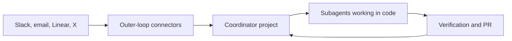

# 5. Scaling work with inner and outer loops

- The reported volume of roughly 2,500 PRs in a month depended on first building a reliable environment. Poteto describes setting up one well-run kitchen, then being able to operate several projects without personally initiating every task. [`32:59`](https://www.youtube.com/watch?v=MN9dGgmLyso&t=1979) [`33:43`](https://www.youtube.com/watch?v=MN9dGgmLyso&t=2023) [`34:02`](https://www.youtube.com/watch?v=MN9dGgmLyso&t=2042)
- Poteto's "inner loop" is agents working in the codebase toward a snapshot of intent. The "outer loop" is information arriving from systems such as Slack, Linear, X, and email. That intent can go stale when new reports or constraints appear outside the coding session. [`35:00`](https://www.youtube.com/watch?v=MN9dGgmLyso&t=2100) [`35:32`](https://www.youtube.com/watch?v=MN9dGgmLyso&t=2132)
- Connecting the loops lets agents gather current context themselves. For example, an agent can watch a Slack channel, triage a bug report, reproduce it, and check whether it still occurs on main. [`36:35`](https://www.youtube.com/watch?v=MN9dGgmLyso&t=2195) [`37:05`](https://www.youtube.com/watch?v=MN9dGgmLyso&t=2225)
- His setup uses Grokbot as an outer-loop connector and Cursor Projects as an inner-loop coordinator. Grokbot can route incoming context to a project; the coordinator delegates to subagents and manages related tasks instead of doing all the implementation itself. [`42:09`](https://www.youtube.com/watch?v=MN9dGgmLyso&t=2529) [`42:40`](https://www.youtube.com/watch?v=MN9dGgmLyso&t=2560) [`43:34`](https://www.youtube.com/watch?v=MN9dGgmLyso&t=2614) [`43:52`](https://www.youtube.com/watch?v=MN9dGgmLyso&t=2632)
- Grouping related reports under one coordinator helps preserve shared context and detect a common underlying cause. Spawning one agent per report can duplicate work and miss the larger pattern. [`44:20`](https://www.youtube.com/watch?v=MN9dGgmLyso&t=2660) [`44:48`](https://www.youtube.com/watch?v=MN9dGgmLyso&t=2688)

