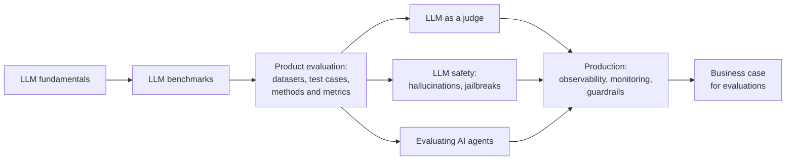

# Course curriculum

The course moves from model fundamentals to product-level evaluation, then to production and business concerns:

1. **LLM fundamentals** — what an LLM is and what an LLM-powered product is. [`0:15`](https://www.youtube.com/watch?v=rHs0sP7b5fM&t=15)
2. **LLM benchmarks** — how to evaluate large language models themselves. [`0:30`](https://www.youtube.com/watch?v=rHs0sP7b5fM&t=30)
3. **Product-level evaluation** — building an evaluation dataset, writing test cases, and choosing evaluation methods and metrics. [`0:30`](https://www.youtube.com/watch?v=rHs0sP7b5fM&t=30)
4. **LLM as a judge** — described as "fascinating but slightly controversial". [`0:45`](https://www.youtube.com/watch?v=rHs0sP7b5fM&t=45)
5. **LLM safety** — hallucinations, jailbreaks, and how to protect against them. [`0:45`](https://www.youtube.com/watch?v=rHs0sP7b5fM&t=45)
6. **Evaluating AI agents** — flagged as one of the more complex topics. [`0:45`](https://www.youtube.com/watch?v=rHs0sP7b5fM&t=45)
7. **After launch** — production observability, monitoring, and guardrails. [`0:45`](https://www.youtube.com/watch?v=rHs0sP7b5fM&t=45)
8. **Business case** — why invest in AI evaluations. [`1:09`](https://www.youtube.com/watch?v=rHs0sP7b5fM&t=69)

