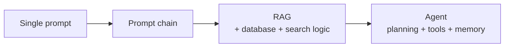

# What's an LLM-powered product?

## Definition

- **Any software that uses an LLM inside its functionality** [`1:06`](https://www.youtube.com/watch?v=B7fl6He1lxM&t=66).
- Two ways to build one [`1:06`](https://www.youtube.com/watch?v=B7fl6He1lxM&t=66):
  - Add LLM-powered features to an existing product (e.g. let users "talk to their data").
  - Create entirely new LLM-powered applications: chatbots, assistants, coding tools.

## Complexity spectrum

From simplest to most complex:

1. **Single prompt** — e.g. generating e-commerce item descriptions may need just one well-crafted prompt [`1:30`](https://www.youtube.com/watch?v=B7fl6He1lxM&t=90).
2. **Prompt chains** — multiple prompts chained together [`1:30`](https://www.youtube.com/watch?v=B7fl6He1lxM&t=90).
3. **RAG (retrieval augmented generation)** — giving the LLM access to external data; e.g. a support chatbot pulling help-center articles. This adds components like a database and search logic to the app [`1:30`](https://www.youtube.com/watch?v=B7fl6He1lxM&t=90) [`1:48`](https://www.youtube.com/watch?v=B7fl6He1lxM&t=108).
4. **AI agents** — solve multi-step tasks: plan steps, use tools (e.g. internet search), keep memory; e.g. an AI research assistant that writes a report. Internally these are complex graphs and chains of prompts [`1:48`](https://www.youtube.com/watch?v=B7fl6He1lxM&t=108).

