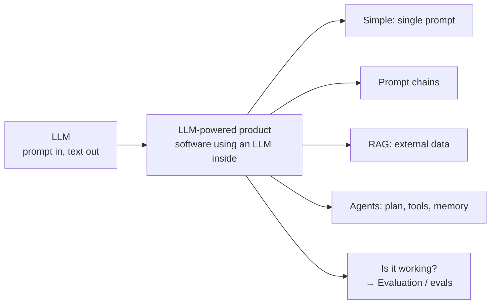

# What is an LLM-powered product?

*Evidently AI · 3:07 · [Watch on YouTube](https://www.youtube.com/watch?v=B7fl6He1lxM)*

Short educational explainer that sets the ground for an LLM evaluation course: before evaluating anything, it defines what is being evaluated. It covers what an LLM is and how you interact with it, what makes software an "LLM-powered product" (from single-prompt features to RAG systems and agents), and closes with real-world examples of companies shipping LLM features — which is where the need for evaluation begins.

## Topics

1. [Introduction](01-introduction.md)
2. [What's an LLM?](02-what-is-an-llm.md)
3. [What's an LLM-powered product?](03-what-is-an-llm-powered-product.md)
4. [Real-world examples of LLM-powered products](04-real-world-examples.md)

## Overview

## Key takeaways

- An LLM is an AI model trained on huge amounts of text; unlike previous ML waves, you typically don't train it yourself — you take an available model (maybe fine-tune it) and use it as is [`0:15`](https://www.youtube.com/watch?v=B7fl6He1lxM&t=15).
- LLMs handle both generative tasks (open-ended output: summaries, code, emails, translation) and simpler predictive tasks (classifying text by sentiment or topic) [`0:35`](https://www.youtube.com/watch?v=B7fl6He1lxM&t=35).
- An LLM-powered product is any software that uses an LLM inside its functionality — either LLM features added to an existing product or entirely new LLM-based applications (chatbots, assistants, coding tools) [`1:06`](https://www.youtube.com/watch?v=B7fl6He1lxM&t=66).
- Complexity scales: from a single well-crafted prompt, to prompt chains, to RAG (giving the LLM external data, which adds a database and search logic), to agents that plan steps, use tools, and keep memory [`1:30`](https://www.youtube.com/watch?v=B7fl6He1lxM&t=90) [`1:48`](https://www.youtube.com/watch?v=B7fl6He1lxM&t=108).
- Real companies already ship these: StitchFix/NextDoor (marketing text), Salesforce (Slack summaries), Vimeo (video summaries), Google and Incident.io (incident summaries), Dropbox (Q&A over files), DoorDash (support chatbot) [`2:21`](https://www.youtube.com/watch?v=B7fl6He1lxM&t=141).
- Once you build such a product, you inevitably ask "is it working as expected, and how do I improve it?" — that is where evaluation ("evals") starts, the subject of the next videos [`2:42`](https://www.youtube.com/watch?v=B7fl6He1lxM&t=162).
