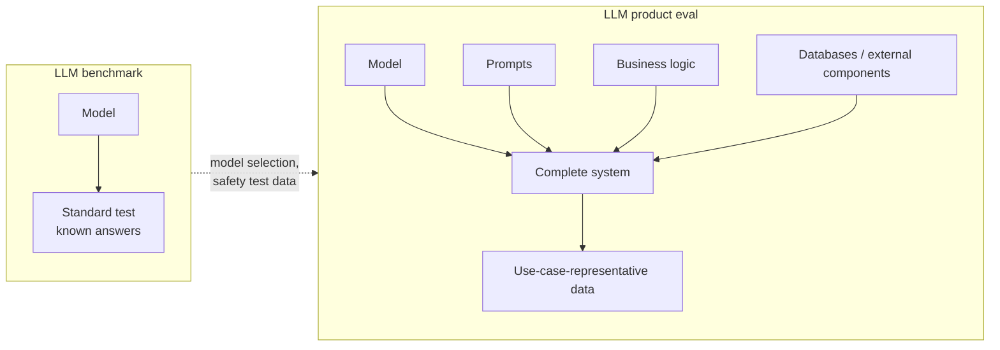

# LLM benchmarks vs. LLM product evals

- Benchmarks may be irrelevant to your product: a customer-support chatbot doesn't care whether the model can code. [`2:13`](https://www.youtube.com/watch?v=32zkohJICgc&t=133)
- Key difference: evaluating an LLM-powered product means evaluating the **complete system**, not just the model. [`2:13`](https://www.youtube.com/watch?v=32zkohJICgc&t=133)

## What a product eval covers

- The model itself. [`2:28`](https://www.youtube.com/watch?v=32zkohJICgc&t=148)
- The prompts you write. [`2:28`](https://www.youtube.com/watch?v=32zkohJICgc&t=148)
- The business logic around them. [`2:28`](https://www.youtube.com/watch?v=32zkohJICgc&t=148)
- External components, like databases the system might use. [`2:28`](https://www.youtube.com/watch?v=32zkohJICgc&t=148)
- Run on data **representative of your use case**, not a standard test set. [`2:28`](https://www.youtube.com/watch?v=32zkohJICgc&t=148)

## Where benchmarks still help

1. Choosing which models to try when building your product. [`2:45`](https://www.youtube.com/watch?v=32zkohJICgc&t=165)
2. Reusing some benchmark data — e.g. safety benchmark data — to test your own product. [`2:45`](https://www.youtube.com/watch?v=32zkohJICgc&t=165)

Bottom line: generally you want to design more specific tests for your application. [`2:45`](https://www.youtube.com/watch?v=32zkohJICgc&t=165)

