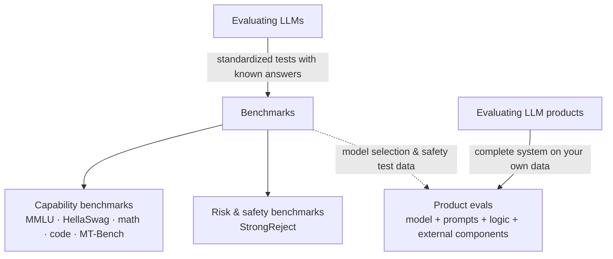

# LLM evaluation benchmarks

> Evidently AI · 3:06 · [Watch on YouTube](https://www.youtube.com/watch?v=32zkohJICgc)

Short educational video explaining what LLM evaluation benchmarks are, showing examples of well-known benchmarks (MMLU, HellaSwag, MT-Bench, StrongReject), why new benchmarks keep appearing, and how benchmarking an LLM differs from evaluating an LLM-powered product, where the whole system must be tested on use-case-representative data.

## Topics

1. [What are LLM evaluation benchmarks?](01-what-are-llm-benchmarks.md)
2. [Examples of LLM benchmarks](02-examples-of-llm-benchmarks.md)
3. [Why so many benchmarks?](03-why-so-many-benchmarks.md)
4. [LLM benchmarks vs. LLM product evals](04-benchmarks-vs-product-evals.md)

## Overview

## Key takeaways

- Evaluating LLMs (models) and evaluating LLM applications built on them are two different things. [`0:14`](https://www.youtube.com/watch?v=32zkohJICgc&t=14)
- Benchmarks are standardized tests with known answers — "school exams" for LLMs — enabling systematic, fair model comparison; leaderboards like the Open LLM Leaderboard rank models across them. [`0:31`](https://www.youtube.com/watch?v=32zkohJICgc&t=31)
- Each benchmark targets a specific capability: MMLU for general knowledge, HellaSwag for common-sense reasoning, math and code benchmarks, MT-Bench for multi-turn conversation. [`1:00`](https://www.youtube.com/watch?v=32zkohJICgc&t=60)
- Safety benchmarks exist too: OpenAI's o1 model card reports performance on StrongReject, which measures resistance to common attacks. [`1:25`](https://www.youtube.com/watch?v=32zkohJICgc&t=85)
- New benchmarks are constantly needed because there are many skills to test, benchmarks become outdated as models improve, and models can inadvertently memorize benchmark data during training. [`1:51`](https://www.youtube.com/watch?v=32zkohJICgc&t=111)
- Benchmarks don't necessarily test what matters for your product: product evals cover the complete system (model, prompts, business logic, external components like databases) on data representative of your use case. [`2:13`](https://www.youtube.com/watch?v=32zkohJICgc&t=133) [`2:28`](https://www.youtube.com/watch?v=32zkohJICgc&t=148)
- Benchmarks remain useful for choosing candidate models and reusing safety benchmark data, but application-specific tests should be designed for your product. [`2:45`](https://www.youtube.com/watch?v=32zkohJICgc&t=165)
