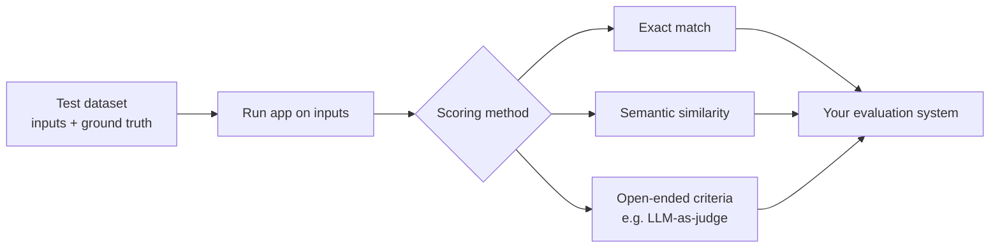

# Automated evaluations

## Step 1 — Build a test dataset

- A collection of **sample inputs** plus expected correct outputs, called **ground truth** [`2:30`](https://www.youtube.com/watch?v=RIGU1hy3UR8&t=150).
- Example: for a customer support system, the dataset holds customer queries and their ideal answers — "like a benchmark, but for your use case" [`2:30`](https://www.youtube.com/watch?v=RIGU1hy3UR8&t=150).
- The dataset can come out of your manual labeling process or be designed separately [`2:47`](https://www.youtube.com/watch?v=RIGU1hy3UR8&t=167).

## Step 2 — Score responses against the dataset

- **Exact match**: sometimes you can compare responses to ground truth word-for-word [`2:47`](https://www.youtube.com/watch?v=RIGU1hy3UR8&t=167).
- **Semantic similarity**: often the same meaning can be expressed many ways, so you test for meaning rather than word-by-word accuracy [`2:47`](https://www.youtube.com/watch?v=RIGU1hy3UR8&t=167).
- **Open-ended evaluation**: score responses by criteria such as conciseness or politeness [`3:08`](https://www.youtube.com/watch?v=RIGU1hy3UR8&t=188).
  - Some qualities are objective and easy to measure (e.g., output length within limits); others, like tone, are subjective and hard to quantify — one method is **using an LLM as the scorer** [`3:08`](https://www.youtube.com/watch?v=RIGU1hy3UR8&t=188).

## The end goal

- Design **your own evaluation system**: datasets + the ways you score new data against them [`3:31`](https://www.youtube.com/watch?v=RIGU1hy3UR8&t=211).

---

Previous: [From vibe checks to manual labeling](04-from-vibe-checks-to-manual-labeling.md) · Next: [Experiments, stress-testing & regression testing](06-experiments-stress-testing-regression.md)
