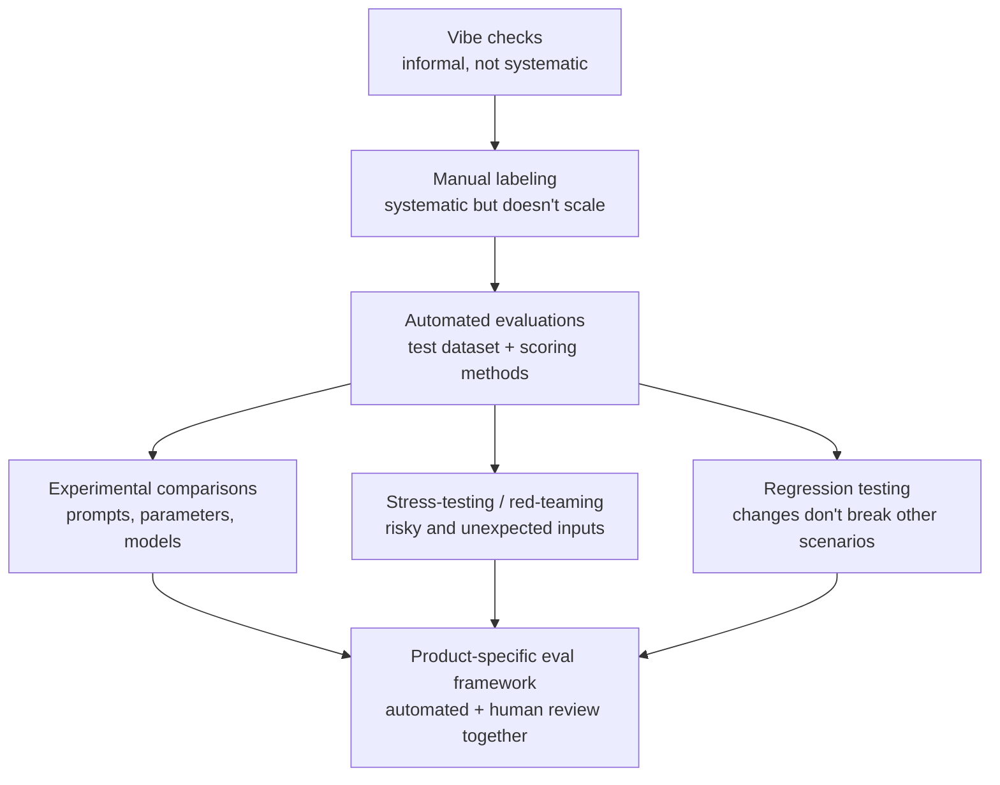

# How to evaluate an LLM application

*Evidently AI · 5:59 · [Watch on YouTube](https://www.youtube.com/watch?v=RIGU1hy3UR8)*

## Summary

A big-picture introduction to evaluating LLM-powered applications, focused on the pre-deployment phase. It explains why LLM testing differs from traditional software testing (non-determinism), frames quality as capabilities plus risks, and walks through the maturity path from informal vibe checks to manual labeling to a fully automated evaluation system built on test datasets and scoring methods. It closes with how that system enables experiments, red-teaming, and regression testing, illustrated with real practices from Asana, Webflow, and GitLab.

## Topics

1. [Introduction & when we need LLM evals](01-introduction-and-when-evals-are-needed.md)
2. [Why evaluating LLMs is hard](02-why-evaluating-llms-is-hard.md)
3. [What is LLM product quality](03-what-is-llm-product-quality.md)
4. [From vibe checks to manual labeling](04-from-vibe-checks-to-manual-labeling.md)
5. [Automated evaluations](05-automated-evaluations.md)
6. [Experiments, stress-testing & regression testing](06-experiments-stress-testing-regression.md)
7. [Examples from Asana, Webflow, GitLab](07-examples-asana-webflow-gitlab.md)
8. [LLM evals are product-specific](08-evals-are-product-specific.md)

## The evaluation maturity path

## Key takeaways

- LLM apps are non-deterministic — the same input can yield different outputs — so testing means checking that the *range* of possible outputs stays within expectations, not that the system "works" [`0:39`](https://www.youtube.com/watch?v=RIGU1hy3UR8&t=39) [`1:00`](https://www.youtube.com/watch?v=RIGU1hy3UR8&t=60).
- LLM product quality reduces to two axes: capabilities (accurate, useful, helpful responses) and risks (safe, non-harmful outputs) [`1:16`](https://www.youtube.com/watch?v=RIGU1hy3UR8&t=76).
- Vibe checks aren't systematic and manual labeling doesn't scale; the destination is your own evaluation system — a test dataset with ground truth plus scoring via exact match, semantic similarity, or open-ended criteria (including LLM-as-judge for subjective qualities like tone) [`1:40`](https://www.youtube.com/watch?v=RIGU1hy3UR8&t=100) [`2:14`](https://www.youtube.com/watch?v=RIGU1hy3UR8&t=134) [`2:30`](https://www.youtube.com/watch?v=RIGU1hy3UR8&t=150) [`3:08`](https://www.youtube.com/watch?v=RIGU1hy3UR8&t=188).
- LLMs are brittle: small prompt tweaks can have unexpected side effects, so regression-test after every change — even by replaying last week's production data under the new prompt [`4:21`](https://www.youtube.com/watch?v=RIGU1hy3UR8&t=261).
- Automation never replaces human review: Asana pairs automated unit tests with PM end-to-end review, Webflow pairs daily automated scores with weekly manual scoring, and GitLab tests Duo daily against thousands of prompts with ground-truth answers, then manually examines results for patterns [`4:42`](https://www.youtube.com/watch?v=RIGU1hy3UR8&t=282) [`5:10`](https://www.youtube.com/watch?v=RIGU1hy3UR8&t=310).
- Eval frameworks are product-specific — defining "good" requires domain experts and the complete team, because the contents of the evaluations matter as much as the technical setup [`5:25`](https://www.youtube.com/watch?v=RIGU1hy3UR8&t=325).
