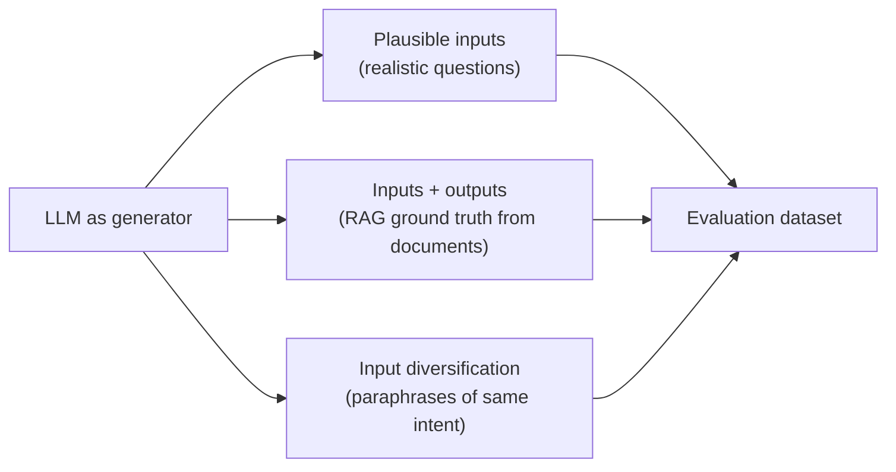

# Synthetic data: three ways to use it

Synthetic data is made-up data created specifically for testing purposes that mimics the expected inputs your application can get, and LLMs themselves can generate it. [`1:35`](https://www.youtube.com/watch?v=Do6KAkutKbc&t=95)

## 1. Generate plausible inputs

- Ask the model to create realistic questions — e.g. for a travel assistant, generate trip planning questions. [`1:35`](https://www.youtube.com/watch?v=Do6KAkutKbc&t=95)
- Run those inputs through your app and review the outputs to build a good dataset. [`1:52`](https://www.youtube.com/watch?v=Do6KAkutKbc&t=112)

## 2. Generate inputs *and* outputs (RAG)

- Take a source document, have an LLM extract key points, then generate questions for them. [`2:01`](https://www.youtube.com/watch?v=Do6KAkutKbc&t=121)
- Those questions have known answers because they come literally from the document — giving you a labeled ground truth dataset to compare your app's responses against. [`2:17`](https://www.youtube.com/watch?v=Do6KAkutKbc&t=137)

## 3. Diversify inputs

- Use an LLM to generate different phrasings of the same intent — e.g. "what's the weather today" → "what's the forecast", "will it rain today" — to verify the app processes all input variants correctly. [`2:29`](https://www.youtube.com/watch?v=Do6KAkutKbc&t=149)

