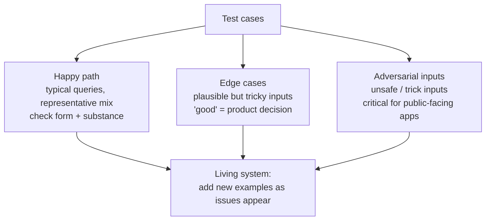

# Structuring test cases: three groups

The recommendation is to divide test cases into three big groups: happy path, edge cases, and adversarial inputs. [`2:47`](https://www.youtube.com/watch?v=Do6KAkutKbc&t=167)

## 1. Happy path

- Usual scenarios — typical queries where you expect the app to perform well. [`2:47`](https://www.youtube.com/watch?v=Do6KAkutKbc&t=167)
- Design it as a **representative** test set: if half of real queries are about orders and half about returns, the dataset should reflect that split. [`2:47`](https://www.youtube.com/watch?v=Do6KAkutKbc&t=167)
- Test both **substance** (are answers correct vs. your ideal answer?) and **form** (tone, length, whether a link must always be included, etc.). [`3:09`](https://www.youtube.com/watch?v=Do6KAkutKbc&t=189)

## 2. Edge cases

- Still plausible inputs, but where something can go wrong and special handling is required. [`3:26`](https://www.youtube.com/watch?v=Do6KAkutKbc&t=206)
- Examples to test: incomplete questions (does the app make things up?), very long or complex queries, discontinued products, questions about competitors, financial advice or other sensitive topics. [`3:26`](https://www.youtube.com/watch?v=Do6KAkutKbc&t=206)
- Questions in a different language; this part is often called **stress-testing**. [`3:48`](https://www.youtube.com/watch?v=Do6KAkutKbc&t=228)
- For each edge case you must define what "good" is — often a **product decision** (e.g. for foreign-language questions: translate? answer in English? politely decline?). [`3:48`](https://www.youtube.com/watch?v=Do6KAkutKbc&t=228)
- Test scenarios should encode what you expect the app to do in the ideal case. [`4:09`](https://www.youtube.com/watch?v=Do6KAkutKbc&t=249)

## 3. Adversarial inputs

- Test whether the app handles unsafe inputs or things designed to trip it up: can it generate harmful content? Can it reveal private data? [`4:15`](https://www.youtube.com/watch?v=Do6KAkutKbc&t=255)
- This testing is **critical for public-facing systems** (a separate video is promised on it). [`4:15`](https://www.youtube.com/watch?v=Do6KAkutKbc&t=255)

## A living system

- Test datasets are not perfected on day one: keep adding new examples as you encounter new issues to grow coverage — this grunt work is very important. [`4:30`](https://www.youtube.com/watch?v=Do6KAkutKbc&t=270)

