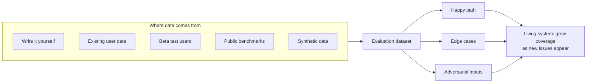

# LLM evaluation datasets: test cases and synthetic data

*Evidently AI · 6:06 · [Watch on YouTube](https://www.youtube.com/watch?v=Do6KAkutKbc)*

## Summary

An educational video on building evaluation datasets for LLM applications. It covers five sources of evaluation data (manual test cases, existing data, beta users, public benchmarks, and synthetic data), three ways to use LLM-generated synthetic data (plausible inputs, RAG ground truth, and input diversification), and a three-group structure for test cases: happy path, edge cases, and adversarial inputs. It closes with how top companies (Tesla, Google) invest heavily in manual eval work and practical advice for designing your own datasets.

## Topics

1. [Sources of evaluation data](01-sources-of-evaluation-data.md)
2. [Synthetic data: three ways to use it](02-synthetic-data.md)
3. [Structuring test cases: three groups](03-structuring-test-cases.md)
4. [What top companies do and how to design datasets](04-industry-practice-and-design-principles.md)

## Key takeaways

- Real user data beats invention: Wix built its evaluation dataset from existing customer service live chats, and Segment tested its LLM audience builder with queries users had built before. [`0:35`](https://www.youtube.com/watch?v=Do6KAkutKbc&t=35) [`0:56`](https://www.youtube.com/watch?v=Do6KAkutKbc&t=56)
- Synthetic data over source documents yields a labeled ground truth dataset for RAG: an LLM extracts key points and generates questions whose answers are known because they come from the document itself. [`2:01`](https://www.youtube.com/watch?v=Do6KAkutKbc&t=121)
- Structure test cases into three groups — happy path (representative typical queries, checked for form and substance), edge cases (plausible-but-tricky inputs where "good" is a product decision), and adversarial inputs (critical for public-facing systems). [`2:47`](https://www.youtube.com/watch?v=Do6KAkutKbc&t=167) [`3:48`](https://www.youtube.com/watch?v=Do6KAkutKbc&t=228) [`4:15`](https://www.youtube.com/watch?v=Do6KAkutKbc&t=255)
- Evals are unavoidable manual work even at the top: Karpathy spent a third of his time on evals at Tesla, and Google search relies on human assessors following long labeling instructions. [`4:47`](https://www.youtube.com/watch?v=Do6KAkutKbc&t=287)
- The goal is not to ace all tests but to measurably see improvement over time; challenge any "99% accuracy" claim with "on which datasets?", and start small — 10 input/output cases is enough to begin. [`5:31`](https://www.youtube.com/watch?v=Do6KAkutKbc&t=331) [`5:16`](https://www.youtube.com/watch?v=Do6KAkutKbc&t=316) [`5:46`](https://www.youtube.com/watch?v=Do6KAkutKbc&t=346)
