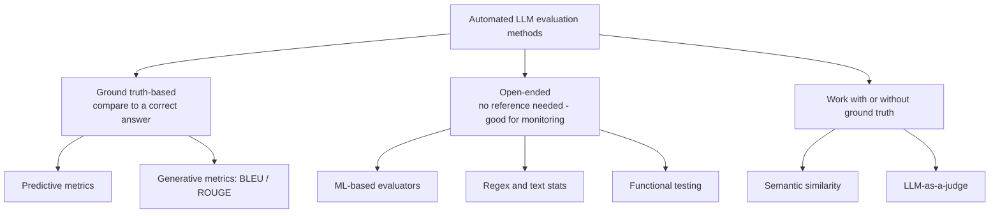

# Introduction and the two groups of evaluation methods

## Scope of the video

- Overview of automated LLM evaluation methods: predictive quality metrics, generative quality metrics, semantic similarity, ML-based models, LLM-as-a-judge, plus simpler methods like text statistics and regular expressions [`0:02`](https://www.youtube.com/watch?v=6eOcgYP5D4Q&t=2)

## Manual first, automated to scale

- Manual evaluation is always the starting point: "always look at your data", don't skip it, and involve domain experts [`0:19`](https://www.youtube.com/watch?v=6eOcgYP5D4Q&t=19)
- Automated evaluations are where you scale beyond manual review [`0:19`](https://www.youtube.com/watch?v=6eOcgYP5D4Q&t=19)

## The two big groups

- **Ground truth-based methods**: compare responses to a known correct answer [`0:41`](https://www.youtube.com/watch?v=6eOcgYP5D4Q&t=41)
- **Open-ended methods**: don't rely on ground truth; useful for monitoring live systems [`0:41`](https://www.youtube.com/watch?v=6eOcgYP5D4Q&t=41)

