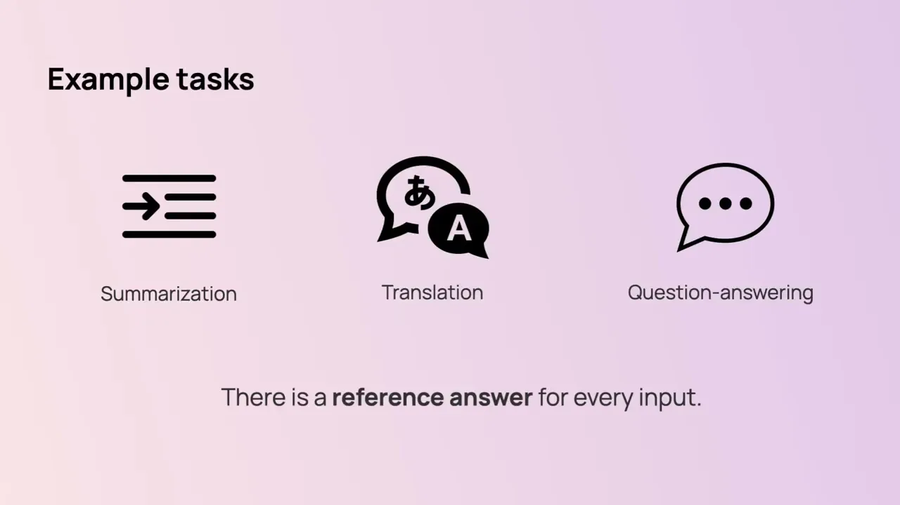
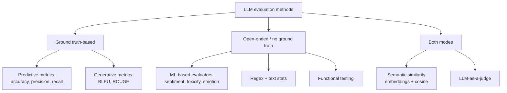

# LLM evaluation methods and metrics

*Evidently AI · 5:09 · [Watch on YouTube](https://www.youtube.com/watch?v=6eOcgYP5D4Q)*

## Summary

An educational overview of the main automated methods for evaluating LLM outputs. After stressing that manual review with domain experts always comes first, it splits automated methods into ground truth-based and open-ended groups, then walks through each technique: predictive metrics (accuracy/precision/recall), generative metrics (BLEU/ROUGE), semantic similarity via embeddings, LLM-as-a-judge, small ML-based evaluators, regular expressions and text statistics, and functional testing. It closes by showing how to match evaluators to specific test datasets, from happy-path Q&A sets to edge cases like competitor questions.

## Topics

1. [Introduction and the two groups of evaluation methods](01-introduction-and-method-groups.md)
2. [Predictive quality metrics](02-predictive-quality-metrics.md)
3. [Generative quality metrics (BLEU / ROUGE)](03-generative-quality-metrics.md)
4. [Semantic similarity](04-semantic-similarity.md)
5. [LLM-as-a-judge](05-llm-as-a-judge.md)
6. [ML-based evaluators](06-ml-based-evaluators.md)
7. [Regular expressions and text statistics](07-regex-and-text-stats.md)
8. [Functional testing](08-functional-testing.md)
9. [Matching evaluation methods to test datasets](09-matching-evaluators-to-datasets.md)

## Method map

## Key takeaways

- Manual evaluation with domain experts is the mandatory starting point; automated evaluation is how you scale [`0:19`](https://www.youtube.com/watch?v=6eOcgYP5D4Q&t=19)
- All automated methods split into two groups: ground truth-based (compare to a correct answer) and open-ended (no reference; useful for monitoring) [`0:41`](https://www.youtube.com/watch?v=6eOcgYP5D4Q&t=41)
- For classification-style LLM tasks, use standard accuracy/precision/recall — and pick per risk: recall fits content moderation because it measures how well all risky content gets flagged [`1:14`](https://www.youtube.com/watch?v=6eOcgYP5D4Q&t=74)
- BLEU/ROUGE overlap metrics are "less useful": symbol overlap is often not a meaningful quality signal [`1:36`](https://www.youtube.com/watch?v=6eOcgYP5D4Q&t=96)
- Normalized cosine similarity between embeddings scores 1 = identical meaning, 0.5 = unrelated, 0 = opposite — and works both against reference answers and, without ground truth, as a relevance proxy comparing answer to question [`2:09`](https://www.youtube.com/watch?v=6eOcgYP5D4Q&t=129)
- Every evaluation dataset needs evaluators matched to its purpose: happy-path sets pair with semantic similarity/exact match/LLM judge, while edge cases (e.g. competitor questions) pair with an LLM judge, similarity to a polite-denial template, or a regex for canned responses [`4:18`](https://www.youtube.com/watch?v=6eOcgYP5D4Q&t=258)
