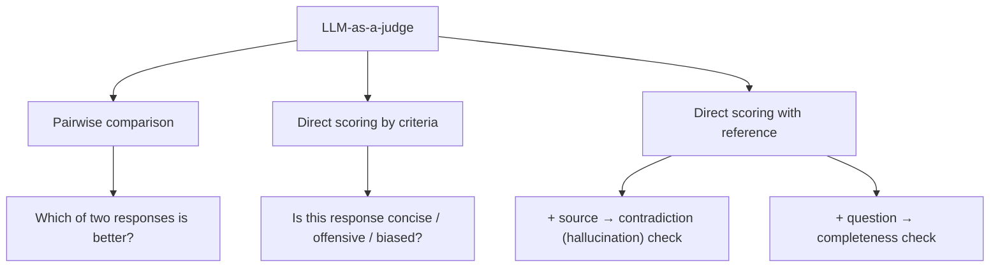

# Types of LLM judges

Three ways to use an LLM as a judge, from comparison to enriched scoring.

## 1. Pairwise comparison

- Show the LLM two outputs and ask: "Which response is better?" [`1:23`](https://www.youtube.com/watch?v=Qj3u_kzfJVo&t=83)
- Useful when testing prompts against each other, but it "does require some tuning" [`1:23`](https://www.youtube.com/watch?v=Qj3u_kzfJVo&t=83)

## 2. Direct scoring by criteria

- Pass a single text and ask the LLM to evaluate specific qualities: "Is this response concise?", "Is it offensive or biased?" [`1:36`](https://www.youtube.com/watch?v=Qj3u_kzfJVo&t=96)
- The presenter considers this the more practical approach [`1:36`](https://www.youtube.com/watch?v=Qj3u_kzfJVo&t=96)

## 3. Direct scoring with reference (extra context)

Add more information to the evaluation prompt [`1:48`](https://www.youtube.com/watch?v=Qj3u_kzfJVo&t=108):

- Response + source it was based on → "Does this response contradict the source?" — a hallucination check [`1:48`](https://www.youtube.com/watch?v=Qj3u_kzfJVo&t=108)
- Question + answer → "Does this response fully address the question?" — a completeness check [`1:48`](https://www.youtube.com/watch?v=Qj3u_kzfJVo&t=108)

