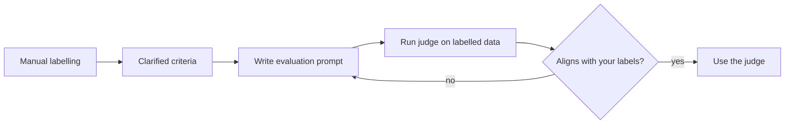

# How to create an LLM judge

The recommended workflow: label first, then automate.

1. **Be the judge yourself first** — do some manual labelling, e.g. evaluating the correctness of a new response against a reference answer [`2:47`](https://www.youtube.com/watch?v=Qj3u_kzfJVo&t=167)
2. **Discover the nuances** that manual labelling exposes [`2:47`](https://www.youtube.com/watch?v=Qj3u_kzfJVo&t=167):
   - How big of a difference counts as incorrect?
   - Do you compare every detail or just the overall idea?
   - Does an extra greeting make an answer incorrect? [`3:02`](https://www.youtube.com/watch?v=Qj3u_kzfJVo&t=182)
3. **Write the evaluation prompt**, run the judge, and measure how well it aligns with your manual labels [`3:02`](https://www.youtube.com/watch?v=Qj3u_kzfJVo&t=182)
4. **Iterate** until alignment is good — "your LLM evaluator needs its own evaluation" [`3:02`](https://www.youtube.com/watch?v=Qj3u_kzfJVo&t=182)

## Can you skip the labelling?

- You *can* just write the best prompt you can, look at results, and correct them [`3:18`](https://www.youtube.com/watch?v=Qj3u_kzfJVo&t=198)
- But labelling first is recommended: it forces you to clarify your own criteria, so you end up writing better prompts [`3:18`](https://www.youtube.com/watch?v=Qj3u_kzfJVo&t=198)

