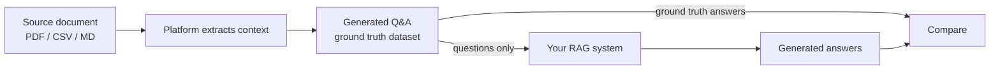

# Generating synthetic data for RAG: inputs and outputs ("Knowledge base" mode)

## What "Knowledge base" mode does

- Second generation option under **Datasets → Generate dataset**: generates both *inputs and outputs* from a source document, producing a **ground truth dataset**. [`3:13`](https://www.youtube.com/watch?v=gKp9K7Etv4A&t=193)
- Accepted source formats: **PDF, CSV, or Markdown**; a short document is recommended to keep generation quick. [`3:13`](https://www.youtube.com/watch?v=gKp9K7Etv4A&t=193)

## Steps demonstrated

1. Use a PDF of the **European AI Act** as the source document. [`3:30`](https://www.youtube.com/watch?v=gKp9K7Etv4A&t=210)
2. Drop the document, name the dataset, and request 10 questions. [`3:30`](https://www.youtube.com/watch?v=gKp9K7Etv4A&t=210)

## How it works and why it matters

- In the background the platform processes the document, extracts context, and generates questions to it; because answers come directly from the trusted source, they can be expected to be reliable (with optional manual review/tweaking). [`4:09`](https://www.youtube.com/watch?v=gKp9K7Etv4A&t=249)
- Intended RAG evaluation workflow: take the question part, pass it through your system to generate answers, and compare those answers against the ground truth. [`4:09`](https://www.youtube.com/watch?v=gKp9K7Etv4A&t=249)

