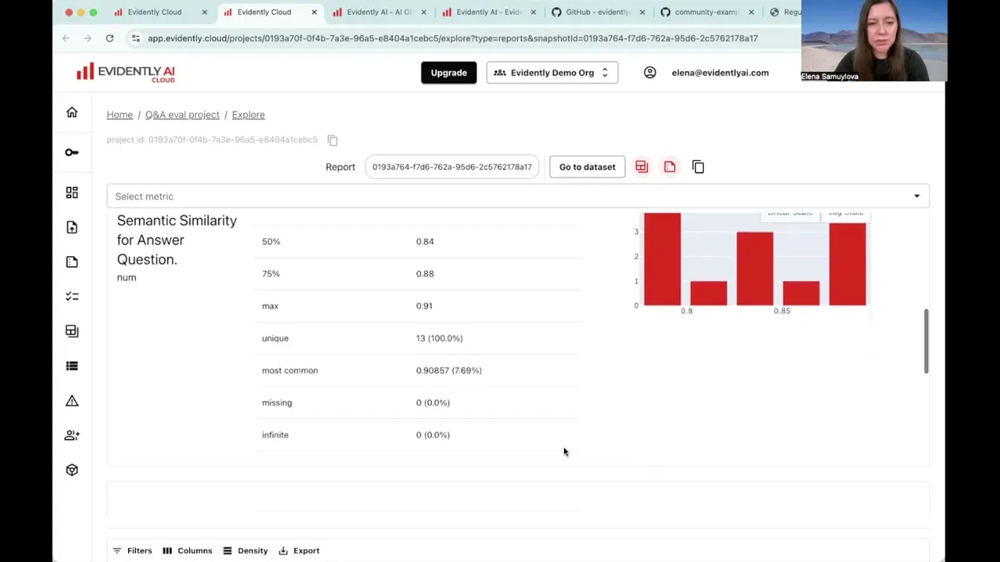
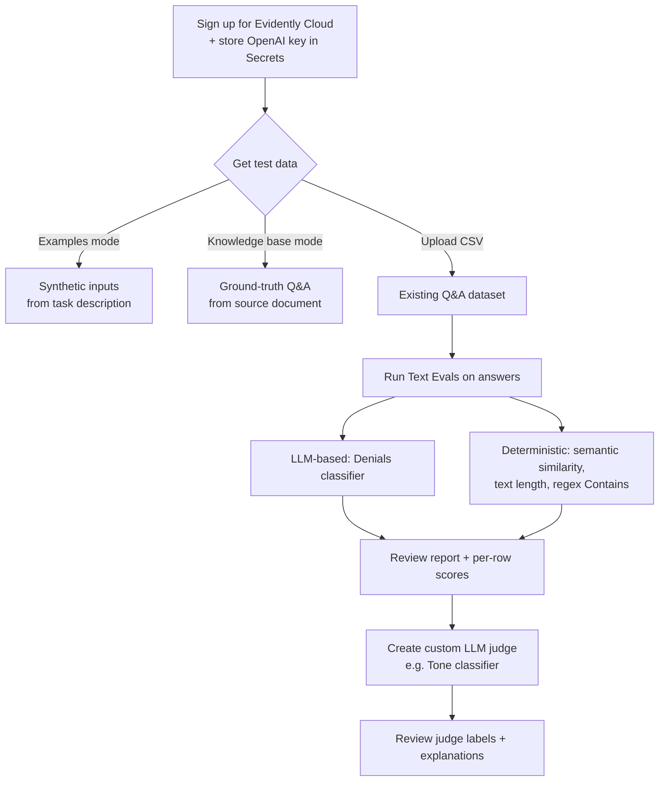

# How to run LLM evals with no code | PRACTICE

*Evidently AI · 12:27 · [Watch on YouTube](https://www.youtube.com/watch?v=gKp9K7Etv4A)*

## Summary

A hands-on tutorial showing how to run LLM evaluations entirely through the Evidently Cloud UI, with no code. It walks through generating synthetic test data (plausible inputs from a task description, and ground-truth Q&A pairs from a source document for RAG), uploading a Q&A dataset and evaluating it with a mix of deterministic checks (semantic similarity, text length, regex word-matching) and LLM-based classifiers, and finally building a custom LLM-as-a-judge to classify response tone. The only prerequisites are a free Evidently Cloud account and, optionally, an OpenAI API key for the LLM-powered steps. [`0:02`](https://www.youtube.com/watch?v=gKp9K7Etv4A&t=2)

## Topics

1. [Introduction and setup](01-introduction-and-setup.md) — what Evidently AI is, prerequisites, project creation, storing the API key.
2. [Generating synthetic data: inputs](02-synthetic-data-inputs.md) — "Examples" mode: plausible inputs from a task description.
3. [Generating synthetic data for RAG](03-synthetic-data-rag.md) — "Knowledge base" mode: ground-truth Q&A from a source document.
4. [Upload data and select metrics](04-upload-data-and-select-metrics.md) — CSV upload, column mapping, choosing four Text Evals descriptors.
5. [Review results](05-review-results.md) — the summary report, per-row scores, and what each check found.
6. [Custom LLM judge](06-custom-llm-judge.md) — building a "Tone" classifier, its results, and closing advice.

## Workflow overview

## Key takeaways

- Synthetic data generation has two modes: "Examples" produces inputs only from a task description, while "Knowledge base" produces both questions and reliable ground-truth answers extracted from a trusted source document (PDF/CSV/Markdown). [`1:56`](https://www.youtube.com/watch?v=gKp9K7Etv4A&t=116) [`3:13`](https://www.youtube.com/watch?v=gKp9K7Etv4A&t=193)
- On the demo health-chatbot dataset, the evaluations surfaced concrete issues: 1 denial (found by both the LLM judge and the regex check), all semantic-similarity scores above 0.78 (no irrelevant answers), and 1 unusually long answer that looked copied from a document. [`7:37`](https://www.youtube.com/watch?v=gKp9K7Etv4A&t=457) [`7:59`](https://www.youtube.com/watch?v=gKp9K7Etv4A&t=479) [`8:53`](https://www.youtube.com/watch?v=gKp9K7Etv4A&t=533)
- Regex-based checks (e.g. matching "sorry", "cannot", "apologies") work without an API key and caught the same denial as the LLM judge here, but they will not generalize as well as an LLM judge. [`7:02`](https://www.youtube.com/watch?v=gKp9K7Etv4A&t=422) [`9:21`](https://www.youtube.com/watch?v=gKp9K7Etv4A&t=561)
- A custom LLM judge needs only a short natural-language criteria description and category names — the platform auto-generates the full prompt (explanations, response structure); the demo "Tone" judge split 13 responses into 7 Formal and 6 Conversational with sensible, phrase-level explanations. [`10:43`](https://www.youtube.com/watch?v=gKp9K7Etv4A&t=643) [`11:25`](https://www.youtube.com/watch?v=gKp9K7Etv4A&t=685)
- Best practice: label a sample yourself first so you can compare your automated evals against human judgment — the demo is only a quick illustration. [`12:08`](https://www.youtube.com/watch?v=gKp9K7Etv4A&t=728)
