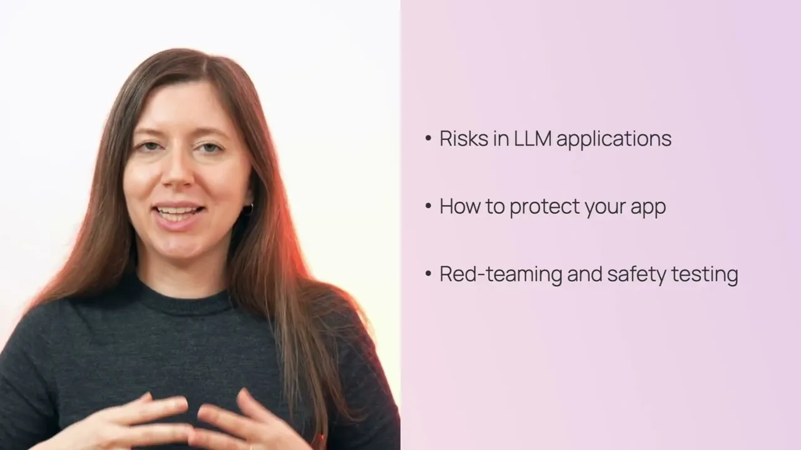
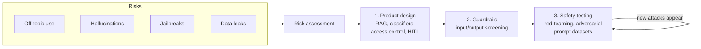

# LLM safety and red-teaming

*Evidently AI · 5:11 · [Watch on YouTube](https://www.youtube.com/watch?v=XZZ6glt0AMA)*

## Summary

A short educational video on LLM safety for application builders. It walks through four things that can go wrong with LLM apps — off-topic use, hallucinations, jailbreaks, and data leaks — each illustrated with a real-world incident (Klarna, Air Canada, Chevrolet, DPD). It then presents a defense strategy: start with risk assessment, then apply three lines of defense — product design choices, real-time guardrails, and safety testing through red-teaming — treating safety as an ongoing process, not a one-time gate.

## Topics

1. [Introduction: why LLM safety matters](01-introduction.md)
2. [Risk 1: Off-topic use](02-off-topic-use.md)
3. [Risk 2: LLM hallucinations](03-hallucinations.md)
4. [Risk 3: LLM jailbreaks](04-jailbreaks.md)
5. [Risk 4: Data leaks](05-data-leaks.md)
6. [Risk assessment](06-risk-assessment.md)
7. [First line of defense: product design choices](07-product-design-choices.md)
8. [Second line of defense: guardrails](08-guardrails.md)
9. [Third line of defense: safety testing and red-teaming](09-safety-testing-and-red-teaming.md)

## Overview

## Key takeaways

- LLM failures are a liability, not just a UX problem: a court ruled Air Canada had to compensate a customer after its chatbot gave refund advice contradicting company policy. [`1:18`](https://www.youtube.com/watch?v=XZZ6glt0AMA&t=78)
- Hallucination is inherent to LLMs — "not a bug but a feature" — so never rely on them for factual information without grounding (e.g., RAG with quoted sources). [`1:01`](https://www.youtube.com/watch?v=XZZ6glt0AMA&t=61)
- Jailbreaks have real business consequences: a Chevrolet chatbot was manipulated into "selling" a car for $1, and a DPD bot was prompted into swearing and mocking its own company. [`1:48`](https://www.youtube.com/watch?v=XZZ6glt0AMA&t=108)
- Defense is layered: risk assessment first, then product design (classifiers, constrained data access, human-in-the-loop), then guardrails on inputs and outputs — accepting that guardrails add latency and can't cover everything. [`2:49`](https://www.youtube.com/watch?v=XZZ6glt0AMA&t=169), [`4:05`](https://www.youtube.com/watch?v=XZZ6glt0AMA&t=245)
- Test the whole system, not the model alone: red-team with a dataset of adversarial prompts and verify the app consistently denies them. [`4:21`](https://www.youtube.com/watch?v=XZZ6glt0AMA&t=261), [`4:38`](https://www.youtube.com/watch?v=XZZ6glt0AMA&t=278)
- Safety is ongoing — new attack types keep emerging, so apps in production must be re-tested continuously. [`4:55`](https://www.youtube.com/watch?v=XZZ6glt0AMA&t=295)
