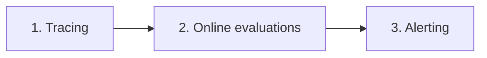

# Monitoring vs. observability

## The distinction

- The terms are often used interchangeably, but they differ [`1:46`](https://www.youtube.com/watch?v=r-CYvjJ-W3k&t=106):
  - **Monitoring** — tracking metrics you defined **in advance** [`1:46`](https://www.youtube.com/watch?v=r-CYvjJ-W3k&t=106)
  - **Observability** — collecting **all the data** so you can answer questions about the app, including ones you **didn't anticipate** [`1:46`](https://www.youtube.com/watch?v=r-CYvjJ-W3k&t=106)
- Framing: monitoring is *part of* observability; observability gives the full picture [`2:01`](https://www.youtube.com/watch?v=r-CYvjJ-W3k&t=121)

## The three-step production observability workflow

Production observability breaks down into three steps [`2:01`](https://www.youtube.com/watch?v=r-CYvjJ-W3k&t=121):

1. **Tracing** — capture data for every user interaction
2. **Online evaluations** — score the captured traces for quality
3. **Alerting** — get notified when something drifts

