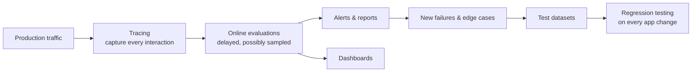

# LLM observability in production: tracing and online evals

*Evidently AI · 5:08 · [Watch on YouTube](https://www.youtube.com/watch?v=r-CYvjJ-W3k)*

Educational video on evaluating LLM applications after they ship. It covers what you can track in production (product metrics, manual log review, software monitoring, and AI quality monitoring), draws the line between monitoring and observability, and then walks through the three-step production observability workflow: tracing, online quality evaluations, and alerting. It closes by explaining why offline test datasets and regression testing still matter even once real production data exists.

## Topics

1. [From experiments to production](./01-from-experiments-to-production.md) — why production evaluation is both an opportunity and a safety need
2. [What to track in production](./02-what-to-track-in-production.md) — product metrics, manual labeling, software monitoring, and LLM quality monitoring
3. [Monitoring vs. observability](./03-monitoring-vs-observability.md) — the distinction, and the three-step production workflow
4. [Tracing](./04-tracing.md) — capturing full sessions, intermediate steps, and why product teams need access
5. [Online quality evaluations](./05-online-quality-evaluations.md) — delayed/sampled evals, quality metrics, dashboards, and flagging for review
6. [Alerts and continuous testing](./06-alerts-and-continuous-testing.md) — alerting, feeding failures back into test datasets, and regression testing

## Key takeaways

- Four things are trackable in production: product metrics, manual log review, software monitoring, and AI quality monitoring — but product metrics need careful interpretation, e.g. long chatbot conversations may mean users are stuck, not impressed [`0:29`](https://www.youtube.com/watch?v=r-CYvjJ-W3k&t=29)
- Monitoring tracks metrics defined in advance; observability collects all the data so you can answer questions you didn't anticipate — monitoring is part of observability, not a synonym [`1:46`](https://www.youtube.com/watch?v=r-CYvjJ-W3k&t=106)
- Production observability is a three-step workflow: tracing, online evaluations, and alerting [`2:01`](https://www.youtube.com/watch?v=r-CYvjJ-W3k&t=121)
- Unlike traditional tracing, LLM traces matter for their *content* (user questions, model answers), so product teams need a user-friendly way to inspect them — and masking should protect personal data during manual review [`2:42`](https://www.youtube.com/watch?v=r-CYvjJ-W3k&t=162)
- Online evaluations run with a delay (e.g. over the last hour of traces) and can be sampled (e.g. 10% of traffic) at high volume, reusing offline methods: LLM judges, semantic similarity, and regular expressions [`3:08`](https://www.youtube.com/watch?v=r-CYvjJ-W3k&t=188)
- Test datasets remain necessary after launch: every change (new models, bug fixes, prompt adjustments) needs regression testing, and production failures should be added back to the test set to keep it representative [`4:16`](https://www.youtube.com/watch?v=r-CYvjJ-W3k&t=256)
