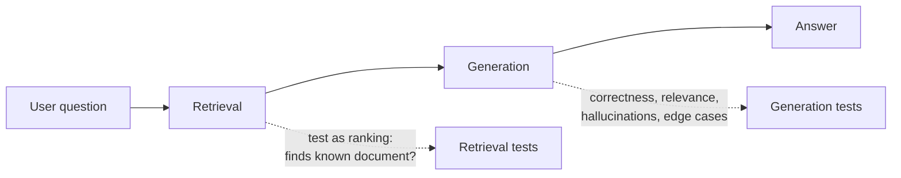

# Testing RAG Quality

First principle: break the system into smaller testable components — you still build evaluators and test cases as before, but you evaluate parts instead of the whole. [`1:46`](https://www.youtube.com/watch?v=6EtqsMcEhaw&t=106)

A RAG system has two main components to test separately:

## 1. Retrieval

- Check that it finds the relevant documents that answer the question. [`2:04`](https://www.youtube.com/watch?v=6EtqsMcEhaw&t=124)
- Treat it as a **ranking problem**: ask questions and check whether it finds the document you know it should find. [`2:04`](https://www.youtube.com/watch?v=6EtqsMcEhaw&t=124)

## 2. Generation

- The part that formulates the answer from the retrieved information. [`2:04`](https://www.youtube.com/watch?v=6EtqsMcEhaw&t=124)
- Run different questions and check answer **correctness**, **relevance**, and **hallucinations**. [`2:22`](https://www.youtube.com/watch?v=6EtqsMcEhaw&t=142)

## RAG-specific edge cases

- No document retrieved: does the system correctly deny a response, or does it invent one? [`2:22`](https://www.youtube.com/watch?v=6EtqsMcEhaw&t=142)
- Contradictory context: how does the LLM resolve it? [`2:22`](https://www.youtube.com/watch?v=6EtqsMcEhaw&t=142)
- Plus the usual format checks: does it always quote a link, does it stay within a certain response length, etc. [`2:44`](https://www.youtube.com/watch?v=6EtqsMcEhaw&t=164)

