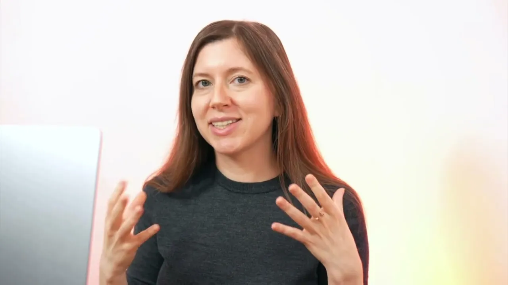
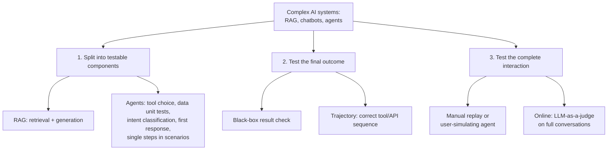

# AI agent and RAG evaluation

*Evidently AI · 6:04 · [Watch on YouTube](https://www.youtube.com/watch?v=6EtqsMcEhaw)*

Educational explainer on how to evaluate complex AI systems — RAG pipelines, chatbots, and AI agents — that go beyond the simple input/output shape of tasks like summarization. It defines each system type, then develops three general evaluation strategies: splitting the system into smaller testable components, black-box testing of final outcomes and trajectories, and testing the complete interaction through simulated scenarios and conversation-level online evaluations.

## Topics

1. [Introduction: Evaluating Complex AI Systems](01-introduction.md)
2. [Key Concepts: RAG, Chatbots, and AI Agents](02-rag-chatbots-and-agents.md)
3. [Testing RAG Quality](03-testing-rag-quality.md)
4. [Testing AI Agents by Component](04-testing-agents-by-component.md)
5. [Testing Agent Outcomes and Trajectories](05-testing-outcomes-and-trajectories.md)
6. [Scenario Testing and Online Evaluation](06-scenario-testing-and-online-evaluation.md)

## Overview

## Key takeaways

- Complex systems are evaluated with the same machinery as simple ones (evaluators + test cases), applied to parts rather than the whole: break RAG and agents into smaller testable components. [`1:46`](https://www.youtube.com/watch?v=6EtqsMcEhaw&t=106)
- RAG splits into two testable components: retrieval, tested as a ranking problem (does it find the known correct document?), and generation, tested for correctness, relevance, and hallucinations. [`2:04`](https://www.youtube.com/watch?v=6EtqsMcEhaw&t=124) [`2:22`](https://www.youtube.com/watch?v=6EtqsMcEhaw&t=142)
- RAG needs dedicated edge-case tests: with no document retrieved the system must deny rather than invent an answer, and contradictory context must be resolved deliberately. [`2:22`](https://www.youtube.com/watch?v=6EtqsMcEhaw&t=142)
- Agents decompose into five component tests — correct tool choice, data unit tests, intent classification (a pure classification problem), first response quality against ground truth, and single-step checks given a fixed conversation history. [`2:54`](https://www.youtube.com/watch?v=6EtqsMcEhaw&t=174) [`3:34`](https://www.youtube.com/watch?v=6EtqsMcEhaw&t=214)
- Beyond components, test agents black-box (was the booking actually completed?) and by trajectory (was the expected tool/API sequence followed?), and test whole interactions with a user-simulating agent — e.g. a user changing hotel requirements mid-conversation. [`4:32`](https://www.youtube.com/watch?v=6EtqsMcEhaw&t=272) [`5:00`](https://www.youtube.com/watch?v=6EtqsMcEhaw&t=300)
- Online evaluation applies LLM-as-a-judge at the conversation level (frustration, politeness, task resolution) plus hard metrics like function call usage — same principles as simple systems, at a bigger scale with more complex checks. [`5:24`](https://www.youtube.com/watch?v=6EtqsMcEhaw&t=324) [`5:40`](https://www.youtube.com/watch?v=6EtqsMcEhaw&t=340)
