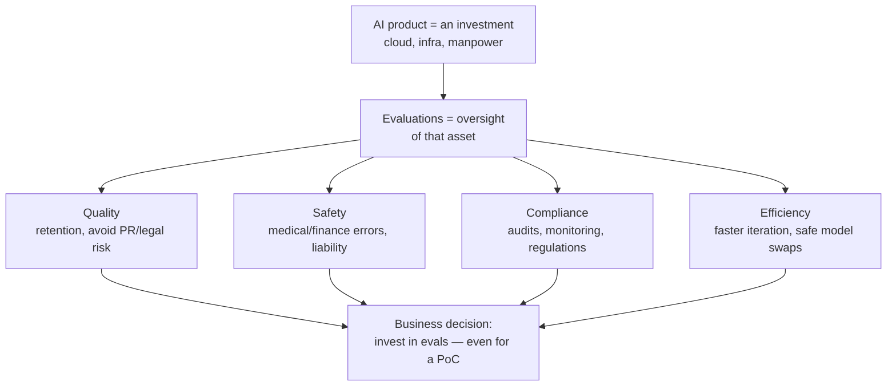

# A business case for LLM evaluations

> Evidently AI · 4:05 · [Watch on YouTube](https://www.youtube.com/watch?v=ZaOo2dce20A)

## Summary

A short educational/argument video making the business (not technical) case for investing in LLM evaluations. It frames an evaluation framework as oversight for an asset you're already paying for — like QA for software or safety testing for manufactured goods — and organizes the argument around four business reasons: quality, safety, compliance, and efficiency. It closes by rebutting the "it's just a proof of concept" objection: even a PoC needs evals, or it's just a glorified demo.

## Topics

1. [Evaluations as an investment](01-evaluations-as-an-investment.md)
2. [Quality](02-quality.md)
3. [Safety](03-safety.md)
4. [Compliance](04-compliance.md)
5. [Efficiency](05-efficiency.md)
6. [Do you need evals for a Proof-of-Concept?](06-evals-for-a-proof-of-concept.md)
7. [Summing up](07-summing-up.md)

## Overview

## Key takeaways

- Evaluations are how you verify an AI investment pays off — e.g. confirming a support chatbot actually cuts support costs in half as expected. [`0:16`](https://www.youtube.com/watch?v=ZaOo2dce20A&t=16)
- If you have an asset, you must invest in its oversight; evals are the AI equivalent of safety testing, software QA, or performance reviews. [`0:37`](https://www.youtube.com/watch?v=ZaOo2dce20A&t=37)
- Users try AI features out of curiosity but stay only if the product is good; bad quality costs users, and can escalate to PR disasters or legal risk. [`1:00`](https://www.youtube.com/watch?v=ZaOo2dce20A&t=60) [`1:14`](https://www.youtube.com/watch?v=ZaOo2dce20A&t=74)
- Not testing high-stakes domains (medical, finance) means gambling with user safety and liability. [`1:26`](https://www.youtube.com/watch?v=ZaOo2dce20A&t=86)
- AI regulations largely demand what evals already provide — safety testing, auditability, production monitoring — so building evals now prepares you before regulations, enterprise customers, or competitors force it. [`1:49`](https://www.youtube.com/watch?v=ZaOo2dce20A&t=109) [`2:04`](https://www.youtube.com/watch?v=ZaOo2dce20A&t=124)
- Without evals you can't safely migrate models — providers have already discontinued models, forcing switches — and debugging becomes untraceable; with evals, the team ships and iterates faster as a competitive advantage. [`2:37`](https://www.youtube.com/watch?v=ZaOo2dce20A&t=157) [`2:55`](https://www.youtube.com/watch?v=ZaOo2dce20A&t=175)
- Even a proof of concept needs evaluations: without them it's a glorified demo, since it must handle some edge cases and show measurable improvement to prove anything. [`3:11`](https://www.youtube.com/watch?v=ZaOo2dce20A&t=191) [`3:25`](https://www.youtube.com/watch?v=ZaOo2dce20A&t=205)
