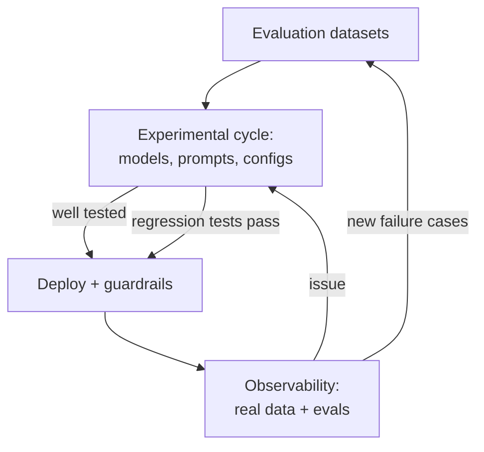

# 2. The evaluation workflow, end to end

The video connects the course's pieces into one workflow, from datasets to production and back.

## Foundation: evaluation datasets

- Start by creating test cases that reflect your **key scenarios, edge cases, and safety risks** — these datasets become your foundation [`0:47`](https://www.youtube.com/watch?v=x9mfMkBWwCY&t=47).

## Experimental cycle

- Iterate: test different **models, prompts, and configurations** [`0:47`](https://www.youtube.com/watch?v=x9mfMkBWwCY&t=47).
- Start with **manual evaluations**, then scale with **automated metrics** [`0:47`](https://www.youtube.com/watch?v=x9mfMkBWwCY&t=47).
- It is an ongoing cycle: make changes → run tests → refine, step by step [`0:47`](https://www.youtube.com/watch?v=x9mfMkBWwCY&t=47).

## Deployment and production

- Once the app is well tested, deploy it; add **guardrails** to prevent bad outputs in production [`1:05`](https://www.youtube.com/watch?v=x9mfMkBWwCY&t=65).
- After deployment, "observability is all you need": collect **real interaction data** and run evals over it to see what's going on and catch issues [`1:05`](https://www.youtube.com/watch?v=x9mfMkBWwCY&t=65).
- When something goes wrong: return to the experimental cycle to test solutions, run **regression tests**, then deploy the fixes [`1:05`](https://www.youtube.com/watch?v=x9mfMkBWwCY&t=65).

## Closing the loop

- Feed **new failure cases back into your evaluation datasets** — the data at the heart of evaluations becomes your major asset [`1:35`](https://www.youtube.com/watch?v=x9mfMkBWwCY&t=95).

