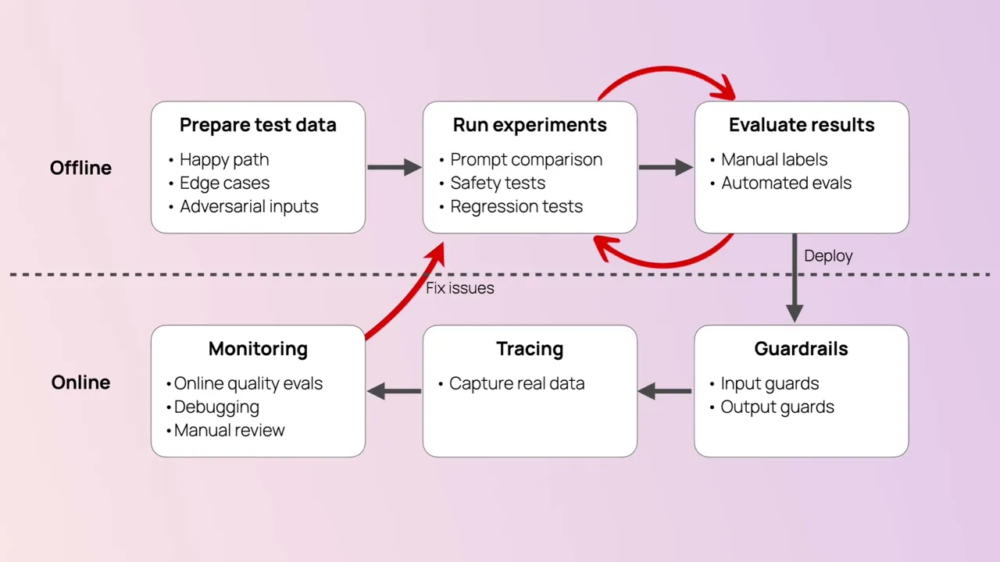
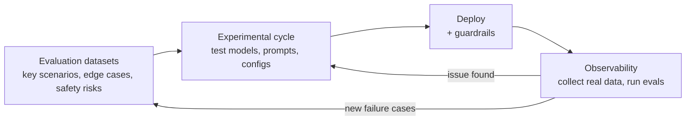

# How to continuously improve LLM products?

Final video of the Evidently AI LLM evaluation course (2:33). It recaps the two kinds of evals covered in the course — evaluating LLM models and evaluating LLM systems built on them — and connects everything into a single end-to-end workflow: evaluation datasets → experimental iteration → deployment with guardrails → production observability → feeding failures back into the datasets. The result is a continuous improvement loop where real user data strengthens the tests, and solid tests drive smart product decisions.

## Topics

1. [Course recap: why evaluations matter](01-course-recap.md)
2. [The evaluation workflow, end to end](02-evaluation-workflow.md)
3. [The continuous improvement loop](03-continuous-improvement-loop.md)
4. [Summing up](04-summing-up.md)

## Key takeaways

- Evaluations matter because they let you move faster, prevent failures, and deliver value to users — the end goal is a system of measurable continuous improvements to your product [`0:18`](https://www.youtube.com/watch?v=x9mfMkBWwCY&t=18), [`0:34`](https://www.youtube.com/watch?v=x9mfMkBWwCY&t=34).
- The workflow is a cycle: build evaluation datasets from key scenarios, edge cases, and safety risks; iterate over models, prompts, and configurations; start with manual evaluations and scale to automated metrics [`0:47`](https://www.youtube.com/watch?v=x9mfMkBWwCY&t=47).
- After deployment, observability is essential: collect real interaction data, run evals over it, return to the experimental cycle when something breaks, and deploy fixes only after regression tests [`1:05`](https://www.youtube.com/watch?v=x9mfMkBWwCY&t=65).
- New production failure cases must be fed back into the evaluation datasets — the data itself becomes your major asset [`1:35`](https://www.youtube.com/watch?v=x9mfMkBWwCY&t=95).
- Enough labeled data eventually enables two upgrades: replacing LLM-as-a-judge with smaller fine-tuned evaluators, and fine-tuning your main LLM for your specific use case [`1:48`](https://www.youtube.com/watch?v=x9mfMkBWwCY&t=108), [`2:04`](https://www.youtube.com/watch?v=x9mfMkBWwCY&t=124).
- Evaluations are a core part of the AI product, not just metrics — start small, but start: "An AI product without evaluations is the product no one cares about" [`2:10`](https://www.youtube.com/watch?v=x9mfMkBWwCY&t=130).
