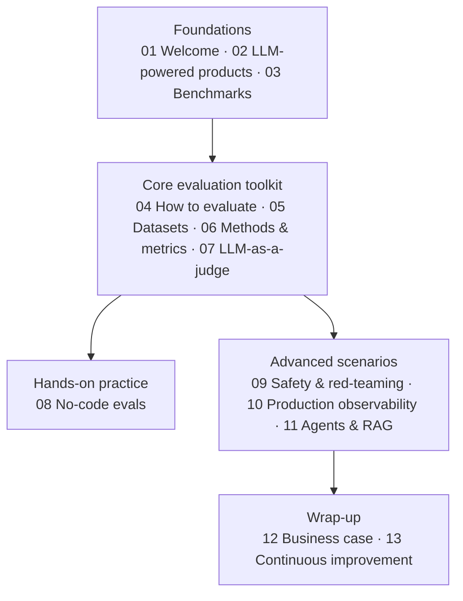

# LLM evaluation course

Playlist: https://www.youtube.com/playlist?list=PL9omX6impEuMgDFCK_NleIB0sMzKs2boI

## What this library covers

This is Evidently AI's end-to-end, no-code-required introduction to evaluating LLM-powered products. The throughline of the series is a single distinction repeated and deepened across every video: evaluating an LLM **model** (benchmarks, standardized exam-like tests) is not the same as evaluating an LLM **application** (your prompts, your data, your business logic, your users). The course argues that the second kind — product evals — is unavoidable work you must own yourself.

Starting from fundamentals (what an LLM-powered product even is, what benchmarks measure and why they are not enough), the series builds the practical machinery of product evaluation: where evaluation datasets come from (real user data, hand-written test cases, synthetic generation), which methods and metrics score outputs (ground-truth comparison, semantic similarity, regex, and the workhorse LLM-as-a-judge), and how to apply all of it hands-on in a no-code platform. It then extends the same principles to harder territory — safety and red-teaming, production observability with tracing and online evals, and complex systems like RAG pipelines and AI agents — before closing with the business case for evals and the continuous improvement loop that ties experimentation, deployment, and production feedback into one cycle.

A reader who works through the whole library ends up with a complete mental model of the LLM evaluation lifecycle: build representative test datasets → evaluate manually first, then automate → deploy with guardrails → observe production and run online evals → feed failures back into the datasets → repeat.

## Videos

1. [Welcome to the LLM evaluation course](./01-welcome-to-the-llm-evaluation-course/README.md) — The 90-second welcome video for Evidently AI's LLM evaluation course, presented by instructor Elena. It frames the course as a high-level, no-coding introduction aimed at anyone building or considering an LLM-powered product. It then previews the full curriculum, from LLM fundamentals and benchmarks through product-level evaluation and safety to production monitoring and the business case for evaluations.

2. [What is an LLM-powered product?](./02-what-is-an-llm-powered-product/README.md) — The groundwork for the course: before evaluating, it defines what is being evaluated. It explains what an LLM is (a large language model you use as-is via prompts, for generative and predictive tasks) and what makes software an LLM-powered product, spanning a complexity spectrum from single prompts through prompt chains and RAG to AI agents. It closes with real-world company examples and the motivating question — "is it working?" — that leads into evals.

3. [LLM evaluation benchmarks](./03-llm-evaluation-benchmarks/README.md) — Explains that evaluating LLMs (models) and evaluating LLM-powered applications are distinct activities, and that benchmarks are the community's standardized, exam-like tests with known answers for comparing models fairly. It surveys examples — MMLU, HellaSwag, math and code benchmarks, MT-Bench, and StrongReject — and explains why new benchmarks keep appearing. It closes by contrasting benchmarks with product evals, which test the complete system on use-case-representative data.

4. [How to evaluate an LLM application](./04-how-to-evaluate-an-llm-application/README.md) — A big-picture introduction to evaluating LLM-powered applications, focused on the pre-deployment phase. It explains why LLM testing is hard (non-determinism means checking that the range of outputs stays within expectations, not that the system "works") and frames quality as two axes: capabilities and risks. It then walks the maturity path — vibe checks, manual labeling, automated evaluations with test datasets and ground truth — and shows how that system enables prompt experiments, red-teaming, and regression testing, with real examples from Asana, Webflow, and GitLab.

5. [LLM evaluation datasets: test cases and synthetic data](./05-llm-evaluation-datasets-test-cases-and-synthetic-data/README.md) — Explains where evaluation data for LLM applications comes from, listing five sources: hand-written test cases, existing user data, beta test users, public benchmarks, and synthetic data. It details three ways to use LLM-generated synthetic data — creating plausible inputs, building labeled ground truth for RAG from source documents, and diversifying phrasings — and recommends structuring test cases into happy path, edge cases, and adversarial inputs. It closes with how companies like Tesla and Google invest heavily in manual eval work, and practical advice for designing representative datasets.

6. [LLM evaluation methods and metrics](./06-llm-evaluation-methods-and-metrics/README.md) — Surveys the main automated methods for evaluating LLM outputs, after stressing that manual review with domain experts always comes first. It divides methods into ground truth-based and open-ended groups, then covers predictive metrics (accuracy/precision/recall), generative metrics (BLEU/ROUGE), semantic similarity via embeddings, LLM-as-a-judge, small ML-based evaluators, regex/text statistics, and functional testing. It closes by showing how to match evaluators to each test dataset, from happy-path Q&A sets to edge cases like competitor questions.

7. [LLM-as-a-judge: evaluating LLMs with LLMs](./07-llm-as-a-judge-evaluating-llms-with-llms/README.md) — Explains LLM-as-a-judge — using an LLM to evaluate another LLM's outputs — and why it's trustworthy despite sounding circular: the judge never redoes the product's work, it just classifies final text against narrow criteria, and critiquing is easier than creating. It covers the three main judge types (pairwise comparison, direct scoring by criteria, and direct scoring with a reference) and stresses that the technique approximates human judgment rather than being a metric. It closes with a practical workflow — label data manually first, then write and iterate the evaluation prompt until the judge aligns with your labels — plus concrete prompt-writing tips.

8. [How to run LLM evals with no code | PRACTICE](./08-how-to-run-llm-evals-with-no-code-practice/README.md) — A hands-on tutorial on running LLM evaluations entirely through the Evidently Cloud UI without writing code. It demonstrates generating synthetic test data two ways — plausible inputs from a task description, and ground-truth Q&A pairs extracted from a source document for RAG — then uploading a health-chatbot Q&A CSV and evaluating it with deterministic checks (semantic similarity, text length, regex word-matching) plus LLM-based classifiers. It closes by building a custom LLM-as-a-judge that classifies response tone and reviewing its per-row labels and explanations.

9. [LLM safety and red-teaming](./09-llm-safety-and-red-teaming/README.md) — Explains what can go wrong with LLM applications, covering four risk categories — off-topic use, hallucinations, jailbreaks, and data leaks — each backed by a real incident (Klarna, Air Canada, Chevrolet, DPD). It then lays out a layered defense strategy: assess your risks first, then reduce them through product design, add real-time guardrails on inputs and outputs, and finally test everything. It closes by framing red-teaming — attacking your own system with adversarial prompt datasets — as an ongoing practice, since new attacks keep emerging.

10. [LLM observability in production: tracing and online evals](./10-llm-observability-in-production-tracing-and-online-evals/README.md) — Moves from offline/experimental LLM evaluation to what changes once an app is live with real users. It surveys four things worth tracking in production — product metrics, manual log review, software monitoring, and AI quality monitoring — then distinguishes monitoring from observability and presents a three-step production workflow: tracing, online evaluations, and alerting. It closes by arguing that test datasets and regression testing remain necessary after launch, with production failures fed back into the test set.

11. [AI agent and RAG evaluation](./11-ai-agent-and-rag-evaluation/README.md) — Explains how to evaluate complex AI systems — RAG pipelines, chatbots, and AI agents — that go beyond a simple input/output shape. After defining each system type (agents being characterized by planning, tool use, and memory), it develops three evaluation strategies: splitting the system into smaller testable components, black-box testing of final outcomes and trajectories, and testing complete interactions via simulated scenarios and conversation-level online evaluations. It closes by noting that evals for complex systems follow the same principles as simple ones, just at a bigger scale with more complex checks.

12. [A business case for LLM evaluations](./12-a-business-case-for-llm-evaluations/README.md) — Makes the business — not technical — case for investing in LLM evaluations, framing them as oversight for an asset you're already funding, analogous to QA for software or safety testing for manufactured products. It organizes the argument around four reasons: quality, safety, compliance, and efficiency. It closes by rebutting the "it's just a proof of concept" objection, arguing that a PoC without evals is merely a glorified demo.

13. [How to continuously improve LLM products?](./13-how-to-continuously-improve-llm-products/README.md) — The final course video recaps the two kinds of LLM evaluations covered throughout the course and explains why evals help you move faster, prevent failures, and deliver user value. It connects the course's pieces into one end-to-end workflow: evaluation datasets built from key scenarios, edge cases, and safety risks; an experimental cycle over models, prompts, and configurations; deployment with guardrails; and production observability with evals over real interaction data. It closes with the continuous improvement loop, where production failures feed back into the evaluation datasets and accumulated labeled data unlocks custom evaluators and fine-tuning.

## Suggested reading path

The playlist order is deliberate and worth following on a first pass — each block builds on the previous one. If you skip around, respect the block dependencies below.

- **Foundations (01–03).** Start here. Video 02 defines the object of study (the LLM-powered product and its complexity spectrum) and video 03 establishes the course's central distinction: model benchmarks vs. product evals. Everything after assumes you have this distinction clear. If you already build LLM apps, you can skim 01 and 02.
- **Core evaluation toolkit (04–07).** The heart of the course, and the strongest internal dependency chain: 04 gives the overall approach, 05 the data (test datasets, synthetic generation), 06 the scoring methods, and 07 deep-dives the most important of those methods, LLM-as-a-judge. Watch these four in order.
- **Hands-on practice (08).** The PRACTICE video applies 05–07 in the Evidently Cloud UI (synthetic data, deterministic checks, a custom judge). It makes little sense before the toolkit block, but it can be done any time after it.
- **Advanced scenarios (09–11).** These three are mutually independent — each applies the core toolkit to a different frontier (safety, production, complex systems) — so you can reorder them by interest. 09 pairs naturally with 05's adversarial test cases, 10 assumes 06's methods (it reuses judges, similarity, and regex as online evals), and 11 assumes 07 (conversation-level judging).
- **Wrap-up (12–13).** Video 12 (the business case) is actually order-independent — read it first if you need to convince stakeholders before investing time. Video 13 is the true capstone: it stitches every previous topic into the continuous improvement loop, so leave it for last.
