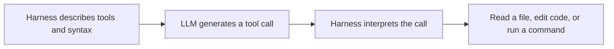

# What a harness does for a language model

## Text becomes action through an execution system

- Theo starts with a simplified model of an LLM: it receives text and generates more text, including predicted tokens. Text generation alone does not read files or execute commands. [`10:05`](https://www.youtube.com/watch?v=ebILGCoN4UU&t=605) [`10:30`](https://www.youtube.com/watch?v=ebILGCoN4UU&t=630)
- A harness provides the connection between model output and actions. His analogy is a chef who needs utensils and ingredients, or a programmer who needs a keyboard to act on a computer. [`11:50`](https://www.youtube.com/watch?v=ebILGCoN4UU&t=710) [`12:18`](https://www.youtube.com/watch?v=ebILGCoN4UU&t=738) [`13:39`](https://www.youtube.com/watch?v=ebILGCoN4UU&t=819)
- The harness describes a special response syntax. When the model uses that syntax, the harness performs the corresponding operation, such as reading or editing a file, running a command, accessing memory, or pushing to GitHub. [`13:39`](https://www.youtube.com/watch?v=ebILGCoN4UU&t=819) [`14:10`](https://www.youtube.com/watch?v=ebILGCoN4UU&t=850)
- Tool access determines what the model can do in its environment. An LLM without that connection can describe an action but cannot perform it through words alone. [`13:11`](https://www.youtube.com/watch?v=ebILGCoN4UU&t=791) [`14:40`](https://www.youtube.com/watch?v=ebILGCoN4UU&t=880)

## Minimal execution relationship

The diagram summarizes Theo's explanation of tool-call syntax and execution. [`13:39`](https://www.youtube.com/watch?v=ebILGCoN4UU&t=819) [`14:10`](https://www.youtube.com/watch?v=ebILGCoN4UU&t=850)

