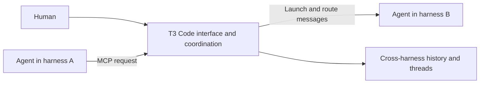

# Why T3 Code coordinates harnesses through MCP

## Keep coordination outside each harness

- T3 Code keeps its implementation in T3 Code and exposes an agreed MCP contract. The harness sends instructions to T3 Code rather than executing a separate implementation of those capabilities itself. [`21:48`](https://www.youtube.com/watch?v=ebILGCoN4UU&t=1308)
- Theo says this reduces interference with native harness behavior. His example is using an existing Claude Code installation and subscription inside T3 Code while retaining its normal skills and plugins. [`22:15`](https://www.youtube.com/watch?v=ebILGCoN4UU&t=1335)
- The added T3 Code MCP can search history across harnesses, send messages to other threads, launch a Codex thread, or spawn an agent using another supported harness. [`22:37`](https://www.youtube.com/watch?v=ebILGCoN4UU&t=1357)
- T3 Code acts as the broker: one agent asks T3 Code to start another harness, and T3 Code passes messages between them. The original harness does not need to implement direct control of the other harness. [`23:05`](https://www.youtube.com/watch?v=ebILGCoN4UU&t=1385) [`23:29`](https://www.youtube.com/watch?v=ebILGCoN4UU&t=1409)

## The architectural tradeoff

- Implementing these features as custom tools in every harness was theoretically possible. Theo chose the external MCP contract so the implementation could be shared and remain less tied to each harness's built-in tools. [`21:23`](https://www.youtube.com/watch?v=ebILGCoN4UU&t=1283) [`21:48`](https://www.youtube.com/watch?v=ebILGCoN4UU&t=1308)
- That choice transfers compatibility work to T3 Code. Later, he identifies handling the different subagent behaviors across harnesses as a difficult part of building the product. [`45:02`](https://www.youtube.com/watch?v=ebILGCoN4UU&t=2702) [`45:24`](https://www.youtube.com/watch?v=ebILGCoN4UU&t=2724)

The diagram shows T3 Code's role in a cross-harness request, as described in the video. [`22:37`](https://www.youtube.com/watch?v=ebILGCoN4UU&t=1357) [`23:29`](https://www.youtube.com/watch?v=ebILGCoN4UU&t=1409)

