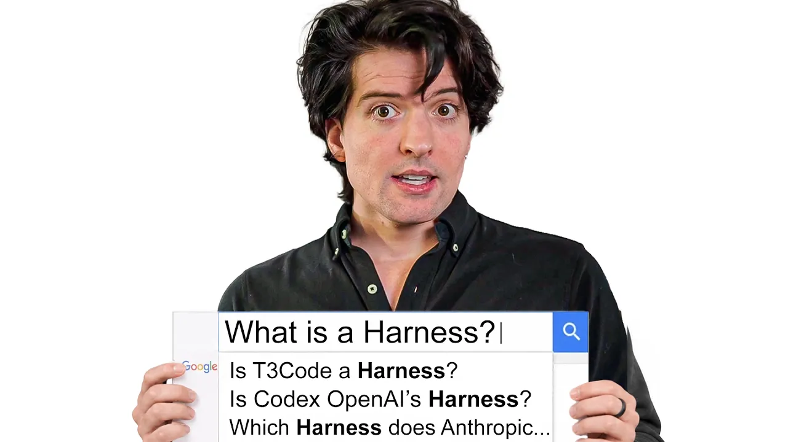

# My last video about ai harnesses

Theo distinguishes the model, harness, and human interface, then explains how T3 Code coordinates existing agents through MCP. His broader argument is that developers should follow useful abstractions and choose tools for capability and cost, rather than become attached to one implementation. [`10:59`](https://www.youtube.com/watch?v=ebILGCoN4UU&t=659) [`21:48`](https://www.youtube.com/watch?v=ebILGCoN4UU&t=1308) [`44:11`](https://www.youtube.com/watch?v=ebILGCoN4UU&t=2651)

This is an opinion/news video with an educational explanation, personal anecdotes, and product advocacy. The notes attribute estimates and predictions to Theo rather than treating them as benchmark results.

## Topic breakdown

1. [The central argument and sponsored agent example](./01-framing-and-sponsored-example.md), 0:00–2:53.
2. [How abstractions change what developers need to care about](./02-abstractions-and-engineering-priorities.md), 2:53–10:05.
3. [What a harness does for a language model](./03-what-a-harness-does.md), 10:05–14:40.
4. [Models, agents, harnesses, and interfaces](./04-agents-and-interfaces.md), 14:40–18:46.
5. [Built-in tools, plugins, and external data](./05-tools-plugins-and-mcp.md), 18:46–21:48.
6. [Why T3 Code coordinates harnesses through MCP](./06-t3-code-architecture.md), 21:48–23:58.
7. [Attachment to tools and learning unfamiliar ways to work](./07-adaptability-and-tool-attachment.md), 23:58–40:30.
8. [Why switching models can lose access to skills](./08-switching-harnesses-and-skills.md), 40:30–43:19.
9. [Model–harness convergence and the productivity argument](./09-model-harness-convergence.md), 43:19–45:47.
10. [T3 Code as an agentic development environment](./10-agentic-development-environments.md), 45:47–49:29.

The [verbatim transcript](./transcript.md) preserves the full discussion and its timestamp links.

## Key takeaways

- A harness turns model output into actions by interpreting a tool-call syntax. Theo defines an agent as an LLM combined with a harness that supplies tools, context, and role instructions. [`14:10`](https://www.youtube.com/watch?v=ebILGCoN4UU&t=850) [`18:09`](https://www.youtube.com/watch?v=ebILGCoN4UU&t=1089)
- T3 Code keeps its coordination logic outside individual harnesses and exposes it through MCP. That lets it broker other agents and pass messages across harnesses. [`21:48`](https://www.youtube.com/watch?v=ebILGCoN4UU&t=1308) [`23:29`](https://www.youtube.com/watch?v=ebILGCoN4UU&t=1409)
- Switching providers in T3 Code can also switch the harness. Claude skills do not automatically appear in Codex; each harness still has its own configuration. [`40:30`](https://www.youtube.com/watch?v=ebILGCoN4UU&t=2430) [`41:06`](https://www.youtube.com/watch?v=ebILGCoN4UU&t=2466) [`41:29`](https://www.youtube.com/watch?v=ebILGCoN4UU&t=2489)
- Theo estimates that running Codex models through Claude Code rather than Codex now differs by roughly 3–5%, perhaps washing out. This is his estimate, not a reported controlled benchmark. [`44:40`](https://www.youtube.com/watch?v=ebILGCoN4UU&t=2680)
- His decision rule is to choose the capability and price needed for the task. He expects training on harness interactions to make the model and its native harness increasingly inseparable. [`43:45`](https://www.youtube.com/watch?v=ebILGCoN4UU&t=2625) [`44:11`](https://www.youtube.com/watch?v=ebILGCoN4UU&t=2651)
- Theo calls T3 Code an agentic development environment, or ADE. Its purpose is to make AI work controllable through an open, customizable interface, and he predicts even this layer will eventually attract less attention. [`46:48`](https://www.youtube.com/watch?v=ebILGCoN4UU&t=2808) [`47:59`](https://www.youtube.com/watch?v=ebILGCoN4UU&t=2879)
