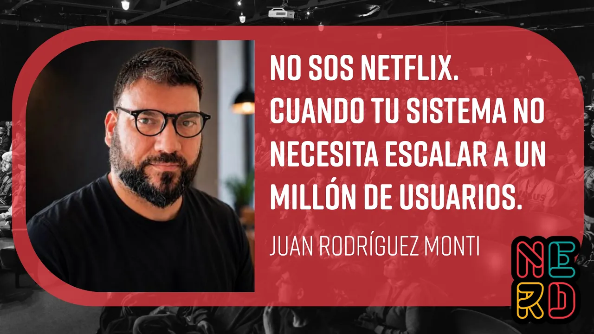

# No sos Netflix. Cuando tu sistema no necesita escalar a un millón de usuarios. - J. Rodríguez Monti

La charla cuestiona la idea de que escalar siempre significa atender millones de usuarios. Para muchos equipos, escalar también es poder trabajar juntos, operar el sistema con confianza y responder a su nivel real de criticidad. Rodríguez Monti propone priorizar los fundamentos de ingeniería y construir sistemas simples, observables, seguros y recuperables antes de adoptar complejidad que el producto todavía no necesita.

## Temas

1. [La escala no es lo mismo que la criticidad](01-escala-y-criticidad.md)
2. [Primero escala el equipo y la ingeniería](02-fundamentos-de-ingenieria.md)
3. [Usar IA sin perder control del sistema](03-ia-y-control-del-codigo.md)
4. [Operación: costos, observabilidad y seguridad](04-operacion-observabilidad-y-seguridad.md)
5. [Sistemas pequeños con alta criticidad](05-sistemas-criticos-pequenos.md)
6. [Simplicidad, complejidad y decisiones por etapas](06-decisiones-y-cierre.md)

## Key takeaways

- La escala incluye la capacidad de que cinco o diez desarrolladores trabajen en el mismo sistema sin bloquearse; no se reduce a atender millones de usuarios. [`3:22`](https://www.youtube.com/watch?v=nGeiH6GSIuU&t=202)
- Un producto para 200 usuarios también necesita estar bien hecho, sobre todo si esos usuarios o las operaciones que realizan son críticos. [`3:55`](https://www.youtube.com/watch?v=nGeiH6GSIuU&t=235)
- Antes de añadir tecnologías distribuidas, hay que resolver el ABC de ingeniería: flujo de ramas, pruebas, precommits, CI/CD, límites claros y ownership. [`9:25`](https://www.youtube.com/watch?v=nGeiH6GSIuU&t=565) [`11:19`](https://www.youtube.com/watch?v=nGeiH6GSIuU&t=679)
- La IA acelera la escritura, pero no reemplaza la revisión, las pruebas, la seguridad ni a una persona responsable que entienda el código generado. [`13:18`](https://www.youtube.com/watch?v=nGeiH6GSIuU&t=798) [`14:43`](https://www.youtube.com/watch?v=nGeiH6GSIuU&t=883)
- El autoscaling puede reaccionar tarde ante un pico; hacen falta aprovisionamiento acorde, presupuestos, alertas y control de costos de nube y tokens. [`8:09`](https://www.youtube.com/watch?v=nGeiH6GSIuU&t=489) [`16:06`](https://www.youtube.com/watch?v=nGeiH6GSIuU&t=966) [`16:38`](https://www.youtube.com/watch?v=nGeiH6GSIuU&t=998)
- La observabilidad puede revelar una falla antes de que la note el usuario cuando las trazas permiten seguir una petición a través del sistema. [`17:18`](https://www.youtube.com/watch?v=nGeiH6GSIuU&t=1038)
- Los sistemas de baja escala y alta criticidad exigen un margen de error pequeño y prácticas para controlar despliegues, amenazas, recuperación, mantenimiento y auditoría. [`19:41`](https://www.youtube.com/watch?v=nGeiH6GSIuU&t=1181) [`22:27`](https://www.youtube.com/watch?v=nGeiH6GSIuU&t=1347) [`23:07`](https://www.youtube.com/watch?v=nGeiH6GSIuU&t=1387)
- Diseña para el sexto desarrollador antes de optimizar para doce millones de usuarios; agrega complejidad cuando resuelva una necesidad concreta. [`24:04`](https://www.youtube.com/watch?v=nGeiH6GSIuU&t=1444) [`26:08`](https://www.youtube.com/watch?v=nGeiH6GSIuU&t=1568)
