# Video notes

A personal video library with **95 videos**: 32 standalone videos and 63 lessons across 3 course collections.

Browse by topic below. Click a title or thumbnail to open its notes, summary, and chapter index. Use “Watch on YouTube” to open the original video. English and Spanish titles follow the source notes.

## Contents

- [AI coding and agent workflows](#ai-coding-and-agent-workflows) · 10 videos
- [AI models and application architecture](#ai-models-and-application-architecture) · 3 videos
- [Databases and distributed systems](#databases-and-distributed-systems) · 6 videos
- [System design, cloud, and deployment](#system-design-cloud-and-deployment) · 5 videos
- [Engineering careers and interviews](#engineering-careers-and-interviews) · 6 videos
- [Business and technology conversations](#business-and-technology-conversations) · 2 videos
- [Course collections](#course-collections)
  - [LLM evaluation course](#llm-evaluation-course) · 13 lessons
  - [CMU intro to database systems](#cmu-intro-to-database-systems) · 26 lessons
  - [Harvard advanced algorithms](#harvard-advanced-algorithms) · 24 lessons

## AI coding and agent workflows

| Cover | Video and notes | Channel | Duration |
| --- | --- | --- | --- |
| [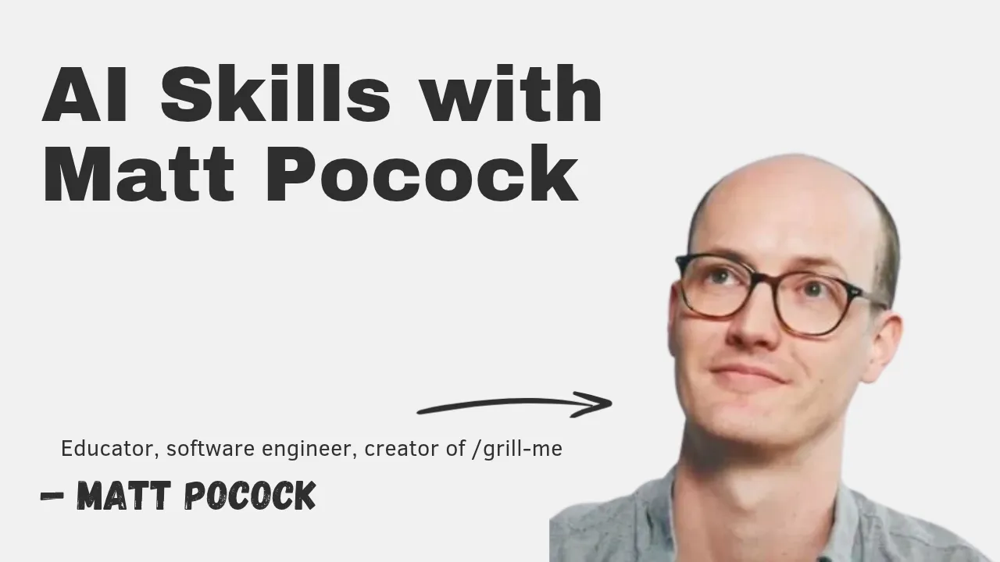](ai-skills-with-matt-pocock/README.md) | [AI Skills with Matt Pocock](ai-skills-with-matt-pocock/README.md) Reusable skills, context management, and engineering fundamentals. [Watch on YouTube](https://www.youtube.com/watch?v=4DhcSPkEbwI) | The Pragmatic Engineer | 1:36:36 |
| [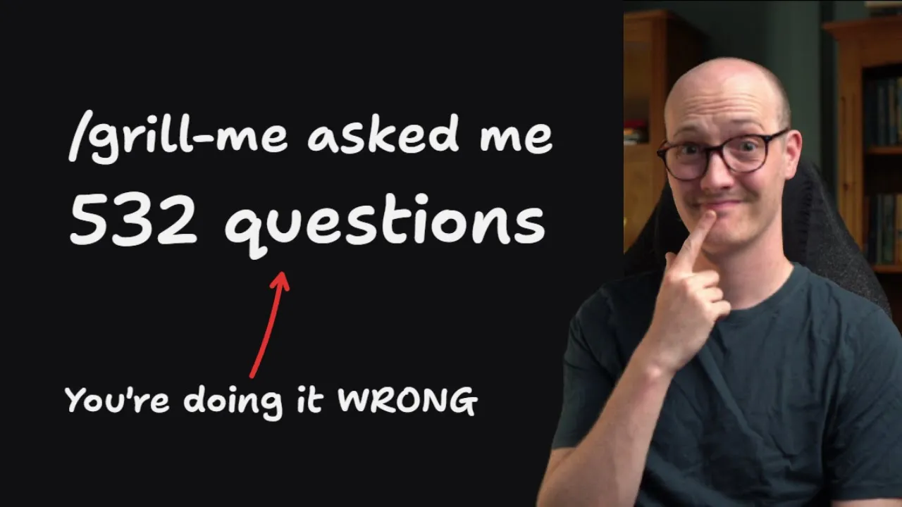](9-things-people-get-wrong-with-my-grill-skills/README.md) | [9 Things People Get Wrong With My /grill-&#42; skills](9-things-people-get-wrong-with-my-grill-skills/README.md) Planning with questions, choosing scope, and using session context. [Watch on YouTube](https://www.youtube.com/watch?v=UzMNBN6xLLA) | Matt Pocock | 13:28 |
|  | [So I tried Matt&#x27;s skills...](so-i-tried-matt-s-skills/README.md) A hands-on review of Matt Pocock&#x27;s skills and pstack. [Watch on YouTube](https://www.youtube.com/watch?v=0oXOOlqVu5M) | Theo - t3․gg | 38:21 |
| [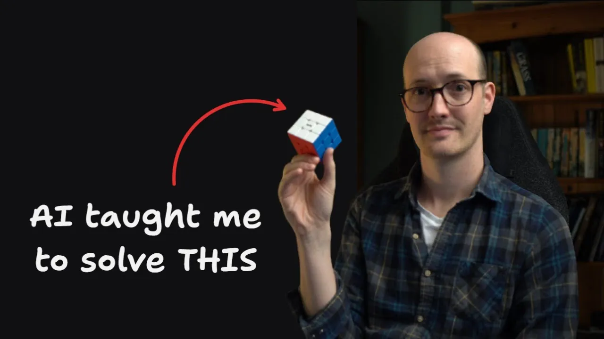](learn-anything-with-the-teach-skill/README.md) | [Learn anything with the /teach skill](learn-anything-with-the-teach-skill/README.md) A stateful agent skill for guided learning. [Watch on YouTube](https://www.youtube.com/watch?v=s5T5oQJcJ6U) | Matt Pocock | 13:04 |
| [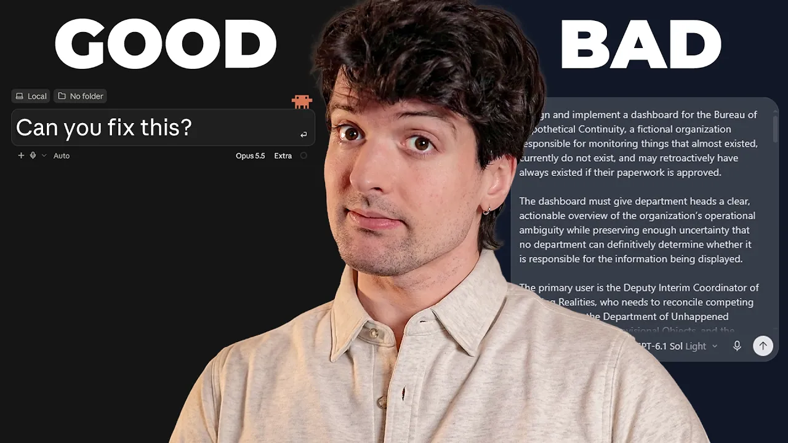](your-prompts-kinda-suck/README.md) | [Your prompts kinda suck](your-prompts-kinda-suck/README.md) Prompt-driven diagnostics, delegation, and connected workflows. [Watch on YouTube](https://www.youtube.com/watch?v=m-B3jIMMmUE) | Theo - t3․gg | 31:47 |
|  | [LIVE: Poteto (creator of pstack) on shipping 1,000&#x27;s of PR&#x27;s a month at SpaceX](live-poteto-creator-of-pstack-on-shipping-1-000-s-of-pr-s-a/README.md) pstack and engineering workflows at SpaceX. [Watch on YouTube](https://www.youtube.com/watch?v=MN9dGgmLyso) | Matt Pocock | 1:05:36 |
| [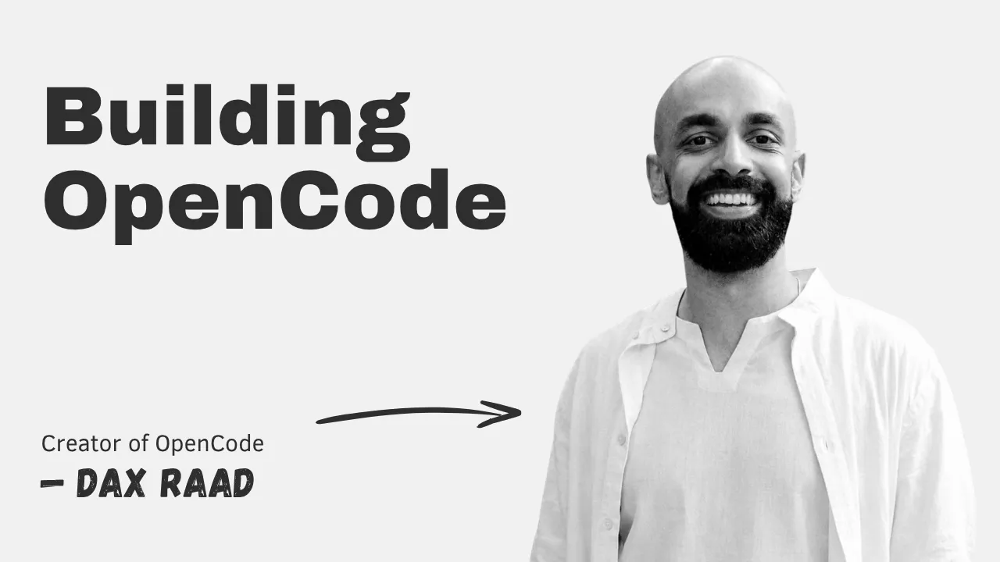](building-opencode-with-dax-raad/README.md) | [Building OpenCode with Dax Raad](building-opencode-with-dax-raad/README.md) Building OpenCode, inference economics, and engineering culture. [Watch on YouTube](https://www.youtube.com/watch?v=1VqKUrxR2C8) | The Pragmatic Engineer | 1:21:01 |
| [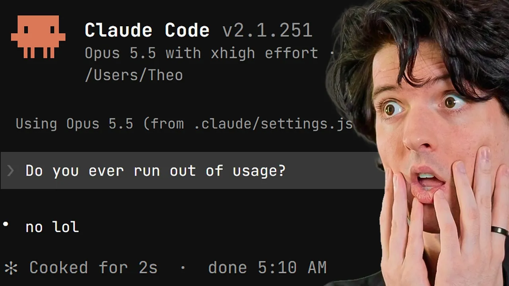](how-to-give-claude-unlimited-usage/README.md) | [How To Give Claude Unlimited Usage](how-to-give-claude-unlimited-usage/README.md) Claude usage limits, costs, and coding workflows. [Watch on YouTube](https://www.youtube.com/watch?v=NBCM_ZoWZo8) | Theo - t3․gg | 38:47 |
|  | [If you have a Claude sub, watch this](if-you-have-a-claude-sub-watch-this/README.md) Subscription economics, parallel agents, verification, and overnight workflows. [Watch on YouTube](https://www.youtube.com/watch?v=D8PikZ1KhUo) | Theo - t3․gg | 1:06:36 |
|  | [The True Cost of AI Coding](the-true-cost-of-ai-coding/README.md) Developer burnout, motivation, and boundaries around AI coding. [Watch on YouTube](https://www.youtube.com/watch?v=iPUn1Fnfn0k) | Syntax | 24:27 |

[Back to contents](#contents)

## AI models and application architecture

| Cover | Video and notes | Channel | Duration |
| --- | --- | --- | --- |
|  | [So I&#x27;ve been testing Gemini 4...](so-i-ve-been-testing-gemini-4/README.md) Hands-on model evaluation, demos, and code audits. [Watch on YouTube](https://www.youtube.com/watch?v=NE006pkiAnk) | Theo - t3․gg | 38:30 |
|  | [Kimi K3 es Salvaje (lo siento, Claude)](kimi-k3-es-salvaje-lo-siento-claude/README.md) Kimi K3 benchmarks, pricing, and practical tests. [Watch on YouTube](https://www.youtube.com/watch?v=DpP2tq74gf4) | midudev | 30:15 |
| [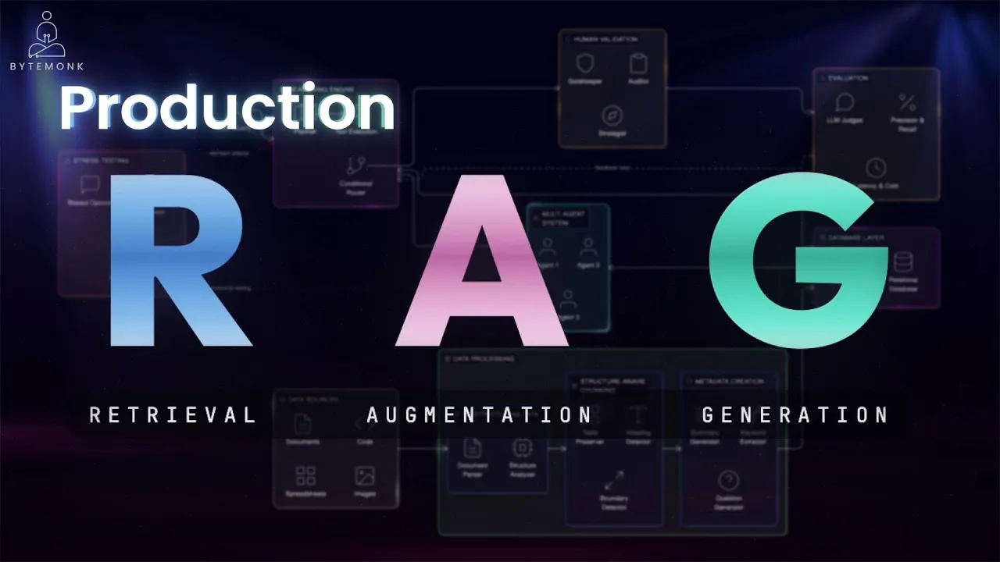](how-to-build-a-scalable-rag-system-for-ai-apps-full/README.md) | [How to Build a Scalable RAG System for AI Apps (Full Architecture)](how-to-build-a-scalable-rag-system-for-ai-apps-full/README.md) Retrieval, indexing, and architecture for RAG applications. [Watch on YouTube](https://www.youtube.com/watch?v=4KiiKQ9RVvA) | ByteMonk | 15:52 |

[Back to contents](#contents)

## Databases and distributed systems

| Cover | Video and notes | Channel | Duration |
| --- | --- | --- | --- |
| [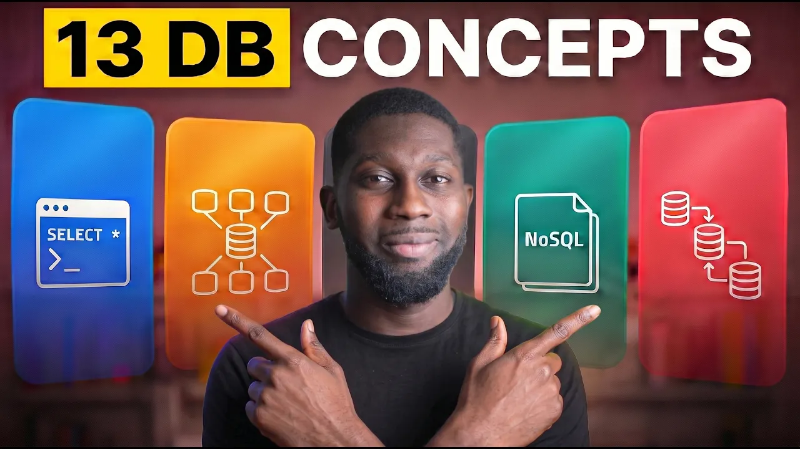](13-database-concepts-every-backend-engineer-must-know/README.md) | [13 Database Concepts Every Backend Engineer Must Know](13-database-concepts-every-backend-engineer-must-know/README.md) Relational fundamentals, performance, transactions, and scaling. [Watch on YouTube](https://www.youtube.com/watch?v=pEzrn6PIxRo) | Amigoscode | 13:17 |
| [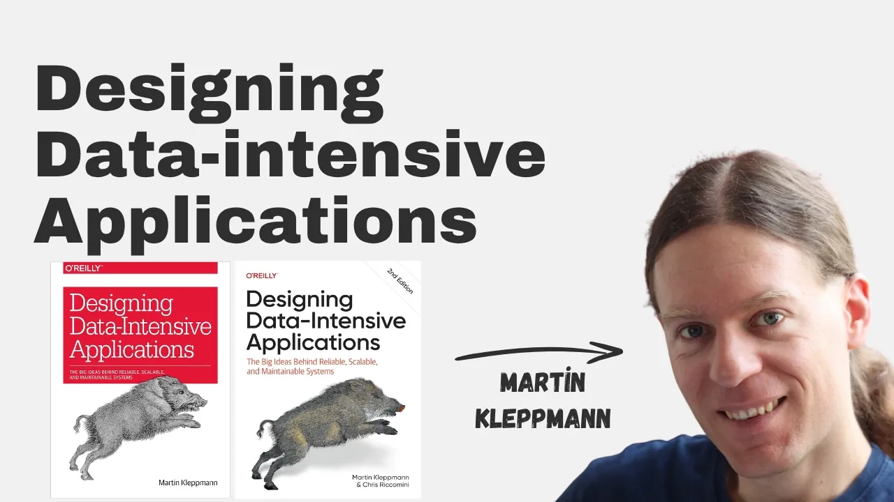](designing-data-intensive-applications-with-martin-kleppmann/README.md) | [Designing Data-intensive Applications with Martin Kleppmann](designing-data-intensive-applications-with-martin-kleppmann/README.md) DDIA, cloud tradeoffs, formal verification, and local-first software. [Watch on YouTube](https://www.youtube.com/watch?v=SVOrURyOu_U) | The Pragmatic Engineer | 1:25:49 |
| [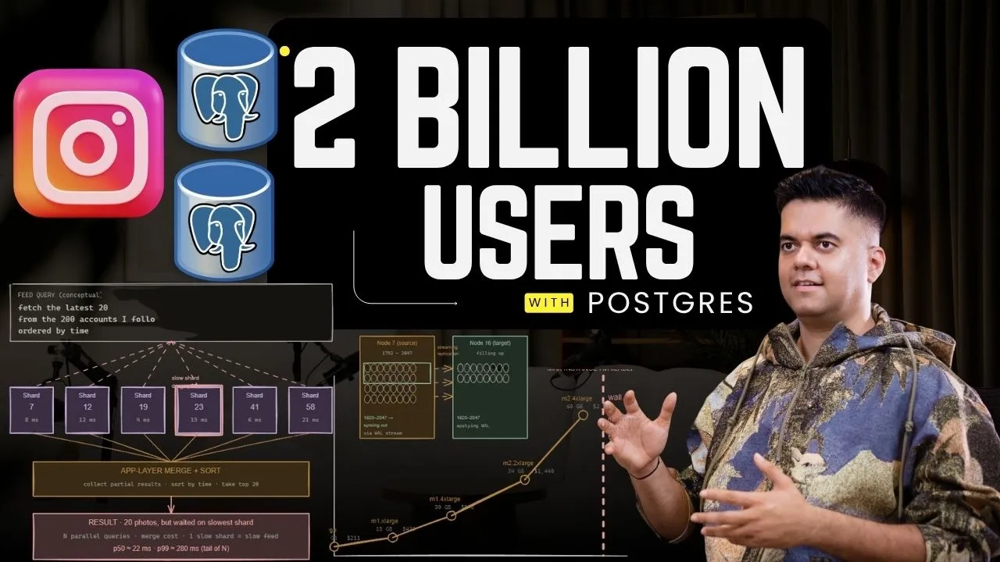](how-instagram-scaled-postgres-to-2-billion-users/README.md) | [How Instagram Scaled Postgres to 2 Billion Users](how-instagram-scaled-postgres-to-2-billion-users/README.md) Connection pooling, sharding, IDs, and Postgres at scale. [Watch on YouTube](https://www.youtube.com/watch?v=YLoYcwnqVzM) | Akhil Sharma | 22:37 |
| [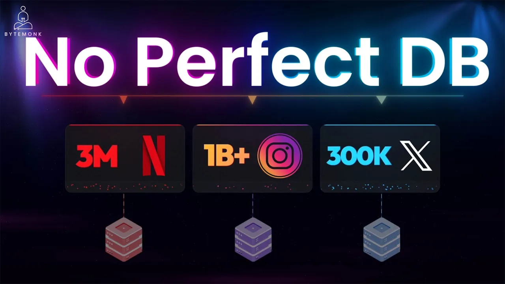](why-netflix-instagram-and-twitter-pick-different-databases/README.md) | [Why Netflix, Instagram, and Twitter Pick Different Databases](why-netflix-instagram-and-twitter-pick-different-databases/README.md) Choosing databases around access patterns. [Watch on YouTube](https://www.youtube.com/watch?v=XjHZCprrEgk) | ByteMonk | 10:49 |
| [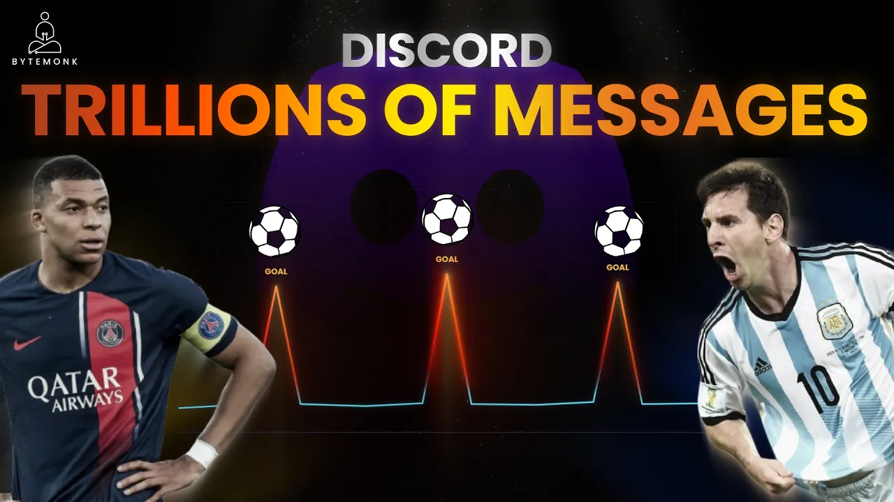](the-real-reason-discord-left-cassandra/README.md) | [The Real Reason Discord Left Cassandra](the-real-reason-discord-left-cassandra/README.md) Message storage, Cassandra bottlenecks, and migration to ScyllaDB. [Watch on YouTube](https://www.youtube.com/watch?v=X4iAQkjtx5k) | ByteMonk | 19:40 |
| [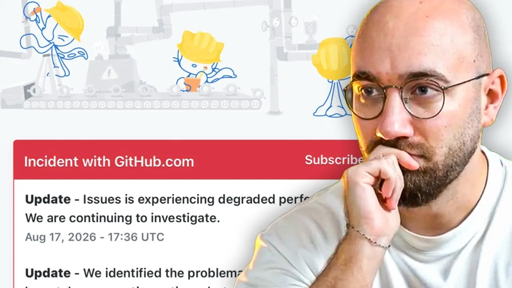](el-error-que-tumbo-a-github-explicado/README.md) | [El error que tumbó a GitHub, explicado](el-error-que-tumbo-a-github-explicado/README.md) A GitHub outage and the engineering behind the failure. [Watch on YouTube](https://www.youtube.com/watch?v=h5of8RrGLeE) | BettaTech | 17:28 |

[Back to contents](#contents)

## System design, cloud, and deployment

| Cover | Video and notes | Channel | Duration |
| --- | --- | --- | --- |
| [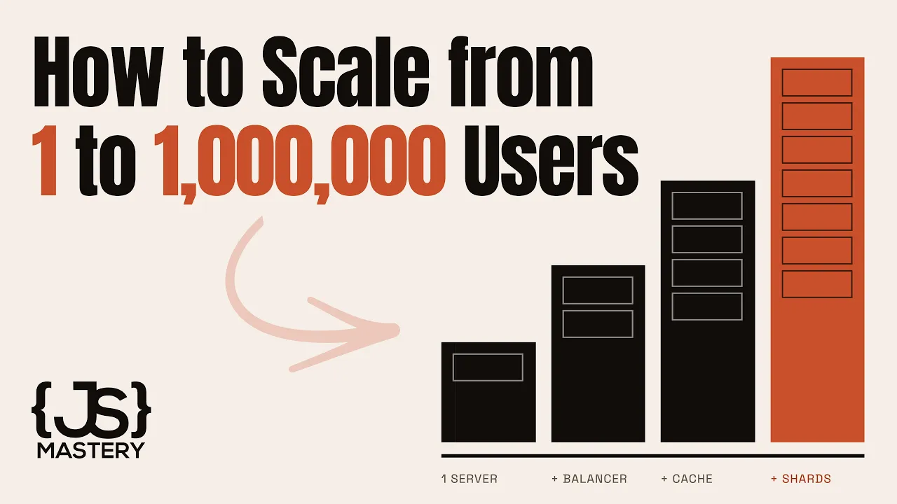](how-senior-engineers-actually-think-about-system-design/README.md) | [How Senior Engineers Actually Think About System Design &amp; Architecture &#124; Full Course](how-senior-engineers-actually-think-about-system-design/README.md) Architecture decisions and system design reasoning. [Watch on YouTube](https://www.youtube.com/watch?v=EaXHfuHRWwg) | JavaScript Mastery | 38:00 |
|  | [No sos Netflix. Cuando tu sistema no necesita escalar a un millón de usuarios. - J. Rodríguez Monti](no-sos-netflix-cuando-tu-sistema-no-necesita-escalar-a-un/README.md) Practical architecture without premature scaling. [Watch on YouTube](https://www.youtube.com/watch?v=nGeiH6GSIuU) | Nerdearla | 27:47 |
| [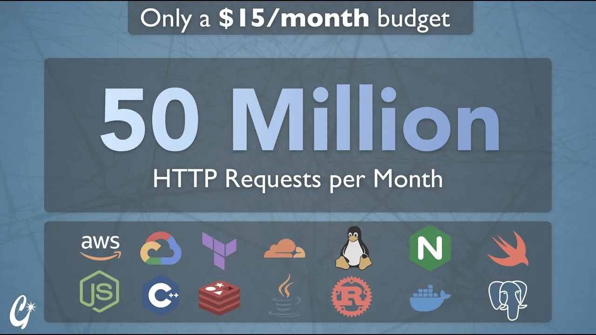](50-million-http-requests-month-15-budget-first-2-hours/README.md) | [50 Million HTTP Requests/Month ($15 Budget) &#91;First 2 Hours&#93;](50-million-http-requests-month-15-budget-first-2-hours/README.md) Deploying real applications on a small AWS budget. [Watch on YouTube](https://www.youtube.com/watch?v=wL3maSWEoh8) | Cododev | 2:26:15 |
| [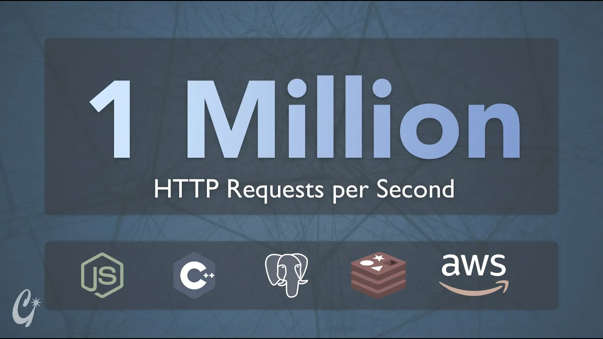](let-s-handle-1-million-requests-per-second-it-s-scarier/README.md) | [Let&#x27;s Handle 1 Million Requests per Second, It&#x27;s Scarier Than You Think!](let-s-handle-1-million-requests-per-second-it-s-scarier/README.md) Load testing and handling high request throughput. [Watch on YouTube](https://www.youtube.com/watch?v=W4EwfEU8CGA) | Cododev | 2:39:18 |
| [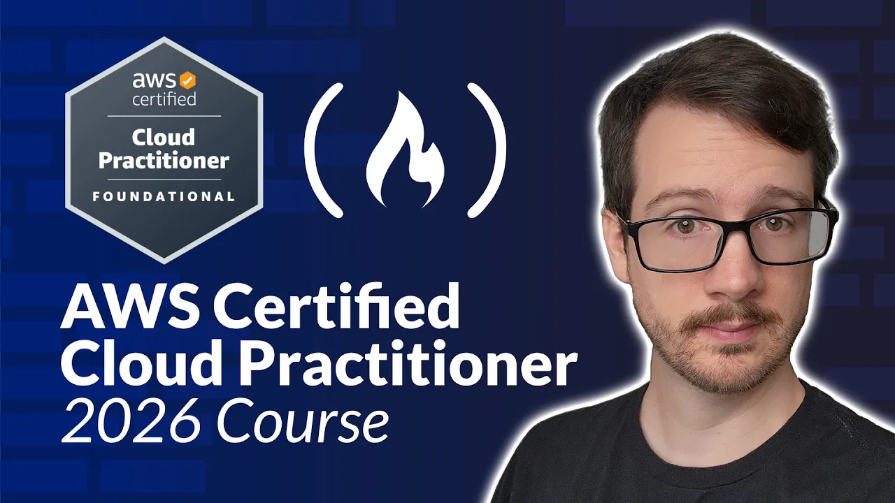](aws-certified-cloud-practitioner-certification-course-2026/README.md) | [AWS Certified Cloud Practitioner Certification Course 2026 (CLF-C02) - Pass the Exam!](aws-certified-cloud-practitioner-certification-course-2026/README.md) Full CLF-C02 course with AWS services, labs, and exam preparation. [Watch on YouTube](https://www.youtube.com/watch?v=7HKot-brXFE) | freeCodeCamp.org | 13:46:27 |

[Back to contents](#contents)

## Engineering careers and interviews

| Cover | Video and notes | Channel | Duration |
| --- | --- | --- | --- |
| [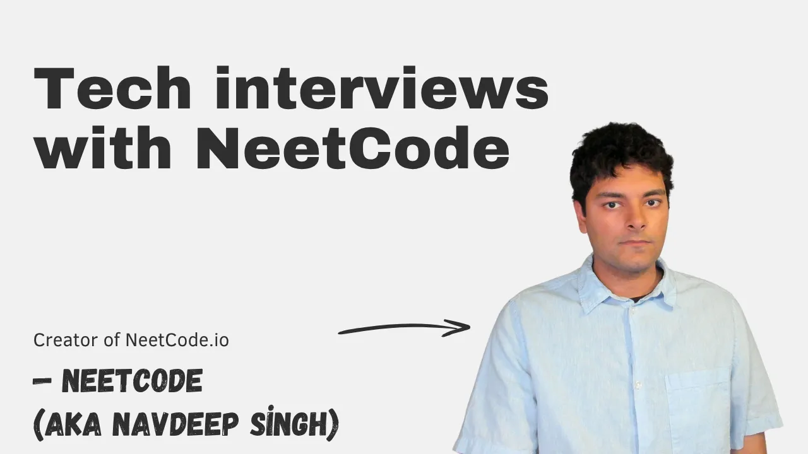](tech-interviews-with-neetcode/README.md) | [Tech interviews with NeetCode](tech-interviews-with-neetcode/README.md) Coding interviews, engineering judgment, and career decisions. [Watch on YouTube](https://www.youtube.com/watch?v=xafwfGVBxos) | The Pragmatic Engineer | 1:29:56 |
| [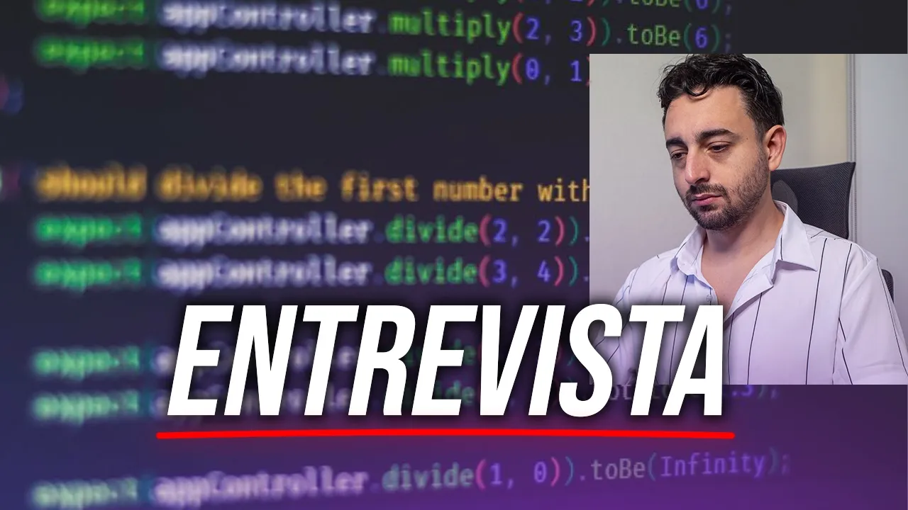](el-error-que-te-descarta-en-una-entrevista-tecnica/README.md) | [EL ERROR que TE DESCARTA en una Entrevista Técnica](el-error-que-te-descarta-en-una-entrevista-tecnica/README.md) Interview formats, preparation, and explaining your reasoning. [Watch on YouTube](https://www.youtube.com/watch?v=rkm5mAymtg4) | Yari Taft | 20:10 |
|  | [Trabajó en Google, Facebook y YouTube: Hablando con Ingeniero de Silicon Valley 🔴](trabajo-en-google-facebook-y-youtube-hablando-con-ingeniero/README.md) Big Tech careers, interviews, English, and international opportunities. [Watch on YouTube](https://www.youtube.com/watch?v=CclzcMfDQfs) | diegoveloper | 2:18:40 |
| [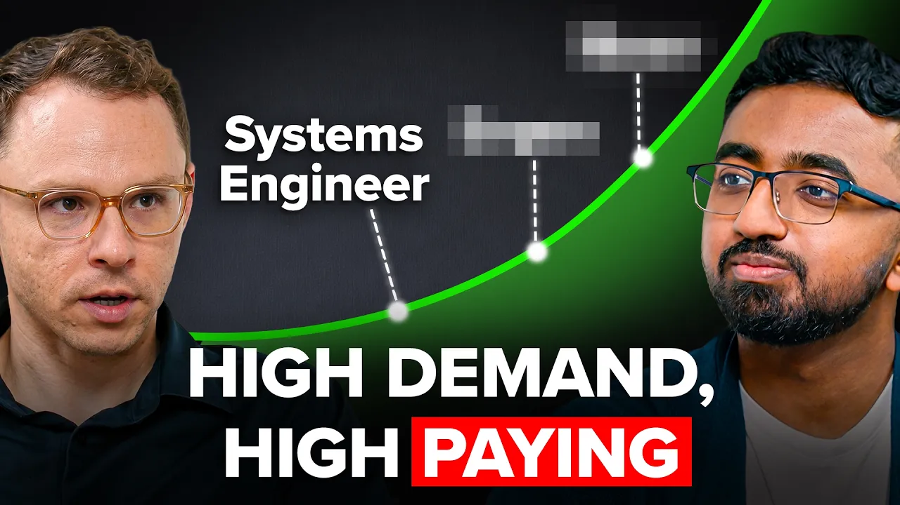](stanford-ai-expert-these-3-jobs-will-explode-in-the-next-5/README.md) | [Stanford AI Expert: These 3 Jobs Will EXPLODE in the Next 5 Years!](stanford-ai-expert-these-3-jobs-will-explode-in-the-next-5/README.md) How AI changes engineering roles and the skills to develop. [Watch on YouTube](https://www.youtube.com/watch?v=Ci7ZDQ3m8cc) | Sajjaad Khader | 13:50 |
| [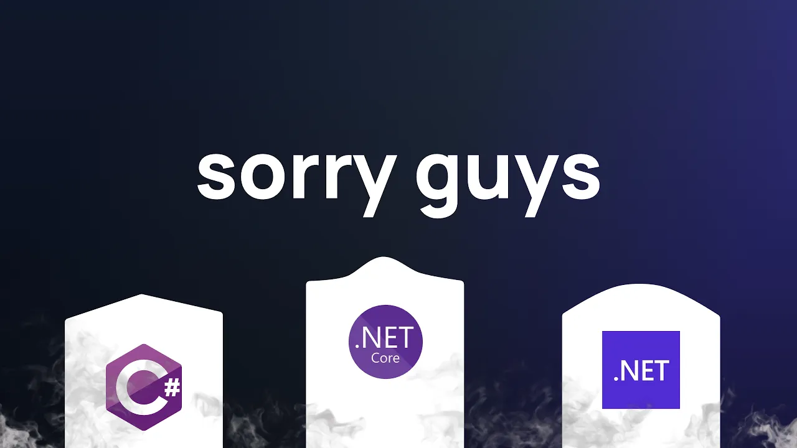](should-you-learn-net-c-in-2026/README.md) | [should you learn .NET &amp; C# in 2026](should-you-learn-net-c-in-2026/README.md) The value of framework expertise as coding agents improve. [Watch on YouTube](https://www.youtube.com/watch?v=SCXhmMbbh6g) | Amichai Mantinband | 15:34 |
| [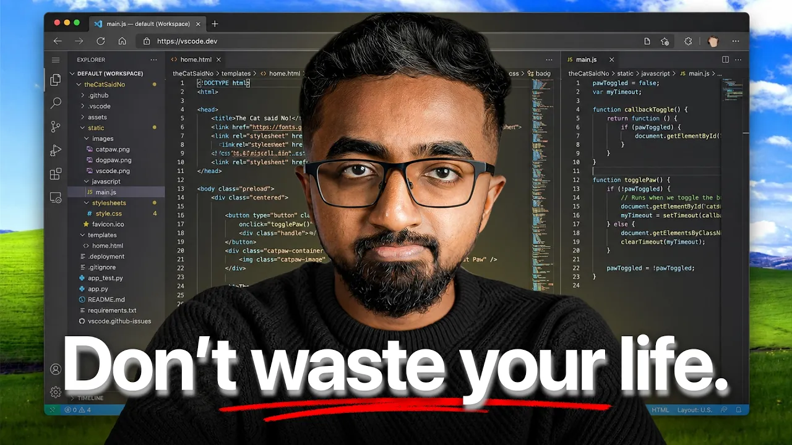](the-art-of-winning-in-tech/README.md) | [The Art of Winning in Tech](the-art-of-winning-in-tech/README.md) Learning from experts, sharing work, and automating repetitive tasks. [Watch on YouTube](https://www.youtube.com/watch?v=j7vSphawXyY) | Sajjaad Khader | 11:30 |

[Back to contents](#contents)

## Business and technology conversations

| Cover | Video and notes | Channel | Duration |
| --- | --- | --- | --- |
|  | [&quot;Hackean&quot; BITCOIN, ESPAÑA es un ESTADO FALLIDO y el NEGOCIO de la TERCERA EDAD #149](hackean-bitcoin-espana-es-un-estado-fallido-y-el-negocio-de/README.md) Bitcoin, business, economics, and current affairs. Episode 149. [Watch on YouTube](https://www.youtube.com/watch?v=JmPxIbLrb5c) | spicy4tuna | 2:01:42 |
|  | [El NEGOCIO de la MUERTE, Método TOYOTA y cómo CONSEGUIR TRABAJO sin CV #150](el-negocio-de-la-muerte-metodo-toyota-y-como-conseguir/README.md) Business models, Toyota, entrepreneurship, and finding work. Episode 150. [Watch on YouTube](https://www.youtube.com/watch?v=t5_M1iFwXbY) | spicy4tuna | 2:10:10 |

[Back to contents](#contents)

## Course collections

Lessons follow the order in each collection. Open a course overview for its reading guide and topic map.

### LLM evaluation course

Evidently AI’s course on datasets, evaluation methods, LLM judges, safety, RAG, agents, and production monitoring.

[Open course overview](llm-evaluation-course/README.md) · 13 lessons

| Cover | Lesson and notes | Channel | Duration |
| --- | --- | --- | --- |
| [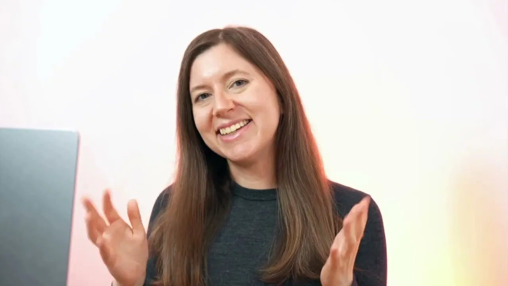](llm-evaluation-course/01-welcome-to-the-llm-evaluation-course/README.md) | [Welcome to the LLM evaluation course](llm-evaluation-course/01-welcome-to-the-llm-evaluation-course/README.md) [Watch on YouTube](https://www.youtube.com/watch?v=rHs0sP7b5fM) | Evidently AI | 1:31 |
| [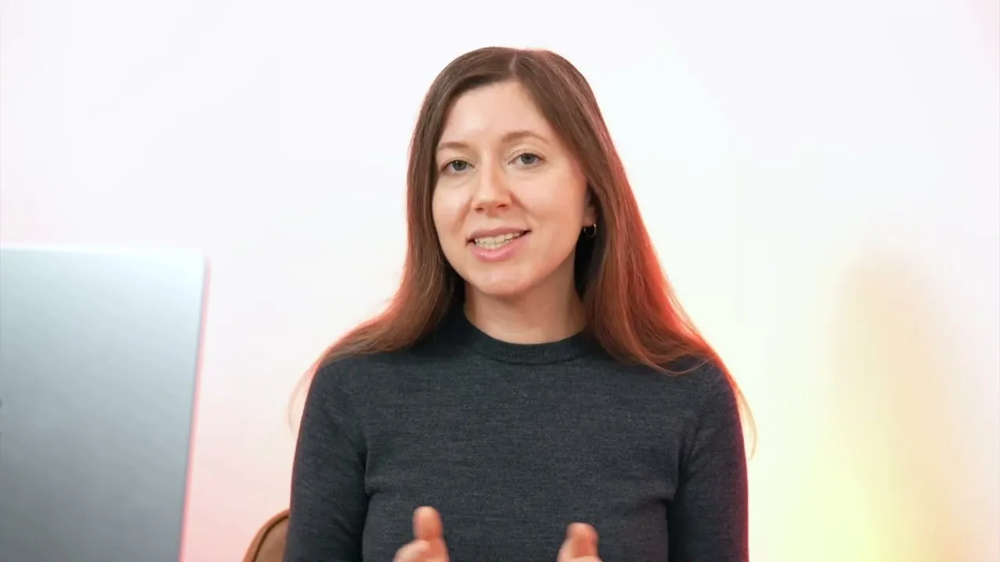](llm-evaluation-course/02-what-is-an-llm-powered-product/README.md) | [What is an LLM-powered product?](llm-evaluation-course/02-what-is-an-llm-powered-product/README.md) [Watch on YouTube](https://www.youtube.com/watch?v=B7fl6He1lxM) | Evidently AI | 3:07 |
| [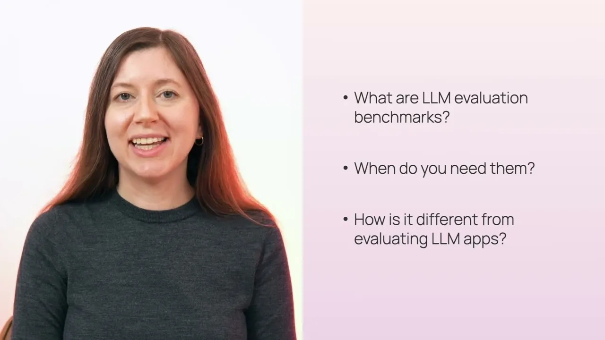](llm-evaluation-course/03-llm-evaluation-benchmarks/README.md) | [LLM evaluation benchmarks](llm-evaluation-course/03-llm-evaluation-benchmarks/README.md) [Watch on YouTube](https://www.youtube.com/watch?v=32zkohJICgc) | Evidently AI | 3:06 |
| [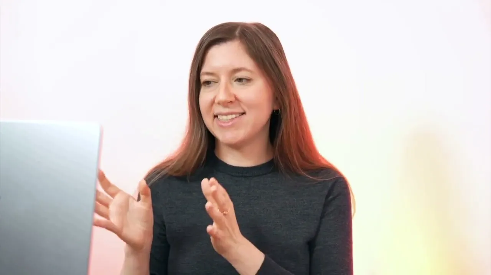](llm-evaluation-course/04-how-to-evaluate-an-llm-application/README.md) | [How to evaluate an LLM application](llm-evaluation-course/04-how-to-evaluate-an-llm-application/README.md) [Watch on YouTube](https://www.youtube.com/watch?v=RIGU1hy3UR8) | Evidently AI | 5:59 |
| [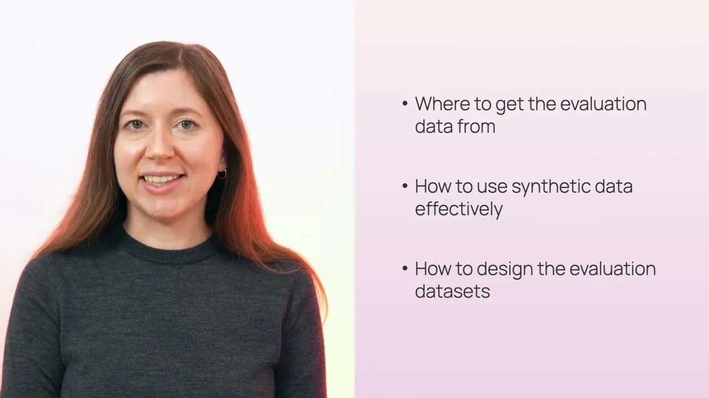](llm-evaluation-course/05-llm-evaluation-datasets-test-cases-and-synthetic-data/README.md) | [LLM evaluation datasets: test cases and synthetic data](llm-evaluation-course/05-llm-evaluation-datasets-test-cases-and-synthetic-data/README.md) [Watch on YouTube](https://www.youtube.com/watch?v=Do6KAkutKbc) | Evidently AI | 6:06 |
| [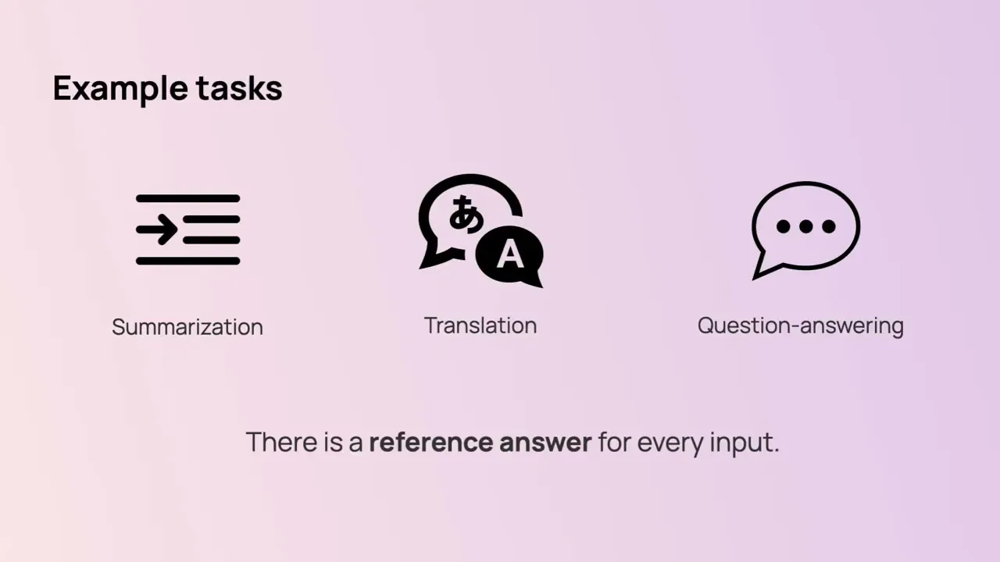](llm-evaluation-course/06-llm-evaluation-methods-and-metrics/README.md) | [LLM evaluation methods and metrics](llm-evaluation-course/06-llm-evaluation-methods-and-metrics/README.md) [Watch on YouTube](https://www.youtube.com/watch?v=6eOcgYP5D4Q) | Evidently AI | 5:09 |
| [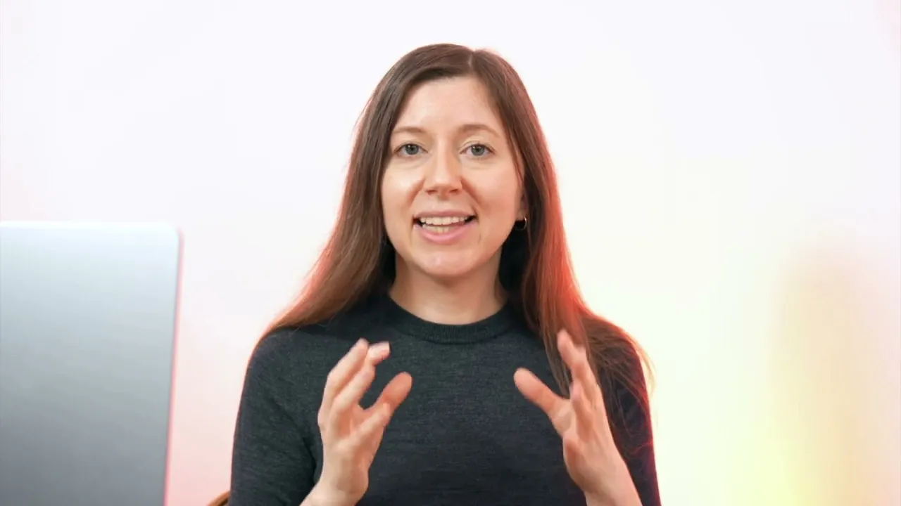](llm-evaluation-course/07-llm-as-a-judge-evaluating-llms-with-llms/README.md) | [LLM-as-a-judge: evaluating LLMs with LLMs](llm-evaluation-course/07-llm-as-a-judge-evaluating-llms-with-llms/README.md) [Watch on YouTube](https://www.youtube.com/watch?v=Qj3u_kzfJVo) | Evidently AI | 5:41 |
| [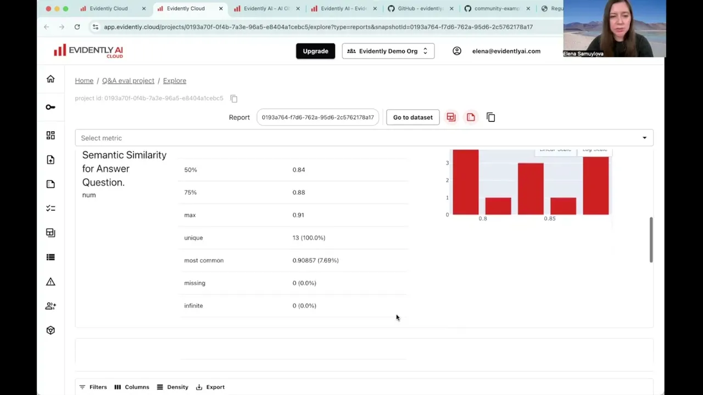](llm-evaluation-course/08-how-to-run-llm-evals-with-no-code-practice/README.md) | [How to run LLM evals with no code &#124; PRACTICE](llm-evaluation-course/08-how-to-run-llm-evals-with-no-code-practice/README.md) [Watch on YouTube](https://www.youtube.com/watch?v=gKp9K7Etv4A) | Evidently AI | 12:27 |
| [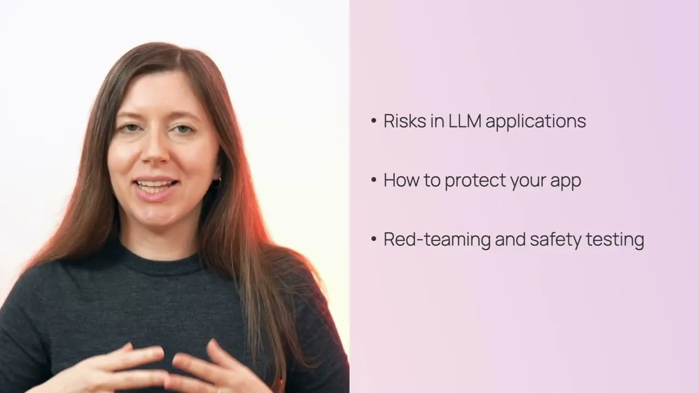](llm-evaluation-course/09-llm-safety-and-red-teaming/README.md) | [LLM safety and red-teaming](llm-evaluation-course/09-llm-safety-and-red-teaming/README.md) [Watch on YouTube](https://www.youtube.com/watch?v=XZZ6glt0AMA) | Evidently AI | 5:11 |
| [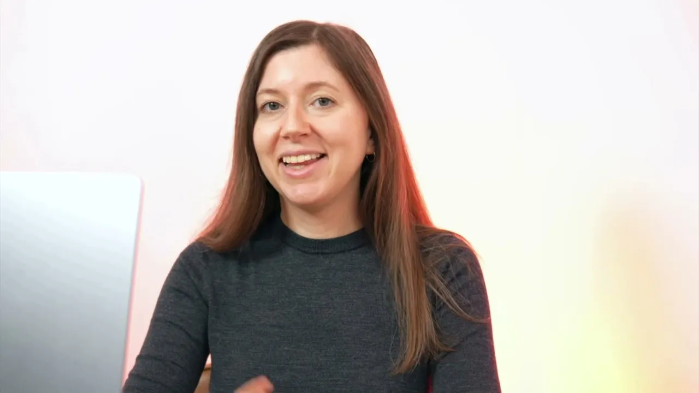](llm-evaluation-course/10-llm-observability-in-production-tracing-and-online-evals/README.md) | [LLM observability in production: tracing and online evals](llm-evaluation-course/10-llm-observability-in-production-tracing-and-online-evals/README.md) [Watch on YouTube](https://www.youtube.com/watch?v=r-CYvjJ-W3k) | Evidently AI | 5:08 |
| [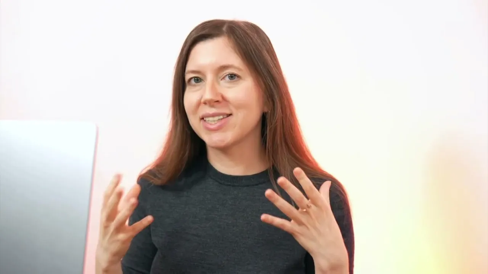](llm-evaluation-course/11-ai-agent-and-rag-evaluation/README.md) | [AI agent and RAG evaluation](llm-evaluation-course/11-ai-agent-and-rag-evaluation/README.md) [Watch on YouTube](https://www.youtube.com/watch?v=6EtqsMcEhaw) | Evidently AI | 6:04 |
| [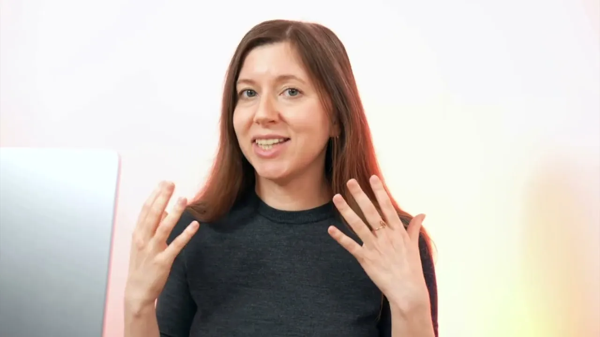](llm-evaluation-course/12-a-business-case-for-llm-evaluations/README.md) | [A business case for LLM evaluations](llm-evaluation-course/12-a-business-case-for-llm-evaluations/README.md) [Watch on YouTube](https://www.youtube.com/watch?v=ZaOo2dce20A) | Evidently AI | 4:05 |
| [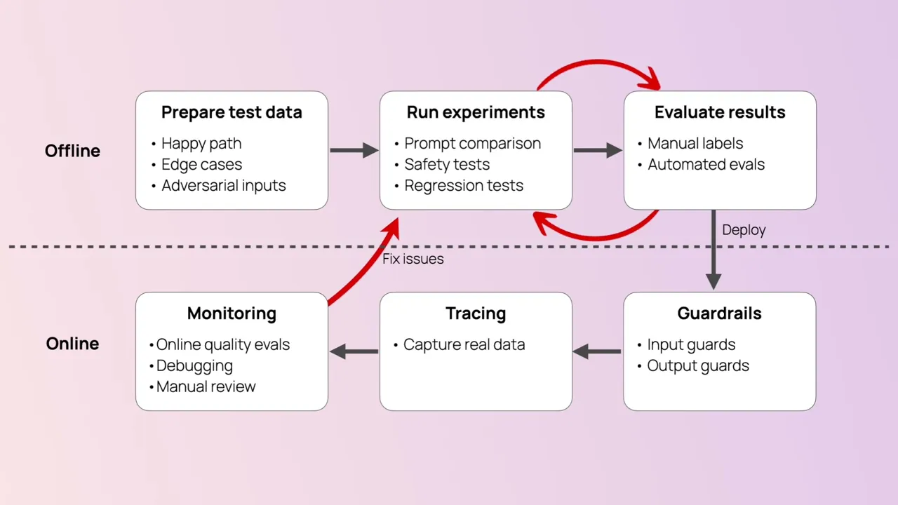](llm-evaluation-course/13-how-to-continuously-improve-llm-products/README.md) | [How to continuously improve LLM products?](llm-evaluation-course/13-how-to-continuously-improve-llm-products/README.md) [Watch on YouTube](https://www.youtube.com/watch?v=x9mfMkBWwCY) | Evidently AI | 2:33 |

[Back to contents](#contents)

### CMU intro to database systems

CMU Database Group’s Fall 2024 course on DBMS internals, storage, indexes, query execution, transactions, recovery, and distribution.

[Open course overview](cmu-intro-to-database-systems-15-445-645-fall-2024/README.md) · 26 lessons

| Cover | Lesson and notes | Channel | Duration |
| --- | --- | --- | --- |
| [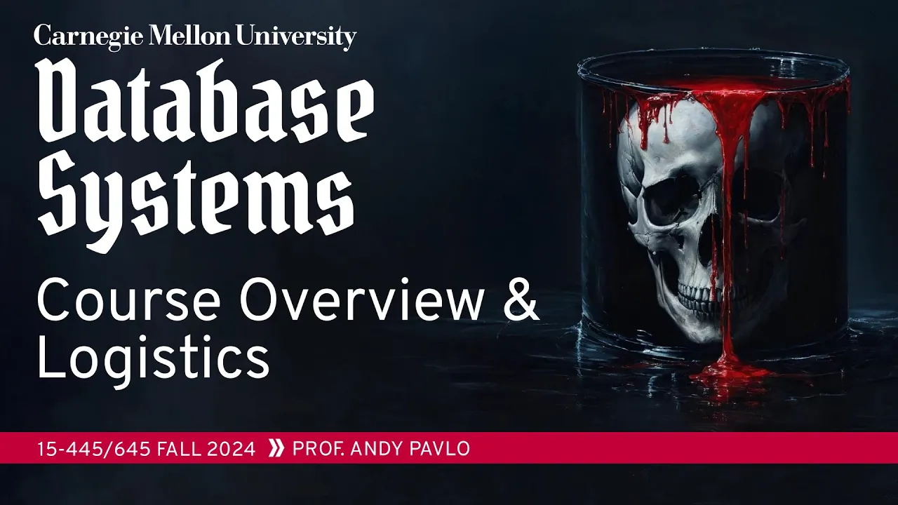](cmu-intro-to-database-systems-15-445-645-fall-2024/01-00-course-overview-logistics-cmu-intro-to-database-systems/README.md) | [#00 - Course Overview &amp; Logistics (CMU Intro to Database Systems)](cmu-intro-to-database-systems-15-445-645-fall-2024/01-00-course-overview-logistics-cmu-intro-to-database-systems/README.md) [Watch on YouTube](https://www.youtube.com/watch?v=otE2WvX3XdQ) | CMU Database Group | 21:20 |
| [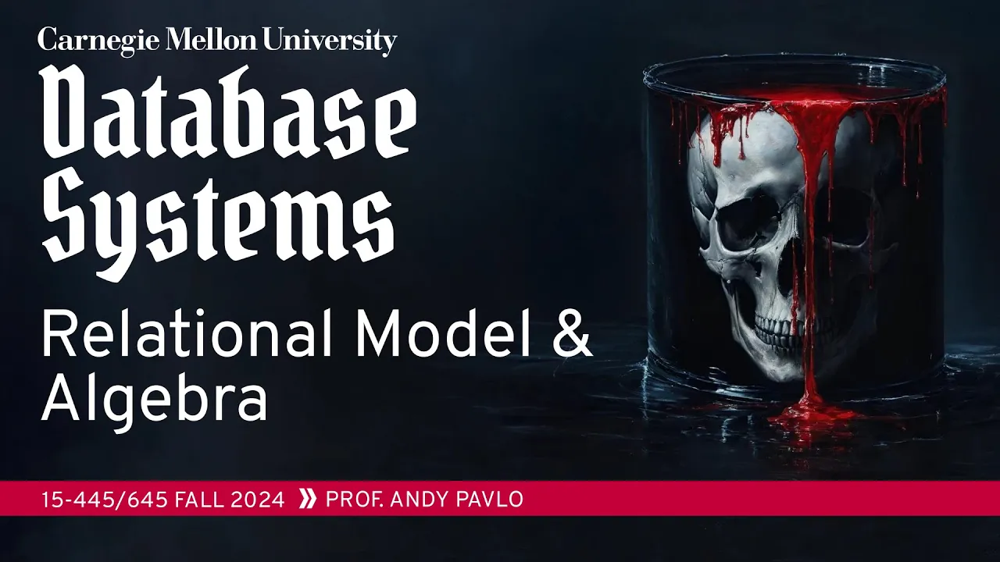](cmu-intro-to-database-systems-15-445-645-fall-2024/02-01-relational-model-algebra-cmu-intro-to-database-systems/README.md) | [#01 - Relational Model &amp; Algebra (CMU Intro to Database Systems)](cmu-intro-to-database-systems-15-445-645-fall-2024/02-01-relational-model-algebra-cmu-intro-to-database-systems/README.md) [Watch on YouTube](https://www.youtube.com/watch?v=APqWIjtzNGE) | CMU Database Group | 1:23:38 |
| [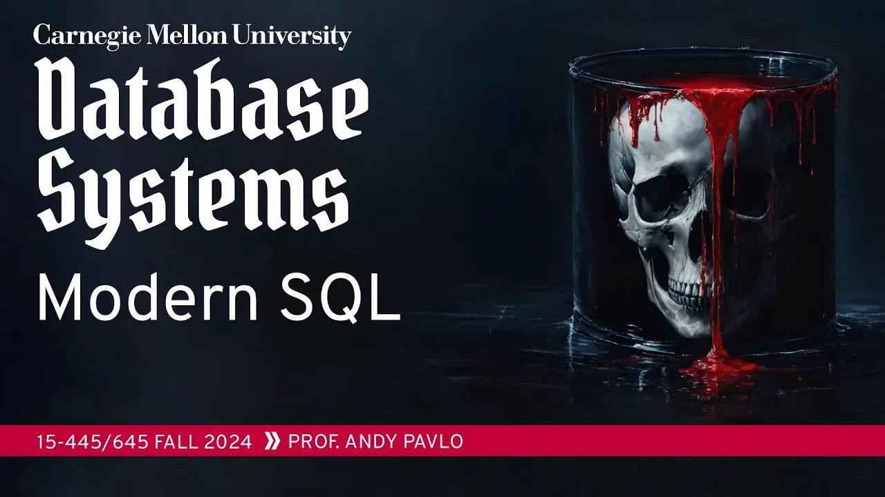](cmu-intro-to-database-systems-15-445-645-fall-2024/03-02-modern-sql-cmu-intro-to-database-systems/README.md) | [#02 - Modern SQL (CMU Intro to Database Systems)](cmu-intro-to-database-systems-15-445-645-fall-2024/03-02-modern-sql-cmu-intro-to-database-systems/README.md) [Watch on YouTube](https://www.youtube.com/watch?v=MzigBKf84aY) | CMU Database Group | 1:18:44 |
| [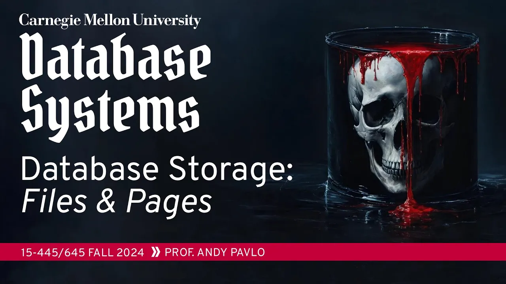](cmu-intro-to-database-systems-15-445-645-fall-2024/04-03-database-storage-files-pages-neon-database-talk-cmu/README.md) | [#03 - Database Storage: Files &amp; Pages ✸ Neon Database Talk (CMU Intro to Database Systems)](cmu-intro-to-database-systems-15-445-645-fall-2024/04-03-database-storage-files-pages-neon-database-talk-cmu/README.md) [Watch on YouTube](https://www.youtube.com/watch?v=dSxV5Sob5V8) | CMU Database Group | 1:22:27 |
| [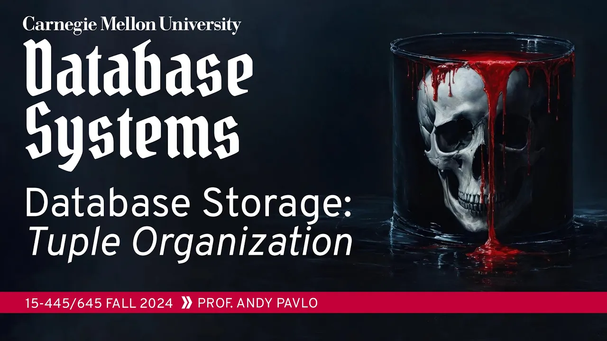](cmu-intro-to-database-systems-15-445-645-fall-2024/05-04-database-storage-log-structured-merge-trees-tuples-cmu/README.md) | [#04 - Database Storage: Log-Structured Merge Trees &amp; Tuples (CMU Intro to Database Systems)](cmu-intro-to-database-systems-15-445-645-fall-2024/05-04-database-storage-log-structured-merge-trees-tuples-cmu/README.md) [Watch on YouTube](https://www.youtube.com/watch?v=IHtVWGhG0Xg) | CMU Database Group | 1:22:41 |
| [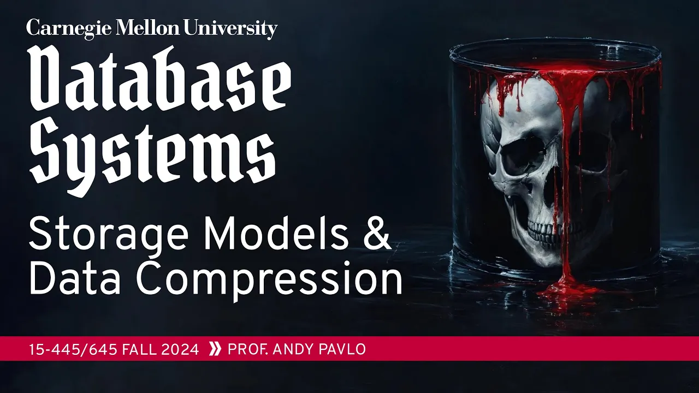](cmu-intro-to-database-systems-15-445-645-fall-2024/06-05-row-vs-column-storage-compression-startree-database-talk/README.md) | [#05 - Row vs. Column Storage + Compression ✸ StarTree Database Talk (CMU Intro to Database Systems)](cmu-intro-to-database-systems-15-445-645-fall-2024/06-05-row-vs-column-storage-compression-startree-database-talk/README.md) [Watch on YouTube](https://www.youtube.com/watch?v=nhlpwmOBEiE) | CMU Database Group | 1:28:00 |
| [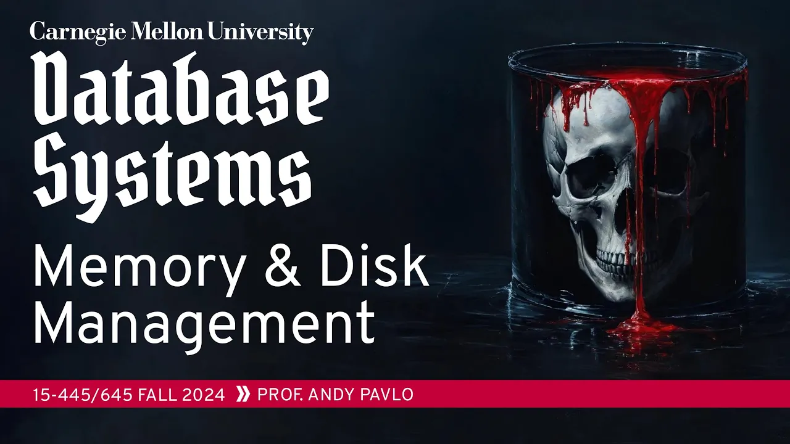](cmu-intro-to-database-systems-15-445-645-fall-2024/07-06-memory-disk-i-o-management-cmu-intro-to-database-systems/README.md) | [#06 - Memory &amp; Disk I/O Management (CMU Intro to Database Systems)](cmu-intro-to-database-systems-15-445-645-fall-2024/07-06-memory-disk-i-o-management-cmu-intro-to-database-systems/README.md) [Watch on YouTube](https://www.youtube.com/watch?v=aoewwZwVmv4) | CMU Database Group | 1:23:56 |
| [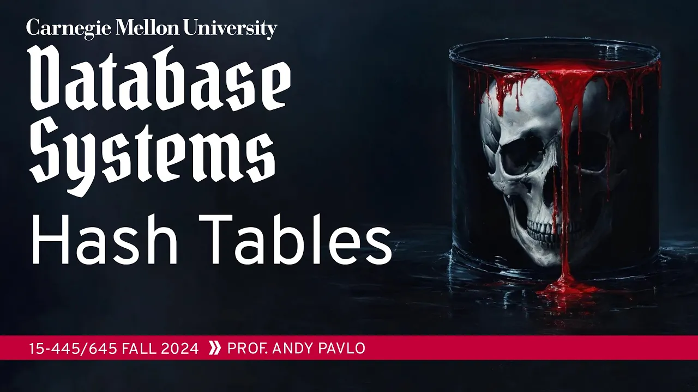](cmu-intro-to-database-systems-15-445-645-fall-2024/08-07-hash-tables-relationalai-database-talk-cmu-intro-to/README.md) | [#07 - Hash Tables ✸ RelationalAI Database Talk (CMU Intro to Database Systems)](cmu-intro-to-database-systems-15-445-645-fall-2024/08-07-hash-tables-relationalai-database-talk-cmu-intro-to/README.md) [Watch on YouTube](https://www.youtube.com/watch?v=VkP_yLM5KBU) | CMU Database Group | 1:23:43 |
| [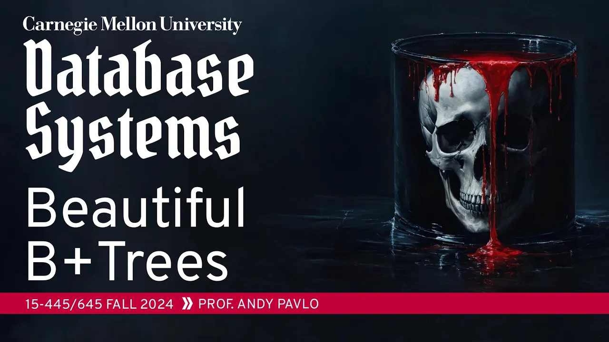](cmu-intro-to-database-systems-15-445-645-fall-2024/09-08-tree-indexes-b-trees-cmu-intro-to-database-systems/README.md) | [#08 - Tree Indexes: B+Trees (CMU Intro to Database Systems)](cmu-intro-to-database-systems-15-445-645-fall-2024/09-08-tree-indexes-b-trees-cmu-intro-to-database-systems/README.md) [Watch on YouTube](https://www.youtube.com/watch?v=scUtG_6M_lU) | CMU Database Group | 1:22:14 |
| [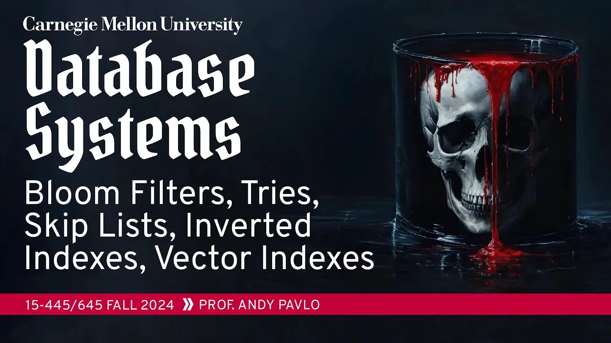](cmu-intro-to-database-systems-15-445-645-fall-2024/10-09-vector-indexes-inverted-indexes-filters-tries-tidb-talk/README.md) | [#09 - Vector Indexes, Inverted Indexes, Filters, Tries ✸ TiDB Talk (CMU Intro to Database Systems)](cmu-intro-to-database-systems-15-445-645-fall-2024/10-09-vector-indexes-inverted-indexes-filters-tries-tidb-talk/README.md) [Watch on YouTube](https://www.youtube.com/watch?v=foMMYyycRgk) | CMU Database Group | 1:21:10 |
| [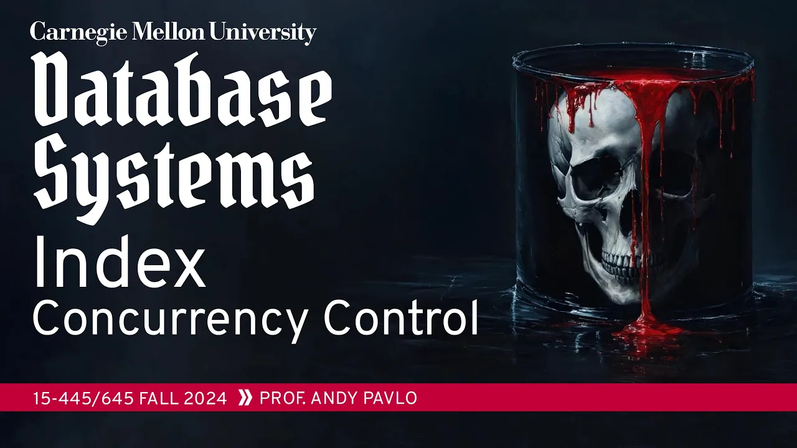](cmu-intro-to-database-systems-15-445-645-fall-2024/11-10-index-concurrency-control-cmu-intro-to-database-systems/README.md) | [#10 - Index Concurrency Control (CMU Intro to Database Systems)](cmu-intro-to-database-systems-15-445-645-fall-2024/11-10-index-concurrency-control-cmu-intro-to-database-systems/README.md) [Watch on YouTube](https://www.youtube.com/watch?v=lgUNTj0Q54M) | CMU Database Group | 1:16:42 |
| [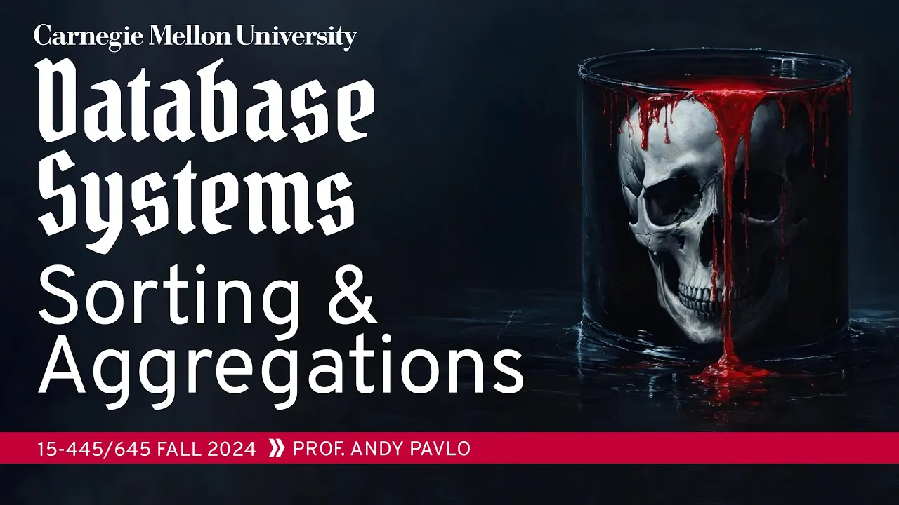](cmu-intro-to-database-systems-15-445-645-fall-2024/12-11-sorting-aggregation-algorithms-dbt-database-talk-cmu/README.md) | [#11 - Sorting &amp; Aggregation Algorithms ✸ dbt Database Talk (CMU Intro to Database Systems)](cmu-intro-to-database-systems-15-445-645-fall-2024/12-11-sorting-aggregation-algorithms-dbt-database-talk-cmu/README.md) [Watch on YouTube](https://www.youtube.com/watch?v=mM3sFwSuGNY) | CMU Database Group | 1:17:56 |
| [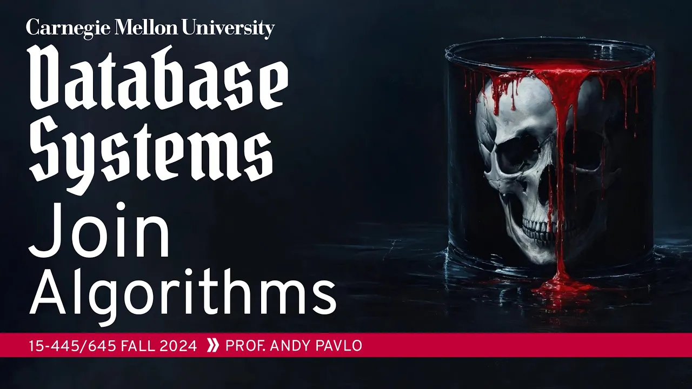](cmu-intro-to-database-systems-15-445-645-fall-2024/13-12-join-algorithms-hash-sort-merge-nested-loop-joins-cmu/README.md) | [#12 - Join Algorithms: Hash, Sort-Merge, Nested Loop Joins (CMU Intro to Database Systems)](cmu-intro-to-database-systems-15-445-645-fall-2024/13-12-join-algorithms-hash-sort-merge-nested-loop-joins-cmu/README.md) [Watch on YouTube](https://www.youtube.com/watch?v=MFazkaZKs1s) | CMU Database Group | 1:14:22 |
|  | [#13 - Query Execution Part 1 (CMU Intro to Database Systems)](cmu-intro-to-database-systems-15-445-645-fall-2024/14-13-query-execution-part-1-cmu-intro-to-database-systems/README.md) [Watch on YouTube](https://www.youtube.com/watch?v=HNtlew7mCc4) | CMU Database Group | 1:23:19 |
| [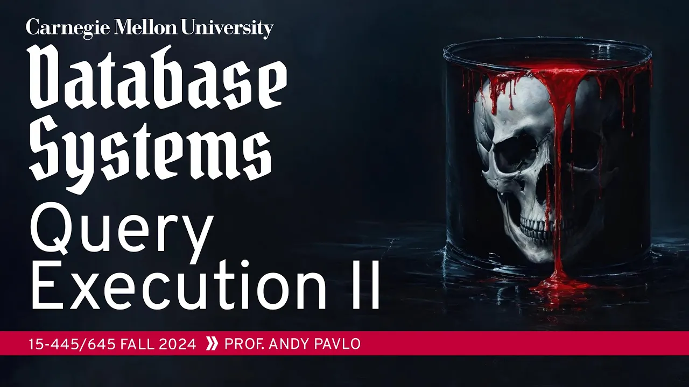](cmu-intro-to-database-systems-15-445-645-fall-2024/15-14-query-execution-part-2-clickhouse-database-talk-cmu/README.md) | [#14 - Query Execution Part 2 ✸ ClickHouse Database Talk (CMU Intro to Database Systems)](cmu-intro-to-database-systems-15-445-645-fall-2024/15-14-query-execution-part-2-clickhouse-database-talk-cmu/README.md) [Watch on YouTube](https://www.youtube.com/watch?v=Vy2t_wZx4Is) | CMU Database Group | 1:02:49 |
| [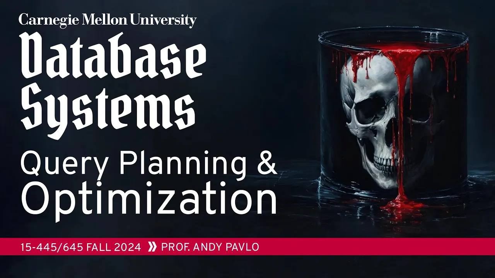](cmu-intro-to-database-systems-15-445-645-fall-2024/16-15-query-planning-optimization-cmu-intro-to-database-systems/README.md) | [#15 - Query Planning &amp; Optimization (CMU Intro to Database Systems)](cmu-intro-to-database-systems-15-445-645-fall-2024/16-15-query-planning-optimization-cmu-intro-to-database-systems/README.md) [Watch on YouTube](https://www.youtube.com/watch?v=X8EHO8VLeG0) | CMU Database Group | 1:21:18 |
|  | [#16 - Concurrency Control Theory ✸ Firebolt Database Talk (CMU Intro to Database Systems)](cmu-intro-to-database-systems-15-445-645-fall-2024/17-16-concurrency-control-theory-firebolt-database-talk-cmu/README.md) [Watch on YouTube](https://www.youtube.com/watch?v=4y656idl8ZU) | CMU Database Group | 1:27:09 |
|  | [#17 - Two-Phase Locking Concurrency Control (CMU Intro to Database Systems)](cmu-intro-to-database-systems-15-445-645-fall-2024/18-17-two-phase-locking-concurrency-control-cmu-intro-to/README.md) [Watch on YouTube](https://www.youtube.com/watch?v=bXpkEt5P_Js) | CMU Database Group | 1:05:22 |
|  | [#18 - Optimistic Concurrency Control ✸ Weaviate Database Talk (CMU Intro to Database Systems)](cmu-intro-to-database-systems-15-445-645-fall-2024/19-18-optimistic-concurrency-control-weaviate-database-talk/README.md) [Watch on YouTube](https://www.youtube.com/watch?v=-TA0QIwFUnU) | CMU Database Group | 1:20:53 |
|  | [#19 - Multi-Version Concurrency Control (CMU Intro to Database Systems)](cmu-intro-to-database-systems-15-445-645-fall-2024/20-19-multi-version-concurrency-control-cmu-intro-to-database/README.md) [Watch on YouTube](https://www.youtube.com/watch?v=niLwbfE3V9Q) | CMU Database Group | 1:27:07 |
|  | [#20 - Database Logging ✸ Confluent Database Talk (CMU Intro to Database Systems)](cmu-intro-to-database-systems-15-445-645-fall-2024/21-20-database-logging-confluent-database-talk-cmu-intro-to/README.md) [Watch on YouTube](https://www.youtube.com/watch?v=mbelzgz-97s) | CMU Database Group | 1:19:21 |
|  | [#21 - Database Recovery with ARIES (CMU Intro to Database Systems)](cmu-intro-to-database-systems-15-445-645-fall-2024/22-21-database-recovery-with-aries-cmu-intro-to-database/README.md) [Watch on YouTube](https://www.youtube.com/watch?v=yVpzHdAP0TY) | CMU Database Group | 1:12:55 |
|  | [#22 - Distributed Database Architectures ✸ DataStax Database Talk (CMU Intro to Database Systems)](cmu-intro-to-database-systems-15-445-645-fall-2024/23-22-distributed-database-architectures-datastax-database/README.md) [Watch on YouTube](https://www.youtube.com/watch?v=o7bjRUcDMx0) | CMU Database Group | 1:23:02 |
|  | [#23 - Distributed Transactional Databases (CMU Intro to Database Systems)](cmu-intro-to-database-systems-15-445-645-fall-2024/24-23-distributed-transactional-databases-cmu-intro-to/README.md) [Watch on YouTube](https://www.youtube.com/watch?v=3wNmpE6DsSs) | CMU Database Group | 1:24:53 |
|  | [#24 - Distributed Analytical Databases (CMU Intro to Database Systems)](cmu-intro-to-database-systems-15-445-645-fall-2024/25-24-distributed-analytical-databases-cmu-intro-to-database/README.md) [Watch on YouTube](https://www.youtube.com/watch?v=L6E75IyBgpk) | CMU Database Group | 1:22:55 |
|  | [#25 - BigQuery + Snowflake + Redshift + Databricks + DuckDB (CMU Intro to Database Systems)](cmu-intro-to-database-systems-15-445-645-fall-2024/26-25-bigquery-snowflake-redshift-databricks-duckdb-cmu-intro/README.md) [Watch on YouTube](https://www.youtube.com/watch?v=fr5lIchF6pw) | CMU Database Group | 1:25:57 |

[Back to contents](#contents)

### Harvard advanced algorithms

Harvard University’s COMPSCI 224 with Jelani Nelson, covering data structures, online and approximation algorithms, linear programming, flow, and streaming.

[Open course overview](advanced-algorithms-compsci-224/README.md) · 24 lessons

| Cover | Lesson and notes | Channel | Duration |
| --- | --- | --- | --- |
|  | [Advanced Algorithms (COMPSCI 224), Lecture 1](advanced-algorithms-compsci-224/01-advanced-algorithms-compsci-224-lecture-1/README.md) [Watch on YouTube](https://www.youtube.com/watch?v=0JUN9aDxVmI) | Harvard University | 1:28:19 |
|  | [Advanced Algorithms (COMPSCI 224), Lecture 2](advanced-algorithms-compsci-224/02-advanced-algorithms-compsci-224-lecture-2/README.md) [Watch on YouTube](https://www.youtube.com/watch?v=3_o0-zPRQqw) | Harvard University | 1:25:39 |
|  | [Advanced Algorithms (COMPSCI 224), Lecture 3](advanced-algorithms-compsci-224/03-advanced-algorithms-compsci-224-lecture-3/README.md) [Watch on YouTube](https://www.youtube.com/watch?v=WqBc0ZCU4Uw) | Harvard University | 1:28:46 |
|  | [Advanced Algorithms (COMPSCI 224), Lecture 4](advanced-algorithms-compsci-224/04-advanced-algorithms-compsci-224-lecture-4/README.md) [Watch on YouTube](https://www.youtube.com/watch?v=edOWKZE1t84) | Harvard University | 1:27:51 |
|  | [Advanced Algorithms (COMPSCI 224), Lecture 5](advanced-algorithms-compsci-224/05-advanced-algorithms-compsci-224-lecture-5/README.md) [Watch on YouTube](https://www.youtube.com/watch?v=rLMikQTOVnI) | Harvard University | 1:21:37 |
|  | [Advanced Algorithms (COMPSCI 224), Lecture 6](advanced-algorithms-compsci-224/06-advanced-algorithms-compsci-224-lecture-6/README.md) [Watch on YouTube](https://www.youtube.com/watch?v=gxp_FrgTkQI) | Harvard University | 1:23:46 |
|  | [Advanced Algorithms (COMPSCI 224), Lecture 7](advanced-algorithms-compsci-224/07-advanced-algorithms-compsci-224-lecture-7/README.md) [Watch on YouTube](https://www.youtube.com/watch?v=LbX51mey3vo) | Harvard University | 1:26:46 |
|  | [Advanced Algorithms (COMPSCI 224), Lecture 8](advanced-algorithms-compsci-224/08-advanced-algorithms-compsci-224-lecture-8/README.md) [Watch on YouTube](https://www.youtube.com/watch?v=aHW6HKVC-SY) | Harvard University | 1:24:06 |
|  | [Advanced Algorithms (COMPSCI 224), Lecture 9](advanced-algorithms-compsci-224/09-advanced-algorithms-compsci-224-lecture-9/README.md) [Watch on YouTube](https://www.youtube.com/watch?v=KBVkri8k3Ao) | Harvard University | 1:24:56 |
|  | [Advanced Algorithms (COMPSCI 224), Lecture 10](advanced-algorithms-compsci-224/10-advanced-algorithms-compsci-224-lecture-10/README.md) [Watch on YouTube](https://www.youtube.com/watch?v=Jsg9TwLRTbM) | Harvard University | 1:24:33 |
|  | [Advanced Algorithms (COMPSCI 224), Lecture 11](advanced-algorithms-compsci-224/11-advanced-algorithms-compsci-224-lecture-11/README.md) [Watch on YouTube](https://www.youtube.com/watch?v=vnS9_NKoEKI) | Harvard University | 1:25:41 |
|  | [Advanced Algorithms (COMPSCI 224), Lecture 12](advanced-algorithms-compsci-224/12-advanced-algorithms-compsci-224-lecture-12/README.md) [Watch on YouTube](https://www.youtube.com/watch?v=2Gl-yNso0_0) | Harvard University | 1:25:04 |
|  | [Advanced Algorithms (COMPSCI 224), Lecture 13](advanced-algorithms-compsci-224/13-advanced-algorithms-compsci-224-lecture-13/README.md) [Watch on YouTube](https://www.youtube.com/watch?v=VuM1WnwEMRQ) | Harvard University | 1:21:46 |
|  | [Advanced Algorithms (COMPSCI 224), Lecture 15](advanced-algorithms-compsci-224/14-advanced-algorithms-compsci-224-lecture-15/README.md) [Watch on YouTube](https://www.youtube.com/watch?v=U7158Q-2rJc) | Harvard University | 1:26:13 |
|  | [Advanced Algorithms (COMPSCI 224), Lecture 16](advanced-algorithms-compsci-224/15-advanced-algorithms-compsci-224-lecture-16/README.md) [Watch on YouTube](https://www.youtube.com/watch?v=4A5LiJpPDRw) | Harvard University | 1:24:57 |
|  | [Advanced Algorithms (COMPSCI 224), Lecture 17](advanced-algorithms-compsci-224/16-advanced-algorithms-compsci-224-lecture-17/README.md) [Watch on YouTube](https://www.youtube.com/watch?v=PPCnYiTpbCo) | Harvard University | 1:26:44 |
|  | [Advanced Algorithms (COMPSCI 224), Lecture 18](advanced-algorithms-compsci-224/17-advanced-algorithms-compsci-224-lecture-18/README.md) [Watch on YouTube](https://www.youtube.com/watch?v=kqt1YV9dEoE) | Harvard University | 1:24:42 |
|  | [Advanced Algorithms (COMPSCI 224), Lecture 19](advanced-algorithms-compsci-224/18-advanced-algorithms-compsci-224-lecture-19/README.md) [Watch on YouTube](https://www.youtube.com/watch?v=R9mT5CtdHLg) | Harvard University | 1:21:33 |
|  | [Advanced Algorithms (COMPSCI 224), Lecture 20](advanced-algorithms-compsci-224/19-advanced-algorithms-compsci-224-lecture-20/README.md) [Watch on YouTube](https://www.youtube.com/watch?v=TdTFYVjzs1I) | Harvard University | 1:23:37 |
|  | [Advanced Algorithms (COMPSCI 224), Lecture 21](advanced-algorithms-compsci-224/20-advanced-algorithms-compsci-224-lecture-21/README.md) [Watch on YouTube](https://www.youtube.com/watch?v=rfTt7k6Nv-I) | Harvard University | 1:27:09 |
|  | [Advanced Algorithms (COMPSCI 224), Lecture 22](advanced-algorithms-compsci-224/21-advanced-algorithms-compsci-224-lecture-22/README.md) [Watch on YouTube](https://www.youtube.com/watch?v=HFqO_8Eoc1U) | Harvard University | 1:20:15 |
|  | [Advanced Algorithms (COMPSCI 224), Lecture 23](advanced-algorithms-compsci-224/22-advanced-algorithms-compsci-224-lecture-23/README.md) [Watch on YouTube](https://www.youtube.com/watch?v=nDLe6_sPSfs) | Harvard University | 1:26:46 |
|  | [Advanced Algorithms (COMPSCI 224), Lecture 25](advanced-algorithms-compsci-224/24-advanced-algorithms-compsci-224-lecture-25/README.md) [Watch on YouTube](https://www.youtube.com/watch?v=M42rQM0vC4g) | Harvard University | 1:26:14 |
|  | [Advanced Algorithms (COMPSCI 224), Lecture 26](advanced-algorithms-compsci-224/25-advanced-algorithms-compsci-224-lecture-26/README.md) [Watch on YouTube](https://www.youtube.com/watch?v=DpxNW0T8CWg) | Harvard University | 1:25:02 |

[Back to contents](#contents)

---

Thumbnails use local covers where available. The Kimi K3 thumbnail loads from YouTube and needs an internet connection.
