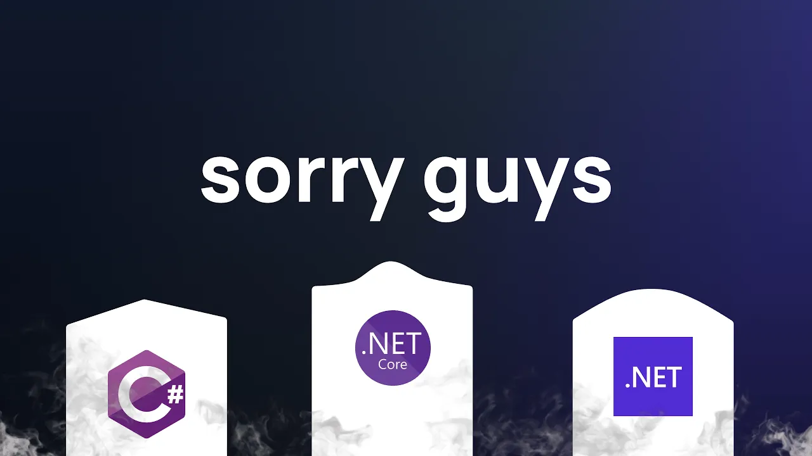
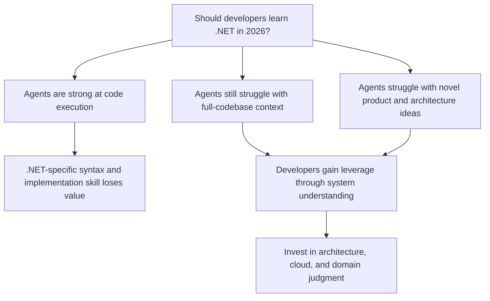

# should you learn .NET & C# in 2026

Amichai Mantinband argues that developers should not invest in becoming deeply specialized in .NET or C# purely for its own sake in 2026. The video frames that answer around what AI agents can already do well, what they still struggle with, and where human developers can retain leverage as software work moves up a level of abstraction.

1. [Context and framing](01-context-and-framing.md)
2. [What agents already do well](02-what-agents-already-do-well.md)
3. [Where agents still struggle](03-where-agents-still-struggle.md)
4. [Why .NET-specific expertise loses value](04-why-net-specific-expertise-loses-value.md)
5. [Where developers should invest instead](05-where-developers-should-invest-instead.md)

## Key takeaways

- The video's final answer is that developers should not aim to become highly proficient in .NET or C# in advance unless their current job specifically requires that depth. [`14:05`](https://www.youtube.com/watch?v=SCXhmMbbh6g&t=845) [`14:39`](https://www.youtube.com/watch?v=SCXhmMbbh6g&t=879)
- Mantinband's main reason is that AI agents are becoming very strong at writing code in any language, so language/framework-specific implementation work is becoming less important than deciding what should be built. [`1:49`](https://www.youtube.com/watch?v=SCXhmMbbh6g&t=109) [`7:57`](https://www.youtube.com/watch?v=SCXhmMbbh6g&t=477)
- He identifies large production codebase context as the clearest remaining human advantage, especially for codebases around 300,000+ lines where model context limits still matter. [`3:23`](https://www.youtube.com/watch?v=SCXhmMbbh6g&t=203) [`4:28`](https://www.youtube.com/watch?v=SCXhmMbbh6g&t=268)
- He expects agent vision and line-by-line code review limitations to improve quickly, so he does not see them as durable areas of developer leverage. [`4:57`](https://www.youtube.com/watch?v=SCXhmMbbh6g&t=297) [`6:19`](https://www.youtube.com/watch?v=SCXhmMbbh6g&t=379)
- The recommended career investment is software architecture, system interaction, cloud architecture, and job-specific low-level knowledge rather than general-purpose .NET specialization. [`14:05`](https://www.youtube.com/watch?v=SCXhmMbbh6g&t=845) [`14:39`](https://www.youtube.com/watch?v=SCXhmMbbh6g&t=879)
