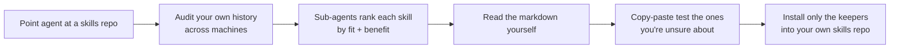

# 02 — How to approach a skill collection (the ground rules)

Theo front-loads the video with the meta-lesson, because he expects viewers to reflexively install everything.

## Rule 1 — Blind copying gets you nothing

- **"You do not get anything out of blindly copying other people's setups."** Treat these repos as *information to consider* while building your own system, not as a set of steps to follow ([`3:14`](https://www.youtube.com/watch?v=0oXOOlqVu5M&t=194)).
- The analogy he uses: copy-pasting his codebase and tweaking it makes you a bad engineer; using it as a reference point to build your own makes you a good one. Blindly installing someone's exact setup is "like paying a bunch of money for a code template" ([`3:39`](https://www.youtube.com/watch?v=0oXOOlqVu5M&t=219)).

## Rule 2 — Audit the skills against *your own* usage

Theo's actual entry point was a prompt, not an install command ([`4:04`](https://www.youtube.com/watch?v=0oXOOlqVu5M&t=244)):

- Ask the agent to **audit your usage across your machines** (his: MacBook, "Leftbook", and BB1) ([`4:24`](https://www.youtube.com/watch?v=0oXOOlqVu5M&t=264)).
- **Compare that history against the skills** in the collection.
- Ask for a **ranked list** of all skills by fit and by expected benefit, each with a brief "why".
- Instruct it to **pull history first, then fan out sub-agents** to do the auditing (he ran it all on Opus 5 because he had usage to burn) ([`4:24`](https://www.youtube.com/watch?v=0oXOOlqVu5M&t=264)).

The output was a document ranking every skill. The top hits for his work: **interrogate, blast radius, technical writing, arena, prove it** ([`4:45`](https://www.youtube.com/watch?v=0oXOOlqVu5M&t=285)). He later repeated the exact same exercise pointed at Matt Pocock's repo ([`13:07`](https://www.youtube.com/watch?v=0oXOOlqVu5M&t=787)).

## Rule 3 — Test a skill *before* installing it

- The easiest way to evaluate a skill is **not** to install it and hope. **Copy the markdown text, paste it into your agent, and ask for the behavior** ([`14:08`](https://www.youtube.com/watch?v=0oXOOlqVu5M&t=848), [`15:53`](https://www.youtube.com/watch?v=0oXOOlqVu5M&t=953)).
- He demonstrates this live: he pastes the grilling skill's text into an agent and gets the full behavior with nothing installed ([`16:19`](https://www.youtube.com/watch?v=0oXOOlqVu5M&t=979)).
- Caveat: this won't work for skills that ship scripts or other assets — but you can copy the script over, or just tell the model where to find and download it ([`16:19`](https://www.youtube.com/watch?v=0oXOOlqVu5M&t=979), [`16:53`](https://www.youtube.com/watch?v=0oXOOlqVu5M&t=1013)).

## Rule 4 — Manage your skills in one place

- Theo keeps all of his skill files in a personal repo called **`fleet`**, and does his skill work in a thread inside it ([`21:50`](https://www.youtube.com/watch?v=0oXOOlqVu5M&t=1310)).
- Rather than installing whole collections, his habit is to **tell the agent to rip out the parts he wants** and keep them in `fleet` ([`23:56`](https://www.youtube.com/watch?v=0oXOOlqVu5M&t=1436)).
- The payoff is fleet-wide propagation: one instruction installed the wizard skill on **all** of his machines, including a newly added Mac Mini he mentioned in passing in the prompt ([`22:20`](https://www.youtube.com/watch?v=0oXOOlqVu5M&t=1340), [`27:52`](https://www.youtube.com/watch?v=0oXOOlqVu5M&t=1672)).
