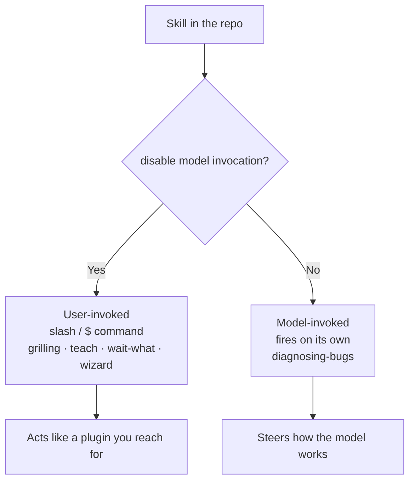

# 04 — Matt Pocock's skills: catalog and structure

After pstack, Theo pointed the same audit prompt at Pocock's repo and got a second ranked document ([`13:07`](https://www.youtube.com/watch?v=0oXOOlqVu5M&t=787)).

## The engineering directory

The directory that matters is `skills/engineering`, containing ([`13:30`](https://www.youtube.com/watch?v=0oXOOlqVu5M&t=810)):

`ask-matt` · `code-review` · `codebase-design` · `diagnosing-bugs` · `domain-modeling` · `grill-with-docs` · `implement` · `improve-codebase-architecture` · `prototype` · `research` · `resolving-merge-conflicts` · `setup-matt-pocock-skills` · `tdd` · `dissect` · `tickets` · `triage` · `wayfinder` · `wizard`

Productivity skills sit alongside: `grill-me`, `handoff`, `two-questionnaire`, `teach`, `wait-what`, `writing-for-agents` ([`23:30`](https://www.youtube.com/watch?v=0oXOOlqVu5M&t=1410)).
Reference skills: `codebase-design` (vocabulary for designing deep modules) and `domain-modeling` (interpreting a project's own words and writing them down) ([`23:30`](https://www.youtube.com/watch?v=0oXOOlqVu5M&t=1410)).

## User-invoked vs model-invoked

The structural detail Theo rates highest in the collection ([`21:03`](https://www.youtube.com/watch?v=0oXOOlqVu5M&t=1263)):

- Many of Pocock's skills set **`disable model invocation`**, meaning the model can't pull them in on its own — you invoke them manually with a slash or `$` command. Theo calls this **"a very good call"** given how some of them behave ([`14:08`](https://www.youtube.com/watch?v=0oXOOlqVu5M&t=848)).
- The docs separate **user-invoked** from **model-invoked**, and Theo emphasizes these are genuinely different things:
  - **User-invoked** — effectively plugins you call when you want them (grilling, teach, wait-what, wizard).
  - **Model-invoked** — steering the model to work differently on its own (diagnosing-bugs).
- Example of correct classification: `diagnosing-bugs` is deliberately **not** manual-only. It fires by itself during debugging, and Theo confirms it has been firing and helping over several days — his agents **find root causes and communicate what's wrong more effectively** ([`14:37`](https://www.youtube.com/watch?v=0oXOOlqVu5M&t=877), [`14:57`](https://www.youtube.com/watch?v=0oXOOlqVu5M&t=897)).

## Skills that call other skills

- Pocock's skills are **self-referential**: `improve-codebase-architecture` tells the agent to run `codebase-design` first to acquire the vocabulary, then presents candidates **as an HTML report** — a touch Theo liked ([`14:08`](https://www.youtube.com/watch?v=0oXOOlqVu5M&t=848), [`20:38`](https://www.youtube.com/watch?v=0oXOOlqVu5M&t=1238)).
- It also pulls in a `CONTEXT.md` vocabulary for the domain and calls out `grilling` and `domain-modeling` ([`20:38`](https://www.youtube.com/watch?v=0oXOOlqVu5M&t=1238)).
- `grill-with-docs` is itself thin — it's a relentless interview that produces docs, ADRs and a glossary as it goes, mostly by composing other skills ([`14:08`](https://www.youtube.com/watch?v=0oXOOlqVu5M&t=848)).

## The prescribed main flow

Theo eventually finds the getting-started docs (**"apparently I should have been reading the docs the whole time"**). Entry point is a `setup-skills` command that configures issue tracking so the skills can drive it ([`22:20`](https://www.youtube.com/watch?v=0oXOOlqVu5M&t=1340)).

Supporting entry points around that spine ([`22:38`](https://www.youtube.com/watch?v=0oXOOlqVu5M&t=1358), [`23:03`](https://www.youtube.com/watch?v=0oXOOlqVu5M&t=1383)):

- **shaping** — turn vague ideas into executable plans.
- **wayfinder** — chart a large effort as a map of decisions, then settle them.
- **prototype** — mock designs to find out what you want before shipping; explicitly deletable code.
- **research** — cited answers from primary sources. Theo is the least sold on this one: he thinks agents already verify claims well enough if you just ask ([`23:03`](https://www.youtube.com/watch?v=0oXOOlqVu5M&t=1383)).

## The recurring complaint: em dashes

- Theo counts **nine em dashes** on the grilling skill page alone — at least one per paragraph in most paragraphs ([`15:23`](https://www.youtube.com/watch?v=0oXOOlqVu5M&t=923)).
- He connects it causally to his own output: *"I was wondering why I was getting em dashes again. It might be Matt's skills."* ([`15:23`](https://www.youtube.com/watch?v=0oXOOlqVu5M&t=923))
- Half-joking, he floats forking the entire repo with only the em dashes stripped out ([`30:06`](https://www.youtube.com/watch?v=0oXOOlqVu5M&t=1806)).
