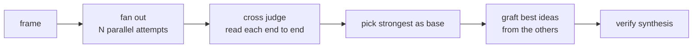

# 07 — pstack: the skills Theo actually kept

Lauren's ("Potato") collection. Theo's audit ranked **interrogate, blast radius, technical writing, arena** and **prove it** as the best fits for his work ([`4:45`](https://www.youtube.com/watch?v=0oXOOlqVu5M&t=285)).

## arena — parallel attempts, then a graft

The most expensive and most fun skill in the set ([`31:52`](https://www.youtube.com/watch?v=0oXOOlqVu5M&t=1912)):

- **Fan out** parallel attempts at the same task.
- **Read every candidate end to end.**
- **Pick the strongest as the base.**
- **Graft the best ideas from the others into it.**
- **Verify** the synthesized result.

Operational detail: start a **to-do list with one entry per phase before launching anything** — the arena runs autonomously, and the list keeps phases from silently disappearing. The phases are **frame → fan out → cross judge → pick → graft → verify** ([`32:17`](https://www.youtube.com/watch?v=0oXOOlqVu5M&t=1937)).

- Theo notes it's **"surprisingly little text for how much this does"** ([`32:17`](https://www.youtube.com/watch?v=0oXOOlqVu5M&t=1937)).
- **Cost:** this one skill has cost him **hundreds of dollars of inference**, because it does the same work multiple times. Aimed at "token burners" with usage to get through ([`31:52`](https://www.youtube.com/watch?v=0oXOOlqVu5M&t=1912), [`32:17`](https://www.youtube.com/watch?v=0oXOOlqVu5M&t=1937)).

## blast radius — what does this break elsewhere?

Theo has been **using this one a ton** ([`33:04`](https://www.youtube.com/watch?v=0oXOOlqVu5M&t=1984)):

- Purpose: find what a change breaks **somewhere else**, before it ships ([`33:04`](https://www.youtube.com/watch?v=0oXOOlqVu5M&t=1984)).
- Invoked as *"blast radius of X"*, *"what could this break?"*, or when reviewing a small diff you don't trust ([`33:29`](https://www.youtube.com/watch?v=0oXOOlqVu5M&t=2009)).
- Positioned as the third member of a trio ([`33:29`](https://www.youtube.com/watch?v=0oXOOlqVu5M&t=2009)):

| Skill | Answers |
| --- | --- |
| how | what the code does |
| why | why it's shaped that way |
| **blast radius** | **what it breaks somewhere else** |

- The part Theo singles out: **you can't trust your own write-up.** The thread's own history is not trustworthy, so don't just hand back the summary — **find the one or two facts the whole thing depends on and prove them by running code** ([`33:29`](https://www.youtube.com/watch?v=0oXOOlqVu5M&t=2009)).
- It also routes its response through **unslop** so the output isn't a mess ([`33:54`](https://www.youtube.com/watch?v=0oXOOlqVu5M&t=2034)).
- **Result:** it has caught a couple of things that would have been miserable otherwise ([`33:54`](https://www.youtube.com/watch?v=0oXOOlqVu5M&t=2034)).

## show your work — a reviewable decision trail

For long-running and unattended work ([`34:18`](https://www.youtube.com/watch?v=0oXOOlqVu5M&t=2058)):

- Keeps a **TSV log, one row per decision**, with columns for **what, why, evidence, result**.
- **Local by default**; commit it when a reviewer needs the trail to trust the result.
- Invoked as `/show your work`, for autonomous or multi-phase runs, or work a human reviews after stepping away.

Its rules ([`34:45`](https://www.youtube.com/watch?v=0oXOOlqVu5M&t=2085)):

- One row = one decision or checkpoint. **If it doesn't fit on one line, the decision isn't crisp yet.**
- **Append only** — a wrong call gets a new row that supersedes it.
- Prefer **evidence produced by committed scripts** over handmade one-offs, so a reviewer can re-run it.

Theo's take: the simple TSV format is easy to read and to pipe into other tools; he plans to play with it more ([`34:45`](https://www.youtube.com/watch?v=0oXOOlqVu5M&t=2085), [`35:10`](https://www.youtube.com/watch?v=0oXOOlqVu5M&t=2110)).

## bro

- Restates the last message without jargon — *state it more simply and concisely, like one human talking to another* ([`33:04`](https://www.youtube.com/watch?v=0oXOOlqVu5M&t=1984)).
- Not originally Lauren's; she pulled it in from **Dylan Moy** (the Effect / functional-programming JavaScript person) ([`32:43`](https://www.youtube.com/watch?v=0oXOOlqVu5M&t=1963)).
- **Basically identical to Pocock's `wait-what`** ([`33:04`](https://www.youtube.com/watch?v=0oXOOlqVu5M&t=1984)).
- Notable as one of the **few pstack skills with model invocation disabled** — Lauren normally lets the model decide ([`33:04`](https://www.youtube.com/watch?v=0oXOOlqVu5M&t=1984)).

## The one real problem with pstack

- **The write-ups are tied to Cursor specifically.** Theo calls this "the biggest issue with pstack" and says he'd be pumped if someone cloned the whole set in a **generic, non-Cursor-specific way**, because "there's so much gold in here" ([`32:17`](https://www.youtube.com/watch?v=0oXOOlqVu5M&t=1937), [`32:43`](https://www.youtube.com/watch?v=0oXOOlqVu5M&t=1963)).

## The AI-detector aside

- Theo ran the skill files through an AI detector: **very likely all of them were AI-written** — including unslop itself, which he finds surprising since it reads so densely and so well. He also notes he "passed 100% human written" and wonders whether the detector just flags markdown ([`31:23`](https://www.youtube.com/watch?v=0oXOOlqVu5M&t=1883)).
- His conclusion is that provenance doesn't change the verdict: **regardless of whether both are AI-generated, pstack's writing is more readable and its behaviors more applicable to his day-to-day** ([`31:23`](https://www.youtube.com/watch?v=0oXOOlqVu5M&t=1883), [`31:52`](https://www.youtube.com/watch?v=0oXOOlqVu5M&t=1912)).
