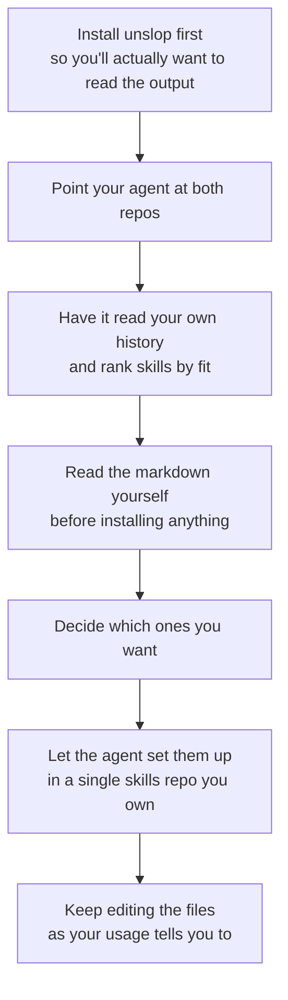

# 08 — Verdict and the recommended workflow

## The comparison Theo didn't want to make

- He explicitly says he **didn't intend this to be a pstack-vs-Pocock showdown** — but he ends up landing somewhere: *"I am much more philosophically aligned with what Potato is cooking over here."* ([`33:54`](https://www.youtube.com/watch?v=0oXOOlqVu5M&t=2034))
- The distinction isn't quality, it's **shape**. Pocock's skills read as **prescribed mental workflows** with an easy entry point to try them; pstack's read as sharp single-purpose tools ([`27:52`](https://www.youtube.com/watch?v=0oXOOlqVu5M&t=1672)).
- His objection to the prescription: he doesn't want that much step-by-step direction (grill-with-docs → spec → tickets → implement → code review). He's built his own workflows and they **don't map to traditional stuff** ([`28:16`](https://www.youtube.com/watch?v=0oXOOlqVu5M&t=1696)).

## What he's keeping from each

| From Matt Pocock | From pstack |
| --- | --- |
| **wizard** — "I'm going to be using that a ton" ([`29:28`](https://www.youtube.com/watch?v=0oXOOlqVu5M&t=1768)) | **unslop** — "everyone should have unslop at this point" ([`35:37`](https://www.youtube.com/watch?v=0oXOOlqVu5M&t=2137)) |
| **grilling** — "clearly super super useful" ([`28:16`](https://www.youtube.com/watch?v=0oXOOlqVu5M&t=1696)) | **blast radius** — has already saved him twice ([`33:54`](https://www.youtube.com/watch?v=0oXOOlqVu5M&t=2034)) |
| **diagnosing-bugs** — has helped him a ton already ([`21:03`](https://www.youtube.com/watch?v=0oXOOlqVu5M&t=1263)) | **arena** — fun and powerful, but expensive ([`31:52`](https://www.youtube.com/watch?v=0oXOOlqVu5M&t=1912)) |
| **writing-for-agents** — for prompting sub-agents ([`28:39`](https://www.youtube.com/watch?v=0oXOOlqVu5M&t=1719)) | **show your work** — plans to explore further ([`35:10`](https://www.youtube.com/watch?v=0oXOOlqVu5M&t=2110)) |
| **codebase-design** + cleanup skills — next on his list ([`28:16`](https://www.youtube.com/watch?v=0oXOOlqVu5M&t=1696)) | |

## The process he recommends

The video's real payload is the method, not the skill list — *"this video is supposed to be an overview, but what you're getting instead is my actual process"* ([`35:10`](https://www.youtube.com/watch?v=0oXOOlqVu5M&t=2110)).

Step by step ([`36:03`](https://www.youtube.com/watch?v=0oXOOlqVu5M&t=2163), [`36:27`](https://www.youtube.com/watch?v=0oXOOlqVu5M&t=2187)):

1. Open your agent, tell it about pstack and about Matt Pocock's skills, and have it cross-reference both against your own histories.
2. **Install unslop before that**, so you'll actually want to read the responses you get.
3. **Read the markdown for every skill before installing it.**
4. Decide which ones you want; let the agent do the setup.
5. Consider a **single repo holding all your skills** — Theo finds this "really powerful".

## The warnings

- **"You shouldn't be running commands that install 500 skills you don't know anything about."** ([`36:45`](https://www.youtube.com/watch?v=0oXOOlqVu5M&t=2205))
- You have many options for how to manage this — **but you should be managing it**, not blindly copying someone else's setup ([`36:27`](https://www.youtube.com/watch?v=0oXOOlqVu5M&t=2187)).
- Use the moment to **refine your toolbox** from what you see working for others plus what you try yourself, and make subtle adjustments based on your own usage ([`36:45`](https://www.youtube.com/watch?v=0oXOOlqVu5M&t=2205)).
- **Stop being scared of editing these files.** Theo has noticed people are afraid to open their `.claude` / agents directories. *"That's silly and you have to get over it"* — there's a lot you can do once you start digging in ([`36:45`](https://www.youtube.com/watch?v=0oXOOlqVu5M&t=2205), [`37:11`](https://www.youtube.com/watch?v=0oXOOlqVu5M&t=2231)).

## The bigger claim

- Theo jokes that **the only time he opens his code editor now is to edit markdown files** — "it's barely a joke at this point. It's markdown files and environment variables" ([`37:11`](https://www.youtube.com/watch?v=0oXOOlqVu5M&t=2231)).
- He frames this as **one of the biggest shifts** enabling far more parallel agent work, and **a huge part of why he shipped so many PRs with so little breakage** over the preceding weekend ([`37:11`](https://www.youtube.com/watch?v=0oXOOlqVu5M&t=2231), [`37:40`](https://www.youtube.com/watch?v=0oXOOlqVu5M&t=2260)).
- The reason isn't the repos themselves: it's that he **went deeper into those directories and assembled a set that fits the work he actually does** ([`37:40`](https://www.youtube.com/watch?v=0oXOOlqVu5M&t=2260)).

## Closing instruction

> Explore these published collections. Don't blindly install them. Poke around, try them out, pull the parts you like, ignore the parts you don't. **Play.** ([`38:01`](https://www.youtube.com/watch?v=0oXOOlqVu5M&t=2281))

- Final word on both suites: **"There's some really good stuff in Matt's skills and even more good stuff in Potato's skills. Check both out and maybe make some of your own too."** ([`38:01`](https://www.youtube.com/watch?v=0oXOOlqVu5M&t=2281))
