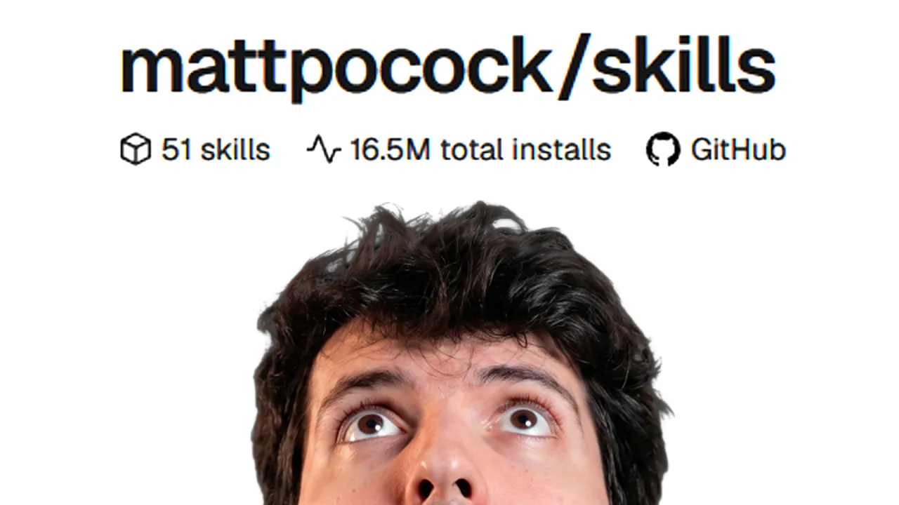
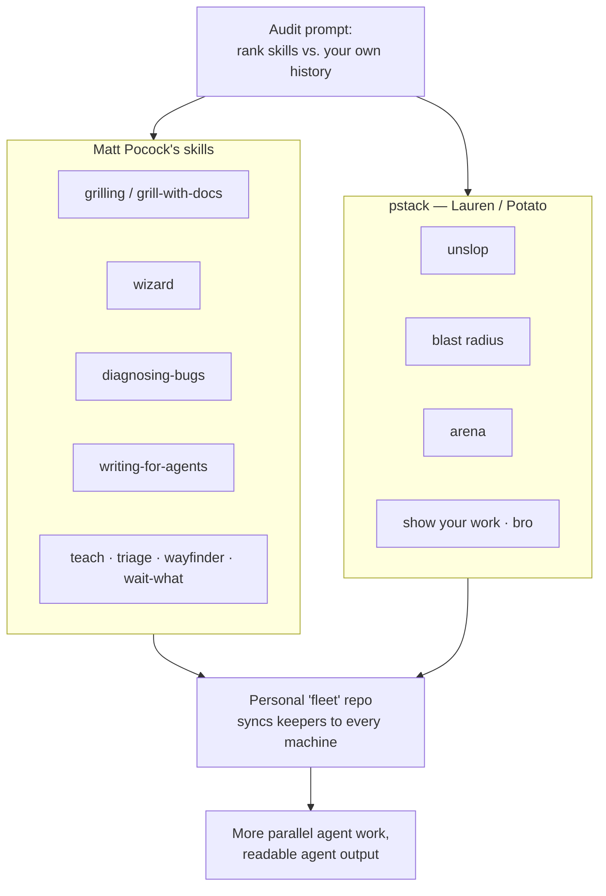

# So I tried Matt's skills...

*Theo - t3․gg · 38:21 · [Watch on YouTube](https://www.youtube.com/watch?v=0oXOOlqVu5M)*

## Summary

Theo spends a week actually using two published collections of AI agent skills — **Matt Pocock's** engineering skills repo and **pstack**, by former React core team member Lauren ("Potato"), now at Cursor — and reports back. It isn't a feature tour: he shows the audit prompt he used to rank every skill against his own machine history, reads the markdown of the ones that matter, runs live A/B comparisons of agent output with and without them, and stress-tests the grilling skill against a real project of his.

The through-line is a warning: skill repos are mostly noise, and blindly installing a collection makes you worse at your job. The value is in reading the files, pulling the parts that map to how you actually work, and keeping them somewhere you own. Along the way he lands on a favorite (`unslop`), a most-anticipated (`wizard`), a most-expensive (`arena`), and one recurring irritation — em dashes everywhere in Pocock's skills, which he traces to his own agents' output regressing.

## Topics

1. [Introduction and premise](01-introduction-and-premise.md) — the two repos, the 200k-star claim, and why Theo finally dove in.
2. [How to approach a skill collection](02-how-to-approach-skill-collections.md) — the ground rules, the audit prompt, and how to test a skill without installing it.
3. [The unslop skill](03-the-unslop-skill.md) — descriptions as triggers, the full rule set, and the before/after that started the rabbit hole.
4. [Matt Pocock's skills: catalog and structure](04-matt-pocock-skills-catalog.md) — the engineering directory, user- vs model-invoked, and the prescribed main flow.
5. [The grilling skill in practice](05-grilling-in-practice.md) — a live interrogation of the Lakebed project, across three model configurations.
6. [Tour of Matt's other skills](06-tour-of-matt-s-other-skills.md) — teach, wizard, writing-for-agents, wait-what, and the fleet-wide install.
7. [pstack: the skills Theo actually kept](07-pstack-skills.md) — arena, blast radius, show your work, bro, and the Cursor-specificity problem.
8. [Verdict and the recommended workflow](08-verdict-and-recommended-workflow.md) — what he kept from each, and the process he tells you to follow.

Full source: [transcript.md](transcript.md)

## Key takeaways

- **One markdown file measurably changed the output.** The same model answering the same question produced dense, scannable prose with `unslop` installed and padded, em-dash-heavy prose without it — Theo's verdict: *"these both came from the same model for adding one markdown file"* ([`12:04`](https://www.youtube.com/watch?v=0oXOOlqVu5M&t=724)). It's the one skill he says everyone should have ([`35:37`](https://www.youtube.com/watch?v=0oXOOlqVu5M&t=2137)).
- **A skill's `description` is a trigger, not a summary.** Its only job is to get the right agent to reach for the skill at the right moment — like a YouTube thumbnail, not a table of contents ([`5:40`](https://www.youtube.com/watch?v=0oXOOlqVu5M&t=340), [`6:07`](https://www.youtube.com/watch?v=0oXOOlqVu5M&t=367)).
- **You can evaluate any text-only skill without installing it** — copy the markdown, paste it into your agent, and ask for the behavior. Theo runs the entire grilling skill this way ([`15:53`](https://www.youtube.com/watch?v=0oXOOlqVu5M&t=953), [`16:19`](https://www.youtube.com/watch?v=0oXOOlqVu5M&t=979)).
- **Grilling produced real, uncomfortable findings on a live project**: a badly stale `CLAUDE.md`, a repo contradicting its own v0 rule, and two competing execution models — before it asked a single question ([`16:53`](https://www.youtube.com/watch?v=0oXOOlqVu5M&t=1013)). Theo went in skeptical and came out with *"I'm seeing the light. This is useful."* ([`19:47`](https://www.youtube.com/watch?v=0oXOOlqVu5M&t=1187))
- **Question quality held across models, but reasoning effort changed the behavior.** On high effort, the faster model spun up background sub-agents to gather data for later questions and offered pre-written answer options; on low effort it just asked ([`18:13`](https://www.youtube.com/watch?v=0oXOOlqVu5M&t=1093)).
- **Separating user-invoked from model-invoked skills is the structural idea worth stealing.** Pocock marks many skills `disable model invocation` so you must call them explicitly — Theo calls it "a very good call" — while leaving `diagnosing-bugs` model-invoked, where it fires on its own and makes his agents find and explain root causes more effectively ([`14:08`](https://www.youtube.com/watch?v=0oXOOlqVu5M&t=848), [`14:57`](https://www.youtube.com/watch?v=0oXOOlqVu5M&t=897), [`21:03`](https://www.youtube.com/watch?v=0oXOOlqVu5M&t=1263)).
- **`arena` works but is genuinely expensive** — fanning out parallel attempts and grafting the best ideas together has cost Theo *hundreds of dollars* of inference ([`31:52`](https://www.youtube.com/watch?v=0oXOOlqVu5M&t=1912), [`32:17`](https://www.youtube.com/watch?v=0oXOOlqVu5M&t=1937)).
- **`blast radius` has already caught real breakage**, and its key instruction is distrust: don't hand back your own write-up — isolate the one or two facts the conclusion rests on and prove them by running code ([`33:29`](https://www.youtube.com/watch?v=0oXOOlqVu5M&t=2009), [`33:54`](https://www.youtube.com/watch?v=0oXOOlqVu5M&t=2034)).
- **Pointer wording is a reliability problem, not a style one.** Per `writing-for-agents`, a must-have target behind a weakly worded context pointer is a **variance bug** ([`30:28`](https://www.youtube.com/watch?v=0oXOOlqVu5M&t=1828), [`30:54`](https://www.youtube.com/watch?v=0oXOOlqVu5M&t=1854)).
- **Each collection has one clear defect.** Pocock's: em dashes throughout — nine on the grilling page alone — which Theo traces to his own agent output regressing ([`15:23`](https://www.youtube.com/watch?v=0oXOOlqVu5M&t=923)). pstack's: the write-ups are tied to Cursor specifically, and he wants a generic clone ([`32:43`](https://www.youtube.com/watch?v=0oXOOlqVu5M&t=1963)).
- **Overall alignment goes to pstack**, on readability and day-to-day applicability — even though an AI detector suggests both collections were AI-written ([`31:23`](https://www.youtube.com/watch?v=0oXOOlqVu5M&t=1883), [`33:54`](https://www.youtube.com/watch?v=0oXOOlqVu5M&t=2034)).
- **The real result isn't a skill list, it's a workflow shift.** Curating skills into a personal `fleet` repo synced across machines is, Theo says, a huge part of why he shipped so many PRs with so little breakage that weekend — and the reason his editor is now mostly for markdown files ([`37:11`](https://www.youtube.com/watch?v=0oXOOlqVu5M&t=2231), [`37:40`](https://www.youtube.com/watch?v=0oXOOlqVu5M&t=2260)).
