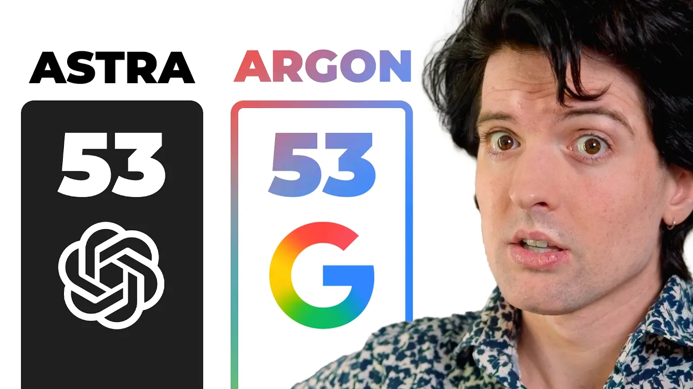

# So I've been testing Gemini 4...

Theo reviews Gemini 4 Argan through pricing, front-end and 3D demos, specialized visual tasks, private code audits, and a failed SQLite implementation. His central argument is that strong benchmark or demo results do not reliably predict usefulness in an existing codebase. [`7:43`](https://www.youtube.com/watch?v=NE006pkiAnk&t=463) [`37:06`](https://www.youtube.com/watch?v=NE006pkiAnk&t=2226)

[Watch the video](https://www.youtube.com/watch?v=NE006pkiAnk) · Theo - t3․gg · 38:30

**Classification:** Opinion/news, specifically a hands-on model review with benchmark evidence. These notes report the video's claims, measurements, and judgments, rather than independently verifying them. Model names follow the supplied transcript where identifiable; unclear names are flagged in the relevant notes.

## Topic breakdown

1. [Release context, disclosures, and Google's claims](01-release-context.md)
2. [Pricing, token use, and caching](02-cost-and-caching.md)
3. [Skatebench, vision, and evaluation scope](03-specialized-benchmarks.md)
4. [Front-end design and iteration speed](04-front-end-design.md)
5. [YouTube access and specialized workflows](05-specialized-workflows.md)
6. [Fishlop: visuals versus game-system reasoning](06-fishlop-game.md)
7. [Hallucination metrics versus code-audit results](07-code-audit-results.md)
8. [SQLite case study: diagnosis, implementation, and review](08-sqlite-case-study.md)
9. [Antigravity reliability and integration costs](09-ecosystem-reliability.md)
10. [Final model choices and limits of the verdict](10-final-verdict.md)

The original [transcript](transcript.md) and cover image are included unchanged.

## Key takeaways

- Low token rates did not guarantee low task cost. Theo reports heavy token use and 70–80% cache hits versus 99%+ with other models, while leaving the cause of the cache behavior unresolved. [`4:31`](https://www.youtube.com/watch?v=NE006pkiAnk&t=271) [`4:53`](https://www.youtube.com/watch?v=NE006pkiAnk&t=293) [`5:24`](https://www.youtube.com/watch?v=NE006pkiAnk&t=324)
- Gemini achieved 100% on Theo's private skateboard-trick naming benchmark, compared with 79% for Opus 5.5 Max. This demonstrated a specific capability, not general coding competence. [`7:43`](https://www.youtube.com/watch?v=NE006pkiAnk&t=463) [`8:14`](https://www.youtube.com/watch?v=NE006pkiAnk&t=494) [`8:53`](https://www.youtube.com/watch?v=NE006pkiAnk&t=533)
- Front-end designs improved with Anthropic's official design skill; Theo still preferred Fable 5.1 for distinctive marketing pages and emphasized fast iteration for product UX. [`12:03`](https://www.youtube.com/watch?v=NE006pkiAnk&t=723) [`12:26`](https://www.youtube.com/watch?v=NE006pkiAnk&t=746) [`12:53`](https://www.youtube.com/watch?v=NE006pkiAnk&t=773) [`13:45`](https://www.youtube.com/watch?v=NE006pkiAnk&t=825)
- In the TS Rust audit, Gemini scored 4.38/10 with 24 false claims out of 36; 6.1 Soul scored 8.84 with 38 true claims and none wrong. [`22:58`](https://www.youtube.com/watch?v=NE006pkiAnk&t=1378) [`23:23`](https://www.youtube.com/watch?v=NE006pkiAnk&t=1403) [`23:48`](https://www.youtube.com/watch?v=NE006pkiAnk&t=1428) [`24:16`](https://www.youtube.com/watch?v=NE006pkiAnk&t=1456)
- The pattern persisted across projects: Gemini scored 2.25/10 on Lakebed with 56 wrong findings out of 78, and 3.95/10 on T3 code architecture with 47 false claims. [`27:13`](https://www.youtube.com/watch?v=NE006pkiAnk&t=1633) [`27:33`](https://www.youtube.com/watch?v=NE006pkiAnk&t=1653) [`28:07`](https://www.youtube.com/watch?v=NE006pkiAnk&t=1687) [`28:34`](https://www.youtube.com/watch?v=NE006pkiAnk&t=1714)
- Gemini's roughly 1,200-line SQLite PR failed checks and left main-thread blocking unresolved. Theo reports that the replacement change was 21 lines and merged. [`30:47`](https://www.youtube.com/watch?v=NE006pkiAnk&t=1847) [`31:37`](https://www.youtube.com/watch?v=NE006pkiAnk&t=1897) [`32:22`](https://www.youtube.com/watch?v=NE006pkiAnk&t=1942) [`33:33`](https://www.youtube.com/watch?v=NE006pkiAnk&t=2013)
- Theo's final choice was to stop using Gemini for code, retain it for YouTube data retrieval, and primarily continue with Opus 5.5. He says he merged none of Gemini's work from this testing. [`37:06`](https://www.youtube.com/watch?v=NE006pkiAnk&t=2226) [`37:30`](https://www.youtube.com/watch?v=NE006pkiAnk&t=2250) [`38:14`](https://www.youtube.com/watch?v=NE006pkiAnk&t=2294)
