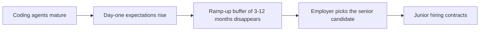

# 1. The Junior Hiring Squeeze

Mihail Eric (Stanford lecturer, head of AI) explains why the CS job market tightened: coding agents raised the baseline expectation for a day-one engineer.

## The data point that frames the interview

- Computer science currently carries a **6.1% unemployment rate**, the **seventh highest among all college degrees** [`0:51`](https://www.youtube.com/watch?v=Ci7ZDQ3m8cc&t=51).

## The mechanism: the ramp-up buffer disappeared

- Coding agents and coding tools caused an "upskilling / up-leveling of the expectations of an engineer from day one" [`0:51`](https://www.youtube.com/watch?v=Ci7ZDQ3m8cc&t=51).
- Historically an entry-level grad got a **buffer of 3–6 months up to a year** to get their feet under them, with no expectation of matching the most productive senior on the team. That affordance "is no longer as true" [`1:17`](https://www.youtube.com/watch?v=Ci7ZDQ3m8cc&t=77).
- Given two candidates for the same role, employers now assume the senior needs **less ramp-up** and pick them — Eric calls this "myopically prioritizing the thing that is most obvious" [`1:38`](https://www.youtube.com/watch?v=Ci7ZDQ3m8cc&t=98).
- Net effect: an **expectation gap** between what juniors are and what companies need, which the host proposes as the cause of the unemployment number — Eric agrees there is "a lot of that at play" [`2:02`](https://www.youtube.com/watch?v=Ci7ZDQ3m8cc&t=122).

## Who actually gets replaced

- **Yes, a category will be replaced**: if your only offer is "hands-on keyboard, cranking out tickets" that are easy to describe in Jira or Linear, that role is easy to outsource to a coding agent [`2:21`](https://www.youtube.com/watch?v=Ci7ZDQ3m8cc&t=141).
- This category is large: it maps to **typically outsourced labor** and consulting firms that "throw people at the problem." That work "will absolutely go down" [`2:42`](https://www.youtube.com/watch?v=Ci7ZDQ3m8cc&t=162).
- The dividing line is not seniority but **whether the work is spec-in / code-out** versus requiring judgment.

## Why companies stopped hiring juniors (Eric's diagnosis)

- It's a **short-term optimization**: a manager responsible for reducing head count with a fixed engineering allocation sees only one lever [`5:43`](https://www.youtube.com/watch?v=Ci7ZDQ3m8cc&t=343).
- The reflex becomes "cut people, throw more cloud tokens at it" — which Eric labels employers "being a little too short-term thinking" [`6:06`](https://www.youtube.com/watch?v=Ci7ZDQ3m8cc&t=366).

> Note: the segment at [`4:57`](https://www.youtube.com/watch?v=Ci7ZDQ3m8cc&t=297)–[`5:43`](https://www.youtube.com/watch?v=Ci7ZDQ3m8cc&t=343) is a sponsor read (Actio Work by Alibaba.com), not part of the interview.
